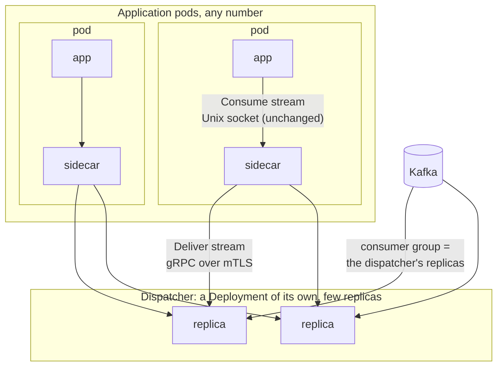

# 6. Consume through a standalone dispatcher that sidecars connect to

## Status

Accepted

## Context

Today every application pod's sidecar holds its own Kafka consumer, so the application's replicas are the consumer group. Two limits follow from that.

- **Scaling rebalances the group.** Every pod added or removed by the autoscaler, and every pod replaced by a rollout, is a group member joining or leaving. Cooperative rebalancing softens this but does not remove it: partitions move, in-flight work is revoked, and a deployment that scales often spends real time rebalancing.
- **Parallelism is capped by the partition count.** A partition is consumed by one member. A topic with 12 partitions keeps at most 12 pods busy, however slow the handler is. Raising the partition count is a one-way change that affects every producer and consumer of the topic.

Both limits come from tying group membership to the processes that do the work. Producing has neither problem and stays as it is.

Kafka's share groups (KIP-932) lift the same two limits inside the broker: many consumers read one partition, each record is acknowledged on its own, and members joining do not revoke anyone's work. They give no ordering at all, and the topics this is for need records of one key processed in order. That rules them out; see Consequences.

## Decision

We will add a second way to run the server, as a **dispatcher**: a standalone deployment that is the consumer group and hands the records it consumes to the sidecars of the application's pods, over streams the sidecars open to it. The application's pods stop being group members.

Arrows point from whoever opens the connection. Records flow the other way: from Kafka through a replica and a sidecar to the app.

### Roles

- It is the same server and the same image. A configuration with a `dispatch` section makes it a dispatcher; a consumer entry with `source: dispatcher` makes a sidecar receive that topic instead of consuming it. One process may be both, and a sidecar may consume some topics directly and receive others.
- **The application's API does not change.** It opens the same `Consume` stream on the Unix socket, grants credits and acknowledges offsets. Where the records come from is configuration, like the codec.

### Who decides what is consumed

- **Sidecars declare, the dispatcher authorizes.** A sidecar says what it wants when it opens a `Deliver` stream: the cluster by name, the consumer group, the topic, and how it is to be consumed (ordering, processing deadline, where to start without a committed offset, what to do with a record that keeps failing). These are the fields of the `consumers` entry the application's sidecar already has. The dispatcher consumes what its connected sidecars have declared and nothing else.
- **A new version of the application brings its topics with it.** While old pods want topic A and new pods want A and B, the dispatcher consumes both and delivers B only to the sidecars that declared it. Nothing is deployed to the dispatcher.
- **The dispatcher's configuration is a policy, not a list of subscriptions.** It holds the clusters, with their addresses and credentials, and rules saying which identities may consume which topics, in which groups, on which cluster. A declaration that no rule allows is refused. A rule also lists the dead-letter topics it allows, because the dispatcher writes dead letters with its own credentials. Without this, any pod the dispatcher accepts could read every topic its Kafka principal can, and the dispatcher would be a way around the brokers' ACLs.
- **Addresses and credentials never come from a sidecar.** A declaration names a cluster; it cannot describe one.
- **How a topic is consumed is one setting per group.** Ordering cannot differ between two sidecars of the same group and topic. The first declaration holds for as long as the group has a subscriber for that topic, and a sidecar that declares something else is refused with an error that says what is in force. Adding a topic, the common case, needs no agreement with anyone. Changing how an existing topic is consumed needs every pod of the old version gone first, or a rule in the dispatcher's policy that fixes the setting.
- **The dispatcher keeps consuming for a grace period** after the last sidecar for a topic has gone, so that a rollout does not make it leave and rejoin.
- **What is declared is held in memory.** After a dispatcher restart the sidecars reconnect and declare again.

### Delivery

- **Sidecars dial the dispatcher.** The dispatcher listens on a TCP port for one new gRPC service, `Delivery`. A sidecar opens a `Deliver` stream when its application opens a `Consume` stream for a topic whose source is the dispatcher, and closes it when the application's stream ends. Application pods get no new listening port.
- **A sidecar connects to every dispatcher replica.** Each replica owns some of the topic's partitions, so a sidecar connected to one replica would see only those.
- **Bootstrap, then membership.** A sidecar is configured with one address: the ClusterIP of the dispatcher's Service. Its first `Deliver` stream reaches whichever replica the Service picks. That replica answers with the full list of replicas, and the sidecar opens a stream to each of the others. This is how a Kafka client treats `bootstrap.servers`.
- **The dispatcher pushes membership.** Whenever the set of replicas changes, every replica sends the new list on every stream it holds, and each sidecar opens and closes streams to match. A sidecar never polls and never re-resolves: after the first connection, what it knows about replicas comes from the replicas.
- **The replicas find each other through a coordination group in Kafka.** Every replica joins one consumer group at startup, whatever has been declared, and attaches the address it can be reached at to its membership; the assignment carries every member's address back, as Kafka Streams does for its own instances. That group consumes nothing. Its only purpose is to be the list of dispatcher replicas, and it changes when a replica starts or stops.
- **The list is every replica, not the replicas consuming a given topic.** A replica starts consuming a group's topics only when a sidecar declares them to it, and a sidecar can only declare to replicas it knows of. If the list were the members of the group being consumed, the first declaration for a new group would reach one replica through the Service and the others would never hear of it. So a sidecar opens a stream to every replica on the list and declares on each.
- The coordination group lives on one of the dispatcher's clusters, named in its configuration.
- **Replicas advertise their pod IP and port.** A replica that restarts gets a new IP, but it also rejoins the coordination group as a new member, so the rebalance of that group tells every peer, and through them every sidecar, where it is. The address defaults to the pod's own interface address. Nothing resolves a name after the bootstrap connection: DNS plays no part.
- A sidecar that loses every stream starts again from the bootstrap address.
- **Who may receive a topic is decided by identity,** by the same policy that authorizes the declaration. The dispatcher needs to know nothing else about the application: no Service name, no selector.
- **Nothing depends on pod readiness.** A pod receives records when its application is consuming, whatever its readiness probe says about serving HTTP.
- The stream carries the same flow control as `Consume`: the sidecar grants credits to a replica only while its application has granted credits itself.
- **The sidecar divides its application's credit among the replicas.** A replica whose partitions are idle must not sit on credit a busy one needs, so the sidecar grants each a small window and replenishes where records actually arrive. Records it holds beyond what the application has asked for are bounded by those windows.
- The dispatcher sends each record to a connected sidecar that has credit, picks the least loaded, and remembers which record is in flight where.
- The sidecar hands records to its application over the existing `Consume` stream and relays each acknowledgement back on the stream the record came from. It keeps no Kafka consumer for that topic and commits nothing.
- **The sidecar decodes.** The dispatcher forwards the bytes stored in Kafka with their headers; the sidecar applies the topic's codec, as it does when it consumes directly. The dispatcher therefore needs no codec classes, no contract descriptors and no extension jars, whatever the applications it serves use.
- A record the sidecar cannot decode is rejected back to the dispatcher instead of acknowledged, and counts as a failed attempt.
- A sidecar reconnects with the backoff and jitter the clients already use, so a restarted replica is not met by every sidecar at once.

### Ordering

The declaration chooses what "in order" means, because a partition is no longer read by one process.

| `ordering` | Rule | Parallelism |
|---|---|---|
| `key` (default) | A record is sent only when no earlier record with the same key is unacknowledged | Across keys, not limited by partitions |
| `partition` | A record is sent only when no earlier record of its partition is unacknowledged | At most one record in flight per partition |
| `none` | Sent as soon as a sidecar has credit | Limited only by credit |

Records without a key are treated as `none` under `key`. Keys are compared as the bytes stored in Kafka, so a codec that encrypts keys differently each time cannot be used with `key`.

### Acknowledgement and commit

- The dispatcher commits, per partition, the offset below which every record is acknowledged. Acknowledgements arrive out of order; the commit position only moves over a contiguous run. This is the bookkeeping the server already does for one stream, applied across many.
- A partition is paused when the span between its commit position and its newest delivered record reaches a configured window. That bounds memory and bounds how much is delivered again after a restart.
- A record that is not acknowledged within the processing deadline, or whose sidecar's stream ends, is delivered again to another sidecar.
- After a configured number of attempts the record is either written to a dead-letter topic and counted as acknowledged, or it blocks its partition, as the declaration says. Blocking is the default: losing a record's place silently is worse than stopping.

### Group membership

- The dispatcher's replicas are the members of every group it consumes for, and of the coordination group. They change only when the dispatcher itself is rolled or resized.
- The dispatcher is a plain Deployment with dynamic group membership. A replica that stops leaves the group and its partitions move to the others at once; a replica that starts joins and takes its share. Rebalances are cooperative, so partitions that do not move are not interrupted.
- When a replica gives partitions up, it stops sending, waits a bounded time for in-flight acknowledgements, commits and releases them. What was still in flight is delivered again by the new owner.
- A replica keeps its in-flight state in memory. After a crash, everything above its last commit is delivered again, whoever owns the partitions next.

### Security

- `Deliver` streams use mutual TLS with the credential sources the server already has (`files` and `spiffe`). The dispatcher is the only listener, so server-side TLS with reloading credentials is needed there and nowhere else.
- The dispatcher accepts only the identities its policy names, and for each only the topics and groups the policy allows; a sidecar accepts only the dispatcher's.
- Network policy is one ingress rule on the dispatcher. Application pods only make outbound connections, to the Service and to each replica.

### Guarantees

- **At least once**, as today. Duplicates happen after a redelivery timeout, a sidecar or dispatcher restart, and a dispatcher rebalance.
- **Ordering holds while nothing is redelivered.** If a pod is slow rather than dead and its record is given to a second pod on timeout, both may process it, and under `key` the next record of that key may then be processed before the slow pod finishes. Nothing short of fencing the application's side effects prevents this; the deadline should be set well above the slowest honest handler.

## Consequences

**Gained**

- An application starts consuming a new topic by rolling out a new version of itself. What it consumes is written in one place, its own configuration.
- Scaling or rolling the application causes no rebalance. Its pods come and go as gRPC streams.
- The application can use more pods than the topic has partitions, with per-key ordering kept.
- Consumer lag and in-flight counts are reported by one small deployment, which makes them a direct signal for the application's autoscaler.
- A stuck or crashed pod delays only the records it held, for one deadline, instead of stalling its partitions until the group notices.

**Paid**

- With no pod running, nobody declares anything, so the dispatcher consumes nothing and reports no lag for that group. An autoscaler that scales from zero must read lag from Kafka, not from the dispatcher.
- Each newly declared topic changes the subscription of the dispatcher's group and rebalances it, once per rollout.
- A policy to write and keep right. A rule that is too wide gives an application topics it should not read.
- A new deployment to run, size and keep available. If every dispatcher replica is down, the topic is not consumed.
- A network hop and a second TLS session on the consume path, and records are held in the dispatcher's memory while in flight.
- More ways to see a record twice than in sidecar mode, and a weaker ordering promise under redelivery.
- A second protocol to keep compatible (`Delivery`), and server-side mutual TLS on the dispatcher, which the server does not have today.
- One more consumer group per dispatcher, on one of its clusters, that exists only for membership. It needs Kafka's classic group protocol, because carrying addresses in group membership needs a client-side assignor. The groups that consume topics are unaffected and can use whichever protocol suits them.
- Rolling or resizing the dispatcher rebalances its own group: a few replicas, cooperatively, and invisible to the application's pods. A rolling update with surge briefly adds a member, so some partitions move twice.
- A discovery protocol of our own to keep correct: a sidecar acting on a stale list would miss the partitions of a replica it does not know.
- Per-key throughput is bounded by one round trip per record under `key`. A topic dominated by a few hot keys gains little.

**Not chosen: share groups (KIP-932)**

Share groups would lift both limits with no dispatcher: each sidecar would run a share consumer, pods would scale without rebalancing anyone, and many pods would read one partition. They are ruled out because they give no ordering: records of one partition are handed to several consumers at once, so two records of the same key can be in flight on different pods, and redelivery reorders further. The topics this is for need per-key ordering.

**Not chosen: the dispatcher dials the sidecars**

The first draft had the dispatcher find the application's pods through a headless Service and open a stream to each. The number of streams is the same either way (pods times replicas), and so is the need to divide credit. It was dropped for three reasons: every application pod would get a listening port carrying application data and need server-side TLS; the set to discover would be the large, constantly changing one; and a headless Service lists only Ready pods, which would tie consuming to a readiness probe that usually means something else.

**Not chosen: a StatefulSet with static group membership**

Static membership lets a restarted replica take its partitions back with no rebalance, and needs the stable identities a StatefulSet gives. It was dropped as the default. It saves no redelivery, because in-flight state is in memory either way; it stalls a restarting replica's partitions instead of moving them; a replica lost for good holds its partitions until the session times out; and peers would not learn a restarted replica's new address, which forces stable names, a second headless Service and DNS back in. It can return as an option if dispatcher rollouts prove too disruptive.

**Not chosen: the dispatcher's configuration lists what is consumed**

The first draft gave the dispatcher a `dispatch` entry per topic. Every new topic then needed two deployments in the right order, the same facts were written in two configurations, and one dispatcher could not serve applications it had not been told about.

**Open**

- **Assignment messages.** The application protocol speaks of assigned and revoked partitions. A receiving sidecar has none in Kafka's sense. The plan is to announce a partition when its first record arrives and never to revoke; the client cores must be checked against batches whose offsets have gaps.
- **Hot keys.** Whether `key` ordering should allow several records of one key in flight to the same sidecar, in order, to recover throughput.
- **What the coordination group subscribes to.** A consumer joins a group by subscribing to something. Whether that can be a topic that does not exist is to be checked in step 6; if it cannot, the dispatcher needs one small topic of its own. The assignor is ours and assigns nothing, so nothing has to be wrapped around Kafka's own assignors.
- **The processing deadline as a group-wide setting.** It comes from the application, so a new version that changes it would be refused until every old pod is gone. It probably should not take part in the conflict check.
- **A blocked partition.** What resumes it, and that attempt counts are lost when a replica restarts, are not settled.
- **Identities without SPIFFE IDs.** The policy names SPIFFE IDs and trust domains; certificates from another PKI match no rule.

## Plan

Each step is a pull request that leaves `main` working. Steps 1 to 4 make the path work end to end; 5 to 7 make it safe to run.

1. **Protocol and schema.** The `Delivery` service, including the declaration, the rejection of a record, and the replica list and its updates; the dispatcher's clusters and policy, and `source` on a consumer, with validation. No behaviour.
2. **Dispatch core, without I/O.** The state machine that decides what to send, to whom, what to redeliver and what to commit, for the three ordering modes. Unit-tested the way the client core is, with scripted events.
3. **Dispatcher.** Kafka consumers created from what sidecars declare, the core from step 2, and the `Delivery` listener, in plaintext and with every declaration allowed. Tested against a broker with scripted sidecars, including a second topic declared while the first is being consumed.
4. **Sidecar receiving side.** `source: dispatcher`: streams to a fixed list of replicas (a list of one until step 6), the credit split, and the bridge to the application's `Consume` stream. Conformance scenarios for the client cores with gapped offsets. End to end: more sidecars than partitions, per-key order, a sidecar killed mid-batch.
5. **Mutual TLS and the policy** on the delivery port: server-side TLS on the dispatcher with reloading credentials, identity checks in both directions, and declarations authorized against the policy.
6. **Membership and rebalance hand-over.** The coordination group and replica addresses through it, the replica list on `Deliver`, pushed on every change; sidecars bootstrap from the Service's ClusterIP. End to end: application scaled up and down with no rebalance recorded; dispatcher replica restarted.
7. **Redelivery limits and dead-letter topic; metrics** (in flight, redeliveries, window pauses, connected sidecars); deployment manifests and an operations section in the design.
