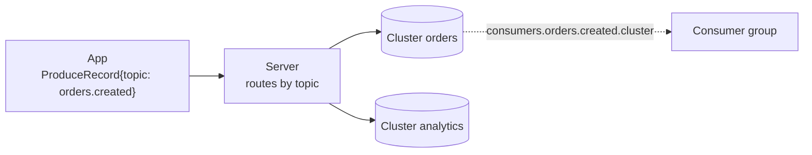
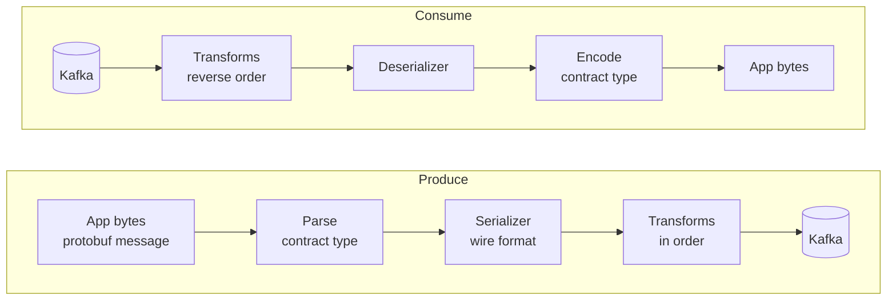

# Odradek: design

Odradek moves the Kafka client out of the application process into a separate server process. This document covers the server deployed as a sidecar container in the application's pod; "the server" below always means that process. The app talks to the server over gRPC on a Unix domain socket and names only topics; which Kafka cluster a topic lives on, and how to connect to it, is the server's configuration.

The design goal is that an app using the server keeps the guarantees it would have with an in-process client. Where it cannot, the difference is named explicitly (section 11).

Contracts:

- App-facing API: [`api/odradek/kafka/v1/odradek.proto`](../api/odradek/kafka/v1/odradek.proto)
- Configuration schema: [`api/odradek/config/v1/config.proto`](../api/odradek/config/v1/config.proto)

## 1. Scope

In scope:

- Produce with broker-ack semantics, per-stream ordering, deduplication of app resends, bounded buffering.
- Consume with consumer groups, app-driven offset commits, rebalance propagation, hung-app detection.
- Several Kafka clusters behind one server, with topic routing owned by the configuration. A topic can be produced to more than one cluster.
- Per-topic record codecs: the format stored in Kafka and transforms such as encryption are server configuration and extension classes, unknown to the app (section 7).
- Configuration read from a mounted volume and applied without restart, including mTLS credential rotation.
- One Java server binary and a thin Java client library.

Deferred:

- Transactions / exactly-once (section 12).
- Client libraries for other languages.
- Shared-memory transport. Broker acknowledgements dominate latency; revisit only if profiles show IPC cost.

## 2. Architecture


| Component | Responsibility |
|---|---|
| `//api` | The two proto contracts. The only thing another language needs. |
| `//server` | Owns all Kafka clients, topic routing, credentials and the settings the guarantees depend on. |
| `//client/core` | The client protocol as a state machine without I/O: sequence numbers, the window, resends, credits, acks. Shared by the JVM clients and checked by the scenarios in `//conformance`. |
| `//client/java` | Binds the core to grpc-java. Exposes `send() -> CompletableFuture` and a handler-based consumer. |
| `//extension/java` | The interface extension jars implement for codec transforms. Serializers use Kafka's own interfaces. |

### Server internals

- **Transport**: grpc-java on unshaded Netty (`grpc-netty`, never `grpc-netty-shaded`) with the epoll native transport (`netty-transport-native-epoll`, `linux-x86_64` and `linux-aarch_64`). The server binds a Unix domain socket, mode `0660`, on an `emptyDir` shared by both containers. Peer UID/GID are checked with `SO_PEERCRED` against an allow-list.
- **Health service**: the standard gRPC health service (`grpc.health.v1.Health/Check`) on a TCP port of its own (default 9464), for kubelet's gRPC probes, which cannot target a Unix socket. The port serves nothing else. Service `""` is `SERVING` when the server can do its work and `NOT_SERVING` otherwise; service `liveness` is `SERVING` while the process runs. The response carries no reason, so each change of state is logged with it. The same service is offered on the app's Unix socket. `Watch` is not offered. Metrics do not need a port: they are pushed over OTLP.
- **Threading**:
  - One shared `KafkaProducer` (thread-safe) per cluster. Each Produce stream calls `send()` from its own serialized gRPC callback, with manual inbound flow control (`request(1)`), so arrival order equals `send()` order.
  - One `KafkaConsumer` per Consume stream, owned by a dedicated poll thread. gRPC control messages (`Credits`, `Ack`, `RevokeDone`) are queued to that thread; nothing else touches the consumer.

### Lifecycle

- The server runs as a native sidecar: an `initContainer` with `restartPolicy: Always`.
- **Startup**: health service `""` is the `startupProbe` and the `readinessProbe`. Its port is up before anything that can take time, and it answers `NOT_SERVING` while the server waits for its first credentials (with a SPIFFE source, the first SVID). It answers `SERVING` once the credentials are loaded and the socket is listening. The app container starts after that. Not built yet: waiting for broker metadata of every required cluster.
- **Readiness afterwards**: `""` goes back to `NOT_SERVING` when a cluster's client certificate has expired, which means whatever renews it has stopped (files not replaced, or the Workload API unreachable for an SVID's lifetime), and when shutdown begins.
- **App readiness**: the client library reports ready only while it holds a session whose handshake has completed.
- **Shutdown**: the server receives SIGTERM after the app container exits. It stops accepting streams, completes in-flight produce results, `flush()`es, commits acked offsets, leaves its groups and exits. `terminationGracePeriodSeconds` must cover app drain plus `delivery.timeout.ms`.
- **Server restart with the app alive**: the app reconnects, sees a new `server_epoch`, and fails every unacknowledged send with *outcome unknown*. Consumers get a fresh assignment; unacked records are redelivered.
- **App restart with the server alive**: produce sessions idle out; consume streams close, which triggers a commit of acked offsets and a group leave.

### Metrics

Metrics are pushed over OTLP/gRPC to the collector named by `telemetry.endpoint`, every `telemetry.exportInterval` (default 30 s) and once more at shutdown. Without an endpoint nothing is exported. The server uses the OpenTelemetry SDK, with the exporter running on the gRPC and Netty the server already has. Every metric carries the resource attribute `service.name` (`odradek`) and whatever `telemetry.resourceAttributes` adds.

| Metric | Kind | Attributes | Meaning |
|---|---|---|---|
| `odradek.produce.records` | counter | `topic`, `outcome`, `error.code` | Records answered to the app. `error.code` is the code the app got |
| `odradek.produce.cluster.writes` | counter | `topic`, `cluster`, `required`, `outcome` | Writes of a record to one cluster. The only trace of a failure on a best-effort cluster |
| `odradek.produce.streams` | up-down counter | | Open Produce streams |
| `odradek.consume.records` | counter | `topic` | Records delivered to the app |
| `odradek.consume.decode.errors` | counter | `topic` | Records the topic's codec could not decode |
| `odradek.consume.streams` | up-down counter | `cluster`, `group` | Open Consume streams, each a Kafka consumer in its group |
| `odradek.consume.stream.ends` | counter | `cluster`, `group`, `reason` | Consume streams ended, by gRPC status. `ABORTED` is an app that stopped acknowledging |
| `odradek.consume.rebalances` | counter | `cluster`, `group`, `event` | Rebalance callbacks: `assigned`, `revoked`, `lost` |
| `odradek.tls.certificate.not_after` | gauge, seconds since the epoch | `cluster` | When the client certificate in use expires |
| `odradek.tls.credential.reloads` | counter | `cluster` | Times new credentials replaced the ones in use, the first load included |
| `odradek.tls.credential.reload.failures` | counter | `cluster` | Times new credentials were rejected or could not be fetched |
| `odradek.ready` | gauge | | 1 when the health service answers `SERVING`, 0 otherwise |

Not built yet: the Kafka clients' own metrics (lag, request latency, batch sizes), latency histograms, and configuration reload metrics.

## 3. API

- Both protos use protobuf Edition 2024. Fields have explicit presence, so "not set" is distinguishable from zero or empty (a null key, a tombstone value, an unset config field that takes its default).
- Every service, RPC, message, field and enum value carries a leading comment, so the protos are the source for generated reference documentation.
- `OdradekService` has two long-lived bidirectional streams:

| RPC | App sends | Server sends |
|---|---|---|
| `Produce` | `ProduceOpen`, then `ProduceRecord`s | `ProduceReady`, then one `ProduceResult` per record |
| `Consume` | `Subscribe`, then `Credits`, `Ack`, `RevokeDone` | `Subscribed`, then `Assigned`, `Revoked`, `Lost`, `RecordBatch` |

- The first message on each stream is the handshake, answered before anything else.
- Neither handshake names a cluster. `ProduceRecord` carries a topic; `Subscribe` carries a list of topics.
- Keys and values are bytes on the API. For a topic with a codec they are a protobuf message of the topic's contract type, independent of what is stored in Kafka (section 7).

## 4. Configuration

### Schema and validation

- The schema is the protobuf message `odradek.config.v1.ServerConfig`. There is no hand-written configuration model.
- The file is YAML (or JSON) in the protobuf JSON mapping: field names in lowerCamelCase, durations as `"30s"`, timestamps as RFC 3339. YAML is converted to JSON and parsed with the protobuf JSON parser in strict mode, so an unknown or misspelled field is an error rather than silently ignored.
- Constraints are declared in the schema with [protovalidate](https://github.com/bufbuild/protovalidate) and evaluated by `protovalidate-java`:
  - Field rules: name patterns for clusters and topics, absolute paths, port range, positive durations, `spiffe://` prefixes, mandatory fields marked `required`.
  - Cross-field CEL rules: every producer and consumer entry references an existing cluster; a producer lists each cluster once and has at least one that is not best effort; `bootstrap.servers` is set; a `spiffe` source has a peer policy; the default processing deadline does not exceed the maximum.
  - The enforced Kafka settings (below) are CEL rules on `Cluster`.
- Validation reports every violation with its field path and rule id. Each rule id has a test.
- Checks that need the outside world (referenced files exist and parse, brokers reachable) run after schema validation, in code.
- A configuration is accepted or rejected as a whole. One invalid entry invalidates the file.

### Example

```yaml
# /etc/odradek/odradek.yaml
clusters:
  orders:
    required: true
    properties:
      bootstrap.servers: orders-kafka:9093
    tls:
      spiffe: {}
      acceptedSpiffeIds: ["spiffe://example.org/ns/kafka/sa/orders-broker"]
  analytics:
    required: false
    properties:
      bootstrap.servers: analytics-kafka:9093
    tls:
      files:
        dir: /etc/odradek/tls/analytics

producers:                     # keyed by topic name
  orders.created:
    clusters:                  # written to both; both must acknowledge
      - cluster: orders
      - cluster: analytics
  clickstream:
    clusters:
      - cluster: analytics

consumers:                     # keyed by topic name
  orders.created:
    cluster: orders            # required, must name an entry in clusters
    groupId: billing
  orders.cancelled:
    cluster: orders
    groupId: billing
```

### Clusters

- Each cluster has a name, Kafka client properties (shared, plus producer-only and consumer-only overrides) and an optional `tls` block.
- The name is referenced only inside the configuration. Apps never see it as a parameter; it appears to them only as information in results.
- `required: true` clusters gate the `startupProbe`. Optional clusters connect on first use.
- Each cluster has its own producer, `buffer.memory`, consumers and credentials, so the container memory limit scales with the number of clusters.
- Every metric carries a `cluster` label.
- A cluster that is still referenced by a producer or consumer entry cannot be removed; such a configuration is invalid.

### Enforced Kafka settings

The server owns the settings the guarantees rest on. They may be omitted from `properties` (the server sets them) but never set to a weaker value, and the app cannot change them over the API.

| Setting | Rule |
|---|---|
| `acks` | `all` |
| `enable.idempotence` | `true` |
| `max.in.flight.requests.per.connection` | 1 to 5 |
| `enable.auto.commit` | `false` |
| `auto.offset.reset` | Must not be set; the start position is per topic (see Consumers) |
| `ssl.keystore.*`, `ssl.truststore.*`, `ssl.engine.factory.class` | Must not be set; TLS material belongs to the `tls` block |
| `partition.assignment.strategy` | Set by the server to cooperative-sticky (classic group protocol) |

### Producers

- `producers` is keyed by topic name. Each entry lists the cluster or clusters the topic is produced to.
- Routing is strict: there is no default. A record for a topic without an entry is rejected with `TOPIC_NOT_CONFIGURED` and never reaches Kafka; the stream stays open and other records are unaffected. The map doubles as the allow-list of topics an app may write.
- A topic may list several clusters, as equal peers with no primary. Every record is written to all of them (section 5).
- `bestEffort: true` on a cluster means its acknowledgement is not required for success. At least one cluster of a topic must not be best effort.

### Consumers

- `consumers` is keyed by topic name. Each entry fixes the cluster and the consumer group for that topic.
- The cluster reference is mandatory. A topic is consumed from exactly one cluster, even when it is produced to several.
- A `Subscribe` for a topic without an entry fails the stream with `NOT_FOUND`.
- One stream is one Kafka consumer, so all topics of a `Subscribe` must resolve to the same cluster and group; otherwise the stream fails with `FAILED_PRECONDITION`. The resolved cluster and group are returned in `Subscribed`.
- **Start position**: for a partition where the group has no committed offset, the server positions the consumer itself:
  - `startTimestamp`, if set: the first record at or after that instant.
  - otherwise `offsetReset`: `EARLIEST` (default, never skips) or `LATEST`.

## 5. Produce path

### Routing

A Produce stream is not bound to a cluster. Each record is routed by its topic to the clusters listed in that topic's `producers` entry. Records for topics on different clusters can share a stream.

### Session and deduplication

- The app picks a `session_id` once per process and numbers records with a strictly increasing `seq`.
- The server generates a `server_epoch` at start and returns it in `ProduceReady`.
- Per `session_id` the server keeps a table `seq -> {in-flight | result}`, with one entry per record covering all of its writes:
  - A record whose `seq` is already in the table is not sent again; the stream is attached to the existing outcome.
  - Entries below the app's `low_watermark` are dropped. Because the window bounds unacknowledged records, the table is bounded too.
- After a stream reconnect:
  - Same `server_epoch`: the library resends everything without a result, with the original `seq`. No duplicates are produced.
  - Different `server_epoch`: the table is gone. The library fails pending sends with `OUTCOME_UNKNOWN`. Whether to resend, accepting possible duplicates, is the app's call, as it is after a Kafka timeout in-process.

### Acknowledgement

- A `ProduceResult` is built only from Kafka delivery callbacks. The server never acknowledges on enqueue.
- The result is a success once every cluster of the topic that is not `bestEffort` has acknowledged with `acks=all`.
- `ProduceResult.writes` lists each cluster that acknowledged, with its own partition and offset.
- A server crash between broker ack and result delivery surfaces as *outcome unknown*, never as a false success.

### Producing to several clusters

Listing more than one cluster for a topic is a first-class, possibly permanent arrangement (two regions, an analytics copy, a standby). It is also the mechanism for moving a topic between clusters (section 10).



- The record is handed to every listed cluster's producer from the same serialized callback, so each cluster receives a stream's records in the same order.
- The server stamps the record with one timestamp (its clock, unless the app set one) and uses it for every write. Timestamps are identical across clusters, which makes timestamp-based positioning of a consumer on another cluster possible.
- A failure on a `bestEffort` cluster is only counted in metrics. That cluster may miss records.
- Once a required cluster has failed, the server waits for every cluster of the topic, best effort included, before answering, so that the result says truthfully where the record is. A definite error code (such as `INVALID_RECORD`) is reported only when no cluster acknowledged and every failure is itself definite.
- If a required cluster fails after another acknowledged, the result is `OUTCOME_UNKNOWN` and `writes` shows where the record already is. An app resend duplicates it there. Multi-cluster produce is at-least-once on each cluster, never exactly-once across them.
- **Prerequisite**: the topic exists on every listed cluster with the same partition count, so that keys map to the same partition number and an explicit `ProduceRecord.partition` is valid everywhere.

What it does not give:

- **Identical logs.** Each producer's own order is preserved on every cluster, but records from different pods can interleave differently on each. For a compacted topic written concurrently by several pods with the same key, the surviving value can differ between clusters. If exact log equality matters, replicate with MirrorMaker 2 instead.
- **History.** A newly added cluster only has what was produced after every pod picked up the change.
- **Independent availability.** A topic is as available and as fast to produce as the worst of its required clusters. Marking a cluster `bestEffort`, or removing it from the list, is a hot reload and the escape hatch.
- **Free memory.** Every in-flight record is buffered once per cluster.

### Ordering

- One Produce stream is one ordering domain. Records are passed to the producers in arrival order by a single serialized callback, so order is preserved per partition on every cluster.
- The idempotent producer preserves per-partition order across its own retries.
- Results may complete out of `seq` order across partitions; within a partition they complete in order.
- As in-process, a failed record does not block later records to the same partition. Apps needing stop-on-first-error use the client library's fail-fast option.

### Backpressure

- `ProduceReady` advertises `max_in_flight_records` and `max_in_flight_bytes`. The library blocks (or fails after a configurable `max.block` equivalent) when the window is full. Each result returns a slot.
- The window is sized below the producers' `buffer.memory`, so `send()` in the server does not block on buffer exhaustion. gRPC/HTTP-2 flow control is the backstop.
- A record that exceeds the window is rejected with `PROTOCOL_VIOLATION`.
- The window is per stream, not per cluster. Records waiting on a slow cluster occupy slots and can delay records for other topics on the same stream. An app that needs isolation between topics uses separate producers in the client library, which are separate streams.

## 6. Consume path

### Delivery and flow control

- The app grants `Credits`. The server delivers at most that many records and pauses all partitions when credits run out, while continuing to `poll()` to stay in the group.
- Records are delivered as per-partition `RecordBatch`es tagged with the partition's `assignment_epoch`.

### Commit after processing

- Auto-commit is off. The app sends `Ack` ranges per partition.
- Per partition the server tracks delivered and acked offsets and commits `highest contiguous acked offset + 1`: asynchronously on an interval, synchronously on revoke and on close.
- Acks carrying a stale `assignment_epoch` are ignored.
- Result: at-least-once, with redelivery limited to records that were delivered but not acked.

### Liveness

In-process, `max.poll.interval.ms` evicts a consumer whose processing thread is stuck. Here the server keeps polling regardless, so it enforces the equivalent itself:

- If the oldest delivered-but-unacked record is older than `max_processing_ms`, the app is considered hung.
- The server commits what was acked, leaves the group, and closes the stream with `ABORTED`. The library surfaces this and fails app readiness.
- `max.poll.interval.ms` on the real consumer is set above `max_processing_ms` plus the revoke deadline, so the server's own rule always fires first.

### Rebalance

With the cooperative-sticky assignor, `onPartitionsRevoked` runs on the poll thread inside `poll()`:

1. Stop delivering records for the revoked partitions.
2. Send `Revoked{revoke_id, partitions, deadline_ms}`.
3. Wait, bounded by `deadline_ms`, for `RevokeDone` while still processing incoming `Ack`s.
4. `commitSync` the contiguous acked offsets for those partitions.
5. Return from the callback.

- `deadline_ms` is kept well under the rebalance timeout.
- `onPartitionsLost` sends `Lost`; nothing is committed.
- `onPartitionsAssigned` sends `Assigned` with a new `assignment_epoch` per partition.

## 7. Record codecs: serialization and encryption

A codec is the per-topic pipeline between the bytes the app exchanges with the server and the bytes stored in Kafka. It is the server's extension point: wire formats and transforms such as encryption are classes named in the configuration, loaded the way the Kafka Java client loads `value.serializer`.

### What the app sees

- The app's contract for a topic is a protobuf message type, never a Kafka wire format. `ProduceRecord.value` and `ConsumedRecord.value` carry that message in protobuf encoding. The Java client library exposes it as typed messages.
- The format stored in Kafka (protobuf with or without schema-registry framing, JSON), and whether it is encrypted, is the topic's codec. Changing it is a configuration change; the app is not rebuilt and cannot tell.
- With no codec configured, bytes pass through unchanged, as today. The app then owns the format.

### Pipeline



- Keys and values have separate pipelines. Each has one serializer/deserializer pair and zero or more transforms.
- The Kafka clients themselves are always configured with the byte-array serializers; the pipeline runs in the server, before `send()` and after `poll()`.

### Extension interfaces

| Stage | Interface | Notes |
|---|---|---|
| Wire format | Kafka's own `org.apache.kafka.common.serialization.Serializer<T>` and `Deserializer<T>` | `T` is `com.google.protobuf.Message` when the topic declares a contract type, `byte[]` when it does not. Serializers written for the Java client against those types are usable as they are |
| Transform | `RecordTransform`, published by Odradek in a small API artifact (`//extension/java`) | Bytes to bytes, one class for both directions so encrypt and decrypt cannot be configured apart |

```java
public interface RecordTransform extends Closeable {
  void configure(Map<String, ?> configs, boolean isKey);
  byte[] apply(String topic, Headers headers, byte[] data);    // produce
  byte[] reverse(String topic, Headers headers, byte[] data);  // consume
}
```

- The lifecycle matches the Java client: instantiate by class name, `configure` once with the codec's `properties`, call per record with topic and headers, `close` on teardown.
- A transform may add headers on produce (key id, algorithm) and is responsible for removing them on consume if the app should not see them.
- A serializer instance is shared by all Produce streams, so it must be thread-safe, as it must be under a shared `KafkaProducer`. Deserializers and the reverse side of transforms get one instance per Consume stream.
- Pipeline code runs on the stream's serialized callback and on the consumer poll thread. It must not block per record: key material and schemas are fetched in `configure` or cached.
- Extension jars are read from one directory (`extensionsDir`) at startup, into a class loader below the server's. The server's own classes, kafka-clients and protobuf always win over a copy in an extension jar. Adding or replacing a jar needs a restart; the image is extended or the directory is mounted.
- Extensions run inside the server process, next to the Kafka credentials. Only trusted code belongs there.

### Configuration

Two things are configured, separately:

- **The contract**, per topic: the protobuf message type the app exchanges, as `valueType` and `keyType` on the topic's `producers` and `consumers` entries. Types are resolved from the descriptor sets listed under `contracts`. A topic present in both maps must declare the same types.
- **The codec**, reusable: how records are stored. Codecs are named, like clusters. `defaultCodec` names the one used by every topic; a topic's `codec` field overrides it.

Resolution for a topic:

1. The topic entry's `codec`, if set.
2. Otherwise `defaultCodec`, if set.
3. Otherwise the built-in `passthrough`, which stores the app's bytes unchanged.

- An override replaces the default as a whole. Nothing is merged, so what a topic uses is always one named codec read in one place.
- `passthrough` is a reserved name. Setting `codec: passthrough` on a topic is how it opts out of the default.
- A reference to a missing codec, a type missing from the descriptor sets, or a class that cannot be loaded rejects the configuration.
- A serializer that needs the message type (`T` is `Message`) cannot be used for a topic without a declared type; that also rejects the configuration.
- A serializer that declares `byte[]` is handed the app's bytes even when the topic declares a type.
- Null keys and tombstone values never enter a pipeline: null stays null in both directions.

```yaml
contracts:
  descriptorSets:                # FileDescriptorSet files
    - /etc/odradek/schemas/acme.binpb

defaultCodec: encrypted-json     # every topic, unless it says otherwise

codecs:
  encrypted-json:
    value:
      serializer: com.example.serde.JsonFromProtoSerializer
      deserializer: com.example.serde.JsonToProtoDeserializer
      properties:
        schema.registry.url: https://registry.example:8081
      transforms:
        - class: com.example.crypto.AesGcmTransform
          properties:
            key.uri: kms://default
    # key: omitted, so keys pass through as bytes
  plain-protobuf:
    value:
      serializer: com.example.serde.ProtobufSerializer
      deserializer: com.example.serde.ProtobufDeserializer

producers:
  orders.created:                # uses the default codec
    valueType: acme.orders.v1.OrderCreated
    clusters:
      - cluster: orders
      - cluster: analytics
  clickstream:                   # override
    codec: plain-protobuf
    valueType: acme.web.v1.Click
    clusters:
      - cluster: analytics
  legacy.raw:                    # opts out; the app owns the bytes
    codec: passthrough
    clusters:
      - cluster: orders

consumers:
  orders.created:
    valueType: acme.orders.v1.OrderCreated
    cluster: orders
    groupId: billing
```

### Effect on the produce path

- The pipeline runs once per record, before routing. Every cluster the topic is produced to receives the same bytes.
- It runs on the stream's serialized callback, in arrival order, so ordering is unchanged.
- The partitioner hashes the key as stored. A transform on the key must be deterministic, or records of one key spread over partitions and compaction stops working. The server cannot check this.
- A payload that does not parse as the contract type, or a serializer or transform that throws, fails that record with `INVALID_RECORD`. Nothing was sent to any cluster, and the stream stays open.
- The in-flight window counts the bytes the app sent. The stored size can differ; a record that grows past the broker limit fails with `INVALID_RECORD`.

### Effect on the consume path

A record that cannot be reversed or deserialized cannot be delivered as the contract type, and skipping it would be silent loss. The consumer entry chooses:

| `onDecodeError` | Behaviour |
|---|---|
| `FAIL` (default) | The stream ends with `DATA_LOSS`. The offset is not committed, so the record is met again after resubscribing, until the codec or the record's source is fixed. This matches the Java client, whose `poll()` keeps throwing at that offset |
| `DELIVER_UNDECODED` | The record is delivered with the stored bytes and a decode-error marker. The app acks it like any other record and decides what to do with it, for example dead-lettering |

### Changing a codec

- A change to a codec's `properties`, classes or transforms, to `defaultCodec`, or to a topic's `codec` is applied by hot reload (section 8): produce pipelines are replaced at a record boundary, consume pipelines between batches. No producer is recreated and no rebalance happens.
- Changing what is stored in a topic that already holds records is a compatibility problem the codec has to solve, not the server: the deserializer must read both the old and the new form until the old records have expired. Self-describing forms (schema-registry framing, a header naming the encryption key) make that possible.
- Key rotation is the transform's concern for the same reason: write with the new key, keep reading with the old ones.

## 8. Hot reload

### Source and watching

- All configuration lives in a directory on a mounted volume (ConfigMap, Secret or projected), default `/etc/odradek`. The only process-level inputs are the configuration directory path and the JVM flags. There are no environment overrides for Kafka settings, because they could not be reloaded.
- Files referenced by the configuration (PEM credentials, SASL credential files) are part of the watched set.
- The watcher is `java.nio.file.WatchService`, which is inotify on Linux, on the configuration directory and on the parent directory of every referenced file.
- Kubernetes updates a volume by swapping the `..data` symlink to a new timestamped directory; the files themselves are never modified in place. The watcher therefore watches directories and treats the `..data` create/move event as "everything may have changed". Watching an individual file would miss updates.
- Volumes mounted with `subPath` never receive updates and must not be used.
- Events are debounced (a few hundred ms), then the whole configuration is re-read and compared by content hash. An inotify `OVERFLOW` forces a re-read. A slow periodic re-hash is the safety net for missed events.

### Applying a change

1. Parse the complete new configuration into `ServerConfig`, validate it with protovalidate, then run the non-schema checks.
2. If invalid: keep running on the last good configuration, log every violation, increment `config_reload_failures_total`. Liveness is not affected.
3. If valid: diff against the running configuration and apply per the table below, then publish the new content hash and reload timestamp as metrics.

At startup there is no last good configuration, so an invalid or missing one fails the `startupProbe`.

| What changed | How it is applied | Visible to the app |
|---|---|---|
| Server tunables: processing deadlines, revoke deadline, commit interval, peer allow-list | In place | No |
| Produce window sizes | New streams only (the window is advertised once per stream) | No |
| mTLS key material and trust bundle | In-memory swap inside the running clients (section 9) | No |
| A cluster's producer properties or SASL credentials | Producer swap | Latency blip only |
| A topic's `producers` entry: cluster added or removed, `bestEffort` changed | At a flush boundary of the produce streams; producers of unchanged clusters are kept | Latency blip only |
| A topic's `producers` entry added or removed | For the next record of that topic; in-flight records complete first | New records for a removed topic fail with `TOPIC_NOT_CONFIGURED` |
| A cluster's consumer properties or SASL credentials; a topic's consumer `cluster` or `groupId` | Consumer rebuild for the streams reading it. If a stream's topics no longer share one cluster and group, it is closed with `FAILED_PRECONDITION` after the revoke handshake | `Revoked` then `Assigned`, or stream ends |
| A topic's `consumers` entry removed | Revoke handshake, commit, then the streams reading it close with `NOT_FOUND` | Stream ends |
| A topic's `startTimestamp` or `offsetReset` | Stored; used only the next time a partition has no committed offset | No |
| A codec's classes, properties or transforms; `defaultCodec`; a topic's `codec` or contract type | Pipeline replaced at a record boundary (produce) or between batches (consume) | No |
| A cluster added | Available immediately | No |
| Socket path, health port | Not reloadable; logged and flagged in `config_restart_required` | No, until restart |

### Producer swap

Kafka clients cannot change properties after construction, so a change means a new client. Two producers writing to one partition at the same time would break ordering, so the swap is gated:

1. Stop reading from the Produce streams (withhold `request(1)`).
2. `flush()` the old producer; every in-flight record gets its result as usual.
3. Create the new producer. If construction fails, resume on the old one and count a reload failure.
4. Resume the streams on the new producer; close the old one.

The session `seq` tables live above the producers, so `server_epoch` does not change and no send becomes *outcome unknown*. The app sees backpressure through the window for the duration of the flush.

### Consumer rebuild

1. Run the normal revoke handshake for all partitions of the stream (`Revoked`, final `Ack`s, `RevokeDone`, bounded).
2. `commitSync`, close the consumer.
3. Create the new consumer and subscribe; the app receives `Assigned` with new `assignment_epoch`s.

- The Consume stream stays open throughout.
- A fleet-wide ConfigMap change reaches every pod within about a kubelet sync period, so rebuilds start after a random jitter to avoid a rebalance storm.
- With static membership (`group.instance.id`) and a rejoin inside the session timeout, the rebuild causes no group rebalance.

## 9. mTLS credential rotation

Certificates do not go through the producer swap or consumer rebuild. SPIRE SVIDs are short-lived (rotated around half of a default one-hour TTL), and a consumer rebuild on every rotation would mean a rebalance every half hour.

The server keeps the current key, certificate chain and trust bundle in memory as one unit and replaces the three together. What differs between sources is only how a new set arrives.

### Mechanism

- Kafka clients accept a custom TLS engine factory through `ssl.engine.factory.class` (KIP-519). The server sets it to its own `ReloadingSslEngineFactory` on every client of a cluster with `tls`, and `security.protocol` to `SSL` unless the properties say `SASL_SSL`.
- The factory reads from a `CredentialSource` that always holds the current `{private key, certificate chain, trust bundle}` as one immutable snapshot.
- Each new TLS handshake builds its engine from the current snapshot. Established connections are left alone; TLS does not re-validate a certificate on a live connection, and connections pick up the new certificate as they are naturally re-established.
- The Kafka clients are never rebuilt for a rotation, so there is no flush, no rebalance, and nothing visible to the app.

### Credential sources

Each cluster's `tls` block selects one source.

| Source | How it updates | When to use | Status |
|---|---|---|---|
| `files` | PEM files in a directory, written by `spiffe-helper`, cert-manager or similar. The server re-reads them every 5 seconds; changed content is parsed and validated, then swapped | No Workload API access, or non-SPIFFE PKI | Implemented |
| `spiffe` | The server holds one stream open on the SPIRE agent's Workload API socket (`FetchX509SVID`); each update the agent pushes is validated, then swapped. The private key never touches disk | Clusters with SPIRE | Implemented |

- `files` is polled, not watched: a Kubernetes volume is updated by swapping a symlink, which a watch on the files does not see.
- A snapshot is rejected if the key does not belong to the leaf certificate, or the leaf is expired or not yet valid. The previous one stays in use and the next poll tries again. This is what makes a writer that replaces the certificate and the key at different moments safe.
- The certificate chain is not checked against the trust bundle: with a non-SPIFFE PKI the client's issuer and the brokers' issuer may differ.
- If the first set cannot be loaded, the server does not start. For `spiffe` it waits up to two minutes for the first SVID, then exits; the pod's restart policy takes it from there.
- `spiffe` is the server's own client of the Workload API, on the gRPC stack it already has, rather than `java-spiffe`: one streaming call, no second gRPC or Netty on the class path, and nothing new for the native image. The socket is `workloadApiSocket`, or the `SPIFFE_ENDPOINT_SOCKET` environment variable. Clusters naming the same socket share one stream and so one SVID. The first SVID of an update is used.
- When the stream ends (the agent restarts), it is opened again with a pause that grows from half a second to thirty. The current SVID stays in use meanwhile, for as long as it is valid.
- Federated bundles cover brokers in another trust domain. A broker is verified against the bundle of the trust domain its SPIFFE ID names and no other, so an authority federated with can only vouch for its own identities.
- Metrics (section 2): `odradek.tls.certificate.not_after`, `odradek.tls.credential.reloads` and `odradek.tls.credential.reload.failures`, per cluster. Alert on time-to-expiry, not on rotation events. Reloads and rejections are also logged, and an expired certificate makes the health service answer `NOT_SERVING`.

### Peer verification

- With `acceptedSpiffeIds` or `acceptedTrustDomain` set, the broker is identified by SPIFFE ID. X.509-SVIDs carry the identity in a URI SAN and usually no DNS SAN, so hostname verification is disabled and replaced in the factory's trust manager: the broker certificate must chain to the trust bundle, carry exactly one URI SAN, and that SPIFFE ID must be listed or belong to the accepted trust domain.
- With neither set (allowed for `files` only), the broker is verified the usual way: chain to the trust bundle, and a certificate that names the host connected to.
- Broker side, outside this repo: brokers need a `principal.builder.class` that maps the client's SPIFFE ID to a Kafka principal for ACLs.

### Deployment

- Credentials are mounted into the server container only. The app container never sees Kafka credentials.
- For `files` with SPIRE, a `spiffe-helper` container writes the SVID to a memory-backed volume shared with the server. For `spiffe`, the agent socket is mounted instead (CSI driver or hostPath).

## 10. Moving a topic between clusters

A migration is a sequence of configuration changes on top of multi-cluster produce. Apps are neither changed nor restarted. Any step can be the last: stopping after step 3 simply leaves the topic produced to both clusters.

| Step | Config change | Wait for |
|---|---|---|
| 1. Add B | New `clusters` entry, `required: false` | Servers report the cluster healthy |
| 2. Warm up (optional) | Add B to the topic's `producers` entry with `bestEffort: true` | Produce error rate on B at zero |
| 3. Produce to both | Remove `bestEffort` from B | Every pod of every producing app has applied it; note this instant as T0 |
| 4. Move consumers | `consumers.<topic>.cluster` to B, `startTimestamp` set | The group's lag on B stable, and no member left on A |
| 5. Stop producing to A (optional) | Remove A from the topic's `producers` entry | Produce error rate normal |
| 6. Retire A (optional) | Remove the `clusters` entry once nothing references it | — |

- Every topic is listed explicitly, so moving a whole cluster means applying the steps to each topic's entry. They can all go in one configuration change.
- **Step 4 precondition**: a group may move only once its committed position on A is past T0, i.e. it has consumed everything that exists only on A. Otherwise those records are lost to it.
- **Step 4 start position**: the group has no committed offsets on B. `startTimestamp` positions it at the first record at or after that instant; set it slightly before the group's current position on A. Without it the group starts at the earliest retained record on B, which is safe but re-reads everything since T0.
- **Step 4 overlap**: the change reaches pods over about a minute, so for a while some members read A and others read B. Records are processed twice in that window, never skipped. Consumers must be idempotent, as with any at-least-once consumer.
- **Rollback**: while the topic is still produced to both, moving consumers back is step 4 in reverse, since A has every record. After step 5, A no longer receives writes.

## 11. Guarantee summary

| In-process guarantee | With the server |
|---|---|
| `send()` success means broker-acked | Preserved. Results come only from delivery callbacks, from every required cluster of the topic. |
| Per-partition ordering | Preserved per Produce stream, on every cluster the topic is produced to. |
| No duplicates from client retries | Preserved while the server stays up. A server restart, or a partial multi-cluster write, yields *outcome unknown*; resending may duplicate. |
| Bounded producer memory | Preserved via the in-flight window, shared by all topics of a stream. |
| Hung consumer is evicted | Preserved via `max_processing_ms`. |
| Commit only processed offsets | Preserved; contiguous-ack rule. |
| Rebalance callbacks | Preserved as `Revoked` / `RevokeDone` with a deadline. |
| App chooses cluster, group and offset reset | Moved to the server configuration by design. |
| App chooses serializers, and with them the stored format | Moved to the server configuration by design. The app's contract is a protobuf message type per topic. |
| A record that cannot be deserialized blocks its partition | Preserved by default; delivering it undecoded is an option per consumer. |
| Transactions / exactly-once | Not provided. |

New, with no in-process equivalent: topics produced to several clusters. Their logs hold the same records but are not identical in order or offsets.

## 12. Transactions (deferred)

- A transactional session is a dedicated Produce stream bound to its own `KafkaProducer` with a stable `transactional.id` per pod (StatefulSet ordinal or configured id) for zombie fencing.
- `Begin`, `SendOffsets`, `Commit`, `Abort` travel in-band on that stream rather than as unary RPCs, so their order relative to produced records is unambiguous.
- `SendOffsets` references a Consume stream in the same server and on the same cluster; the server supplies the consumer group metadata.
- A transaction cannot span clusters. Topics produced to more than one cluster are rejected in a transaction.
- A stream drop mid-transaction aborts it.

## 13. Testing strategy

| Level | What | How |
|---|---|---|
| Unit | Configuration rules (one test per rule id), session tables, contiguous-ack tracker, credit accounting, topic routing | Plain JUnit; Kafka's `MockProducer` / `MockConsumer` |
| Component | Full gRPC stream behaviour over a real UDS against mock Kafka clients | In-process server, real client library |
| End to end | The server binary and the Java client against real brokers: ordering, commit positions, rebalance with two servers | Kafka in KRaft mode (no ZooKeeper), provided by the environment: service containers in CI, containers started locally. Two brokers, so multi-cluster cases run in the same suite |
| Fault | Kill the server mid-produce and mid-revoke; hang the app; drop the stream; stop a broker | End-to-end harness; assert no false acks and no committed-but-unprocessed offsets |
| Reload | ConfigMap-style `..data` symlink swap; invalid configuration keeps the last good one; producer swap under load keeps order and produces no duplicates; consumer rebuild commits before closing; credential rotation against a fake Workload API | Component and end-to-end harness |
| Multi-cluster | Two brokers: a topic produced to both under load; one cluster failing as required and as best effort; a consumer moved with `startTimestamp` loses nothing; removing a cluster from a topic by reload | End-to-end harness |
| Soak | Rolling restarts of app and server under load in a cluster | With the deployment work |

## 14. Open decisions

- **Java package root**: `io.github.bpalermo.odradek` is a placeholder; change it before anything is published.
- **Consumer group protocol**: classic with cooperative-sticky, or the KIP-848 protocol (`group.protocol=consumer`). The callback contract is the same, so the session code keeps the choice in configuration.
- **Broker principal mapping**: brokers need a principal builder that understands SPIFFE IDs; confirm one exists.
- **Third-party serializers**: existing schema-registry serializers for protobuf are expected to plug in unchanged; this is not verified, and their licences need checking before any is bundled.
- **Contract descriptors**: the design reads a `FileDescriptorSet` from the config volume. Fetching descriptors from a schema registry is the alternative.
- **Key management for encryption**: left entirely to the transform class. Whether Odradek ships a reference transform is open.
