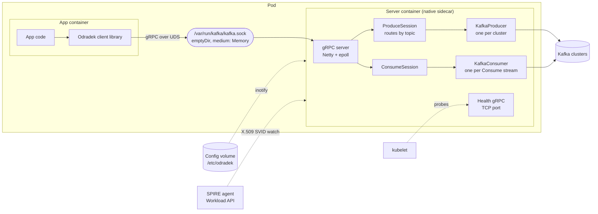
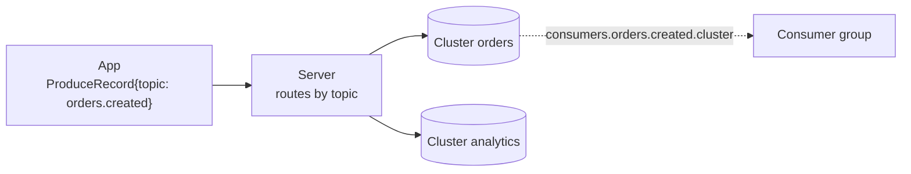
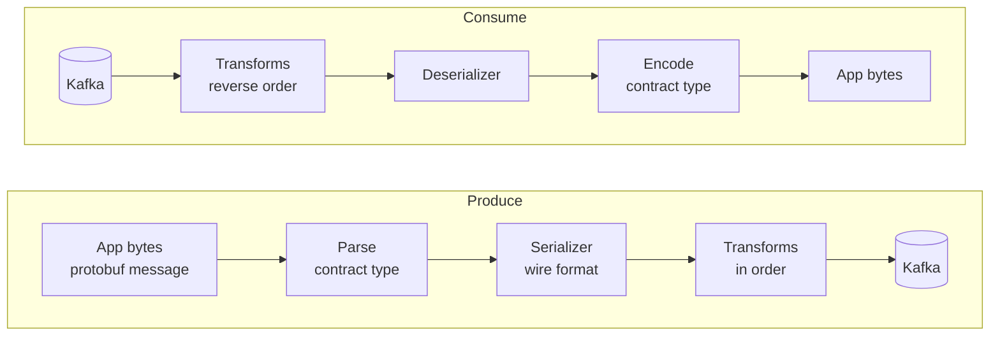

# Odradek: design

Odradek moves the Kafka client out of the application process into a separate server process. This document covers the server deployed as a sidecar container in the application's pod; "the server" below always means that process. The app talks to the server over gRPC on a Unix domain socket and names only topics; which Kafka cluster a topic lives on, and how to connect to it, is the server's configuration.

The design goal is that an app using the server keeps the guarantees it would have with an in-process client. Where it cannot, the difference is named explicitly (section 11).

Contracts:

- App-facing API: [`api/odradek/kafka/v1/odradek.proto`](../api/odradek/kafka/v1/odradek.proto)
- Configuration schema: [`api/odradek/config/v1/config.proto`](../api/odradek/config/v1/config.proto)

## 1. Scope

In scope:

- Produce with broker-ack semantics, per-stream ordering, deduplication of app resends, bounded buffering.
- Consume with consumer groups, app-driven offset commits, rebalance propagation, hung-app detection.
- Several Kafka clusters behind one server, with topic routing owned by the configuration. A topic can be produced to more than one cluster.
- Per-topic record codecs: the format stored in Kafka and transforms such as encryption are server configuration and extension classes, unknown to the app (section 7).
- Configuration read from a mounted volume and applied without restart, including mTLS credential rotation.
- One Java server binary and a thin Java client library.

Deferred:

- Transactions / exactly-once (section 12).
- Client libraries for other languages.
- Shared-memory transport. Broker acknowledgements dominate latency; revisit only if profiles show IPC cost.

## 2. Architecture



| Component | Responsibility |
|---|---|
| `//api` | The two proto contracts. The only thing another language needs. |
| `//server` | Owns all Kafka clients, topic routing, credentials and the settings the guarantees depend on. |
| `//client/core` | The client protocol as a state machine without I/O: sequence numbers, the window, resends, credits, acks. Shared by the JVM clients and checked by the scenarios in `//conformance`. |
| `//client/java` | Binds the core to grpc-java. Exposes `send() -> CompletableFuture` and a handler-based consumer. |
| `//extension/java` | The interface extension jars implement for codec transforms. Serializers use Kafka's own interfaces. |

### Server internals

- **Transport**: grpc-java on unshaded Netty (`grpc-netty`, never `grpc-netty-shaded`) with the epoll native transport (`netty-transport-native-epoll`, `linux-x86_64` and `linux-aarch_64`). The server binds a Unix domain socket, mode `0660`, on an `emptyDir` shared by both containers. Peer UID/GID are checked with `SO_PEERCRED` against an allow-list.
- **Health service**: the standard gRPC health service (`grpc.health.v1.Health/Check`) on a TCP port of its own (default 9464), for kubelet's gRPC probes, which cannot target a Unix socket. The port serves nothing else. Service `""` is `SERVING` when the server can do its work and `NOT_SERVING` otherwise; service `liveness` is `SERVING` while the process runs. The response carries no reason, so each change of state is logged with it. The same service is offered on the app's Unix socket. `Watch` is not offered. Metrics do not need a port: they are pushed over OTLP.
- **Threading**:
  - One shared `KafkaProducer` (thread-safe) per cluster. Each Produce stream calls `send()` from its own serialized gRPC callback, with manual inbound flow control (`request(1)`), so arrival order equals `send()` order.
  - One `KafkaConsumer` per Consume stream, owned by a dedicated poll thread. gRPC control messages (`Credits`, `Ack`, `RevokeDone`) are queued to that thread; nothing else touches the consumer.
  - In a dispatcher, one `KafkaConsumer` per cluster and consumer group that sidecars have declared, owned by a thread of its own together with the group's dispatch cores and `Deliver` streams (see Dispatcher).
  - In a dispatcher, one more `KafkaConsumer`, which consumes nothing: the replica's membership of the coordination group. A member has to be polled to stay one, so it has a thread that does nothing else (see Replicas).
  - In a dispatcher that has dead-lettered a record, one `KafkaProducer` per cluster it did so on, and one thread per producer that calls `send()`: a group's thread never waits, and `send()` can (see Redelivery, limits and dead letters).
  - A Consume stream whose topics are received from a dispatcher has no `KafkaConsumer`. It has a thread of its own all the same, which owns the stream's `Deliver` streams to the dispatcher and everything it knows about them (see What a receiving sidecar does).

### Lifecycle

- The server runs as a native sidecar: an `initContainer` with `restartPolicy: Always`.
- **Startup**: health service `""` is the `startupProbe` and the `readinessProbe`. Its port is up before anything that can take time, and it answers `NOT_SERVING` while the server starts. In order, the server:
  1. loads its first credentials, those of its clusters and those of the delivery port (with a SPIFFE source, it waits for the first SVID);
  2. asks every cluster with `required: true` for its metadata (an Admin client's `describeCluster`, built from the cluster's shared `properties` and its `tls`), one cluster at a time in name order, retrying until each answers;
  3. listens on the Unix socket and, in a dispatcher, on the delivery port;
  4. in a dispatcher, joins the coordination group and waits for the list of replicas (`starting: joining coordination group odradek-dispatcher on cluster orders`). It waits as long as it takes, as for a required cluster, and refuses every declaration with `UNAVAILABLE` meanwhile;
  5. answers `SERVING`. The app container starts after that.
- **A server that only dispatches** (a `dispatch` section, no `producers` and no `consumers`) does not open the Unix socket: no app runs next to it, and the socket's directory, a volume shared with the app, normally does not exist in its pod. `listener` is then ignored. It is ready when its delivery port is up and it knows its replicas, whether or not a sidecar is connected. Readiness is what puts a replica behind the Service's address, so a sidecar is never sent to one that would answer with less than every replica.
- **Waiting for a required cluster**: the socket does not exist until every required cluster has answered, so an app never talks to a server that has not reached the clusters it must have. While waiting, the reason for `NOT_SERVING` names the cluster (`starting: waiting for cluster orders`). An attempt times out after 10 seconds and the next follows a second later. The reason for a failure is logged when it differs from the previous one, and the wait itself every 30 seconds. The server neither gives up nor exits: the `startupProbe`'s `failureThreshold` is what bounds the wait, and kubelet restarts the container when it is exceeded. Clusters that are not required are not contacted at startup.
- **The dispatcher is not waited for.** A server that receives topics from a dispatcher connects to it when an app subscribes, not before, and is ready whether or not it can be reached: an app that only produces must be able to start. While the dispatcher is away the app's Consume stream is open and receives nothing.
- **Startup only**: a required cluster that becomes unreachable later does not change readiness. Producing and consuming report their own errors, and taking the pod out of service for a broker blip would turn a partial failure into a full one.
- **Readiness afterwards**: `""` goes back to `NOT_SERVING` when a certificate in use has expired (a cluster's client certificate, the certificate of a dispatcher's delivery port, or the one a server presents to its dispatcher), which means whatever renews it has stopped (files not replaced, or the Workload API unreachable for an SVID's lifetime), and when shutdown begins.
- **App readiness**: the client library reports ready only while it holds a session whose handshake has completed.
- **Shutdown**: the server receives SIGTERM after the app container exits. It stops accepting streams, completes in-flight produce results, `flush()`es, commits acked offsets, leaves its groups and exits. `terminationGracePeriodSeconds` must cover app drain plus `delivery.timeout.ms`.
- **Shutdown of a server that receives from a dispatcher**: for each Consume stream it grants the dispatcher nothing more, passes on the acknowledgements the app has sent, half-closes its `Deliver` streams and ends the app's stream with `UNAVAILABLE`. The half-close is a clean leave: the dispatcher delivers again, under the same attempt numbers, what the app held. It waits up to 5 seconds for the dispatcher to close the streams.
- **Shutdown of a dispatcher**: it stops accepting `Deliver` streams and hands every partition over as it does in a rebalance (see Hand-over between replicas): it sends nothing new, finishes what it had held back below the newest record it sent, waits for the acknowledgements of what its sidecars hold and for the dead letters being written, for at most `consume.revokeDeadline` in all, commits, ends the streams with `UNAVAILABLE` and leaves the groups it consumes for, whose partitions go to the other replicas. It then closes its dead-letter producers, and only then leaves the coordination group, which is what tells the other replicas, and through them every sidecar, that it is gone: a sidecar closes its streams to a replica that is no longer listed, and until then those streams carried the acknowledgements being waited for. `terminationGracePeriodSeconds` must cover `consume.revokeDeadline`, the commits (the server allows itself 15 seconds beyond the deadline) and the producers and the coordination group after them: `consume.revokeDeadline` plus 35 seconds is safe.
- **Server restart with the app alive**: the app reconnects, sees a new `server_epoch`, and fails every unacknowledged send with *outcome unknown*. Consumers get a fresh assignment; unacked records are redelivered.
- **App restart with the server alive**: produce sessions idle out; consume streams close, which triggers a commit of acked offsets and a group leave.

### Metrics

Metrics are pushed over OTLP/gRPC to the collector named by `telemetry.endpoint`, every `telemetry.exportInterval` (default 30 s) and once more at shutdown. Without an endpoint nothing is exported. The server uses the OpenTelemetry SDK, with the exporter running on the gRPC and Netty the server already has. Every metric carries the resource attribute `service.name` (`odradek`), whatever `telemetry.resourceAttributes` adds, and whatever the environment variable `OTEL_RESOURCE_ATTRIBUTES` adds, read as the OpenTelemetry SDKs read it (`key=value` pairs separated by commas, values percent-encoded). On a key that both set, the variable wins: it is the pod's own, where the configuration is shared. A malformed variable is refused whole and the server does not start (exit status 2), rather than reporting under part of its attributes. Without `telemetry.endpoint` the variable is not read.

| Metric | Kind | Attributes | Meaning |
|---|---|---|---|
| `odradek.produce.records` | counter | `topic`, `outcome`, `error.code` | Records answered to the app. `error.code` is the code the app got |
| `odradek.produce.cluster.writes` | counter | `topic`, `cluster`, `required`, `outcome` | Writes of a record to one cluster. The only trace of a failure on a best-effort cluster |
| `odradek.produce.streams` | up-down counter | | Open Produce streams |
| `odradek.consume.records` | counter | `topic` | Records delivered to the app |
| `odradek.consume.decode.errors` | counter | `topic` | Records the topic's codec could not decode |
| `odradek.consume.streams` | up-down counter | `cluster`, `group` | Open Consume streams. Each is a Kafka consumer in its group, unless its topics are received from a dispatcher |
| `odradek.consume.stream.ends` | counter | `cluster`, `group`, `reason` | Consume streams ended, by gRPC status. `ABORTED` is an app that stopped acknowledging; `FAILED_PRECONDITION`, `PERMISSION_DENIED` and `UNIMPLEMENTED` include a declaration the dispatcher refused |
| `odradek.consume.rebalances` | counter | `cluster`, `group`, `event` | Rebalance callbacks: `assigned`, `revoked`, `lost`. A dispatcher reports them for the groups it consumes for, where `lost` is partitions that changed replica with no hand-over |
| `odradek.dispatch.receivers` | up-down counter | `cluster`, `group`, `topic` | Open `Deliver` streams: the sidecars connected to this replica for the topic |
| `odradek.dispatch.records` | counter | `cluster`, `group`, `topic` | Records a dispatcher sent to sidecars. A record sent again is counted again |
| `odradek.dispatch.redeliveries` | counter | `cluster`, `group`, `topic`, `reason` | Of those, the records this replica had sent before: `deadline` (the processing deadline passed), `rejected` (a sidecar could not decode it), `receiver_gone` (the sidecar's stream ended; not a failed attempt). What a change of replica delivers again is not in it: the next owner cannot know; see `odradek.dispatch.handover.records` |
| `odradek.dispatch.in_flight` | up-down counter | `cluster`, `group`, `topic` | Records sent to a sidecar and not yet acknowledged, rejected or expired |
| `odradek.dispatch.exhausted` | counter | `cluster`, `group`, `topic`, `action` | Records that used all their attempts: `block` (the partition stops) or `dead_letter`. Counted once per record and owner |
| `odradek.dispatch.dead_letter.writes` | counter | `cluster`, `group`, `topic`, `outcome` | Writes of a record to its dead-letter topic: `ok` once the brokers acknowledged it, `error` when the write failed for good. `topic` is the topic the record came from. A failed write is made again, so one record can count several errors |
| `odradek.dispatch.partitions.blocked` | up-down counter | `cluster`, `group`, `topic` | Partitions stopped at a record that used all its attempts (`ON_EXHAUSTED_BLOCK`), on the replica that owns them |
| `odradek.dispatch.window.pauses` | counter | `cluster`, `group`, `topic` | Times a partition stopped handing out new records because its oldest unacknowledged record was `dispatch.partitionWindow` offsets behind |
| `odradek.dispatch.partitions.at_window` | up-down counter | `cluster`, `group`, `topic` | Partitions that hand out no new record now for that reason |
| `odradek.dispatch.handovers` | counter | `cluster`, `group`, `topic`, `outcome` | Partitions this replica gave up in good order: `completed` (everything it had sent was answered first) or `deadline` (`consume.revokeDeadline` ended the wait). `completed` does not say that everything it had held back was sent in the time there was: `odradek.dispatch.handover.records` does. A lost partition is not here but under `odradek.consume.rebalances` |
| `odradek.dispatch.handover.records` | counter | `cluster`, `group`, `topic` | Records this replica had sent and left above the committed offset of a partition it gave up: what the next owner delivers again, acknowledged here or not. Nothing after a hand-over in good order |
| `odradek.dispatch.declarations.refused` | counter | `reason` | Declarations a dispatcher refused, by gRPC status. It carries nothing of what was declared: those names are whatever a caller chose to send |
| `odradek.dispatch.replicas` | gauge | `cluster`, `group` | Replicas on the list this dispatcher replica holds and sends to sidecars; 0 until it has joined the coordination group, which the attributes name |
| `odradek.dispatch.replicas.generation` | gauge | `cluster`, `group` | Generation of that list. The replicas of one dispatcher agree on both; one that reports fewer replicas or an older generation than the others for long has fallen out of the coordination group |
| `odradek.receive.streams` | up-down counter | `cluster`, `group`, `topic` | `Deliver` streams this server holds to dispatcher replicas, declaration accepted. Zero with an open Consume stream means the dispatcher cannot be reached |
| `odradek.receive.streams.wanted` | up-down counter | `cluster`, `group`, `topic` | `Deliver` streams this server should hold: one per replica on the list it acts on, and one while it knows no list. More than `odradek.receive.streams` means a replica that is listed and not reached, whose partitions do not reach this pod |
| `odradek.receive.records` | counter | `cluster`, `group`, `topic` | Records received from a dispatcher. A record received again is counted again |
| `odradek.receive.rejects` | counter | `cluster`, `group`, `topic` | Records returned to the dispatcher because the topic's codec could not decode them |
| `odradek.receive.reconnects` | counter | `cluster`, `group`, `topic` | `Deliver` streams opened again after one was lost, or refused for the time being |
| `odradek.tls.certificate.not_after` | gauge, seconds since the epoch | `cluster` or `delivery` | When the certificate in use expires |
| `odradek.tls.credential.reloads` | counter | `cluster` or `delivery` | Times new credentials replaced the ones in use, the first load included |
| `odradek.tls.credential.reload.failures` | counter | `cluster` or `delivery` | Times new credentials were rejected or could not be fetched |
| `odradek.ready` | gauge | | 1 when the health service answers `SERVING`, 0 otherwise |

The Kafka clients' own metrics are exported too, from an allow-list: Kafka has hundreds, and the per-node and per-topic ones multiply. Each is read from the client on every collection, so its value and its window are Kafka's (an `avg` or a `max` covers Kafka's sample window, 30 s by default, and is absent while there are no samples).

| Metric | Kind | Attributes | Kafka metric |
|---|---|---|---|
| `odradek.kafka.consumer.records.lag` | gauge, records | `cluster`, `group`, `topic`, `partition` | `records-lag`: records between the partition's end and the consumer's position, as of its last fetch |
| `odradek.kafka.consumer.records.lag.max` | gauge, records | `cluster`, `group` | `records-lag-max` |
| `odradek.kafka.consumer.commit.latency.avg`, `.max` | gauge, ms | `cluster`, `group` | `commit-latency-avg`, `commit-latency-max` |
| `odradek.kafka.consumer.commits` | counter | `cluster`, `group` | `commit-total` |
| `odradek.kafka.consumer.last_poll.age` | gauge, s | `cluster`, `group` | `last-poll-seconds-ago` |
| `odradek.kafka.consumer.rebalances` | counter | `cluster`, `group` | `rebalance-total` |
| `odradek.kafka.consumer.rebalance.failures` | counter | `cluster`, `group` | `failed-rebalance-total` |
| `odradek.kafka.consumer.rebalance.latency.avg`, `.max` | gauge, ms | `cluster`, `group` | `rebalance-latency-avg`, `rebalance-latency-max` |
| `odradek.kafka.consumer.assigned_partitions` | gauge | `cluster`, `group` | `assigned-partitions` |
| `odradek.kafka.consumer.connections` | gauge | `cluster`, `group` | `connection-count` |
| `odradek.kafka.consumer.authentication.failures` | counter | `cluster`, `group` | `failed-authentication-total`, a failed TLS handshake included |
| `odradek.kafka.producer.request.latency.avg`, `.max` | gauge, ms | `cluster` | `request-latency-avg`, `request-latency-max` |
| `odradek.kafka.producer.record.error.rate` | gauge, records/s | `cluster` | `record-error-rate` |
| `odradek.kafka.producer.record.errors` | counter | `cluster` | `record-error-total` |
| `odradek.kafka.producer.record.retries` | counter | `cluster` | `record-retry-total` |
| `odradek.kafka.producer.buffer.available` | gauge, bytes | `cluster` | `buffer-available-bytes`. At zero, sends block |
| `odradek.kafka.producer.record.queue_time.avg`, `.max` | gauge, ms | `cluster` | `record-queue-time-avg`, `record-queue-time-max` |
| `odradek.kafka.producer.batch.size.avg`, `.max` | gauge, bytes | `cluster` | `batch-size-avg`, `batch-size-max` |
| `odradek.kafka.producer.connections` | gauge | `cluster` | `connection-count` |
| `odradek.kafka.producer.authentication.failures` | counter | `cluster` | `failed-authentication-total` |

- A dispatcher's consumers report the same `odradek.kafka.consumer.*` metrics, lag included: there the lag of a group is one series per partition, reported by the replica that owns it.
- A dispatcher's dead-letter producers report the `odradek.kafka.producer.*` metrics under their cluster, from the first record it dead-letters there.
- The replicas of a dispatcher read the same configuration, and so do the pods of an application, so `telemetry.resourceAttributes` cannot tell them apart. Each pod names itself through `OTEL_RESOURCE_ATTRIBUTES` (in Kubernetes, `k8s.pod.name=$(POD_NAME)` with `POD_NAME` from the downward API, as the example manifests do), or the collector adds the pod (its `k8sattributes` processor). Without either, the series of two replicas are one series in whatever stores them; for the up-down counters that is wrong, not merely coarse.
- So does a dispatcher's membership of its coordination group, under that group's name: `rebalances` counts the changes of the dispatcher's replicas as this replica saw them, and `last_poll.age` says whether its membership is being kept up. It has no lag and no partitions.
- The client id is not an attribute: a consumer's changes with every stream. The consumers of one group on one cluster are therefore one series. A counter, `assigned_partitions`, `connections` and `buffer.available` are their sum; every other gauge is the largest among them (the worst consumer).
- A consumer's gauges stop being reported when its stream ends, and a partition's lag when the partition is revoked. A counter keeps what closed consumers counted, so it only goes up while the server runs.
- Lag is what the consumer saw at its last fetch. A group with no open stream reports none: lag of a group nobody consumes is the broker's to report.
- The metrics reach the SDK through a Kafka `MetricsReporter` that the server adds to `metric.reporters`, after any reporter the cluster's properties name (Kafka's JMX reporter when they name none). Without `telemetry.endpoint` the reporter is not installed.

- A server that receives a topic from a dispatcher reports `odradek.consume.records`, `odradek.consume.decode.errors` (records delivered undecoded), `odradek.consume.streams` and `odradek.consume.stream.ends` for it as for any other, and the `odradek.receive.*` metrics besides. It has no Kafka consumer, so no `odradek.kafka.consumer.*` and no `odradek.consume.rebalances`: lag is the dispatcher's to report. In `odradek.receive.*`, `cluster` is the dispatcher's name for the cluster.
- The `odradek.tls.*` metrics have one series per set of credentials. Those of a cluster carry `cluster`. Those of the delivery port carry `delivery` instead, with the configuration section as its value: `dispatch.tls` on a dispatcher, `dispatcher.tls` on a server that receives from one.

Not built yet: latency histograms, configuration reload metrics, and, on the receiving side, the records waiting for the app's credit. What each dispatcher metric is for, and which to alert on, is under Operating a dispatcher (section 4).

## 3. API

- Both protos use protobuf Edition 2024. Fields have explicit presence, so "not set" is distinguishable from zero or empty (a null key, a tombstone value, an unset config field that takes its default).
- Every service, RPC, message, field and enum value carries a leading comment, so the protos are the source for generated reference documentation.
- `OdradekService` has two long-lived bidirectional streams:

| RPC | App sends | Server sends |
|---|---|---|
| `Produce` | `ProduceOpen`, then `ProduceRecord`s | `ProduceReady`, then one `ProduceResult` per record |
| `Consume` | `Subscribe`, then `Credits`, `Ack`, `RevokeDone` | `Subscribed`, then `Assigned`, `Revoked`, `Lost`, `RecordBatch` |

- The first message on each stream is the handshake, answered before anything else.
- Neither handshake names a cluster. `ProduceRecord` carries a topic; `Subscribe` carries a list of topics.
- Keys and values are bytes on the API. For a topic with a codec they are a protobuf message of the topic's contract type, independent of what is stored in Kafka (section 7).

## 4. Configuration

### Schema and validation

- The schema is the protobuf message `odradek.config.v1.ServerConfig`. There is no hand-written configuration model.
- The file is YAML (or JSON) in the protobuf JSON mapping: field names in lowerCamelCase, durations as `"30s"`, timestamps as RFC 3339. YAML is converted to JSON and parsed with the protobuf JSON parser in strict mode, so an unknown or misspelled field is an error rather than silently ignored.
- Constraints are declared in the schema with [protovalidate](https://github.com/bufbuild/protovalidate) and evaluated by `protovalidate-java`:
  - Field rules: name patterns for clusters and topics, absolute paths, port range, positive durations, `spiffe://` prefixes, mandatory fields marked `required`.
  - Cross-field CEL rules: every producer entry, every consumer entry that reads Kafka itself and every rule of the dispatcher's policy references an existing cluster; a producer lists each cluster once and has at least one that is not best effort; `bootstrap.servers` is set; a `spiffe` source has a peer policy; the default processing deadline does not exceed the maximum; the settings of a dispatched consumer are consistent; a dispatcher's policy comes with TLS on its delivery port, a dispatcher names its coordination group and, when it has several clusters, the one the group lives on, and the TLS to a dispatcher says who the dispatcher is (see Dispatcher).
  - The enforced Kafka settings (below) are CEL rules on `Cluster`.
- Validation reports every violation with its field path and rule id. Each rule id has a test.
- Checks that need the outside world (referenced files exist and parse, brokers reachable) run after schema validation, in code.
- A configuration is accepted or rejected as a whole. One invalid entry invalidates the file.

### Example

```yaml
# /etc/odradek/odradek.yaml
clusters:
  orders:
    required: true
    properties:
      bootstrap.servers: orders-kafka:9093
    tls:
      spiffe: {}
      acceptedSpiffeIds: ["spiffe://example.org/ns/kafka/sa/orders-broker"]
  analytics:
    required: false
    properties:
      bootstrap.servers: analytics-kafka:9093
    tls:
      files:
        dir: /etc/odradek/tls/analytics

producers:                     # keyed by topic name
  orders.created:
    clusters:                  # written to both; both must acknowledge
      - cluster: orders
      - cluster: analytics
  clickstream:
    clusters:
      - cluster: analytics

consumers:                     # keyed by topic name
  orders.created:
    cluster: orders            # required, must name an entry in clusters
    groupId: billing
  orders.cancelled:
    cluster: orders
    groupId: billing
```

### Clusters

- Each cluster has a name, Kafka client properties (shared, plus producer-only and consumer-only overrides) and an optional `tls` block.
- The name is referenced only inside the configuration. Apps never see it as a parameter; it appears to them only as information in results.
- `required: true` clusters gate startup: the server fetches their metadata before it listens and before the `startupProbe` passes (see Lifecycle). Optional clusters connect on first use. The gate is not re-evaluated after startup.
- Each cluster has its own producer, `buffer.memory`, consumers and credentials, so the container memory limit scales with the number of clusters.
- Every metric carries a `cluster` label.
- A cluster that is still referenced by a producer or consumer entry cannot be removed; such a configuration is invalid.

### Enforced Kafka settings

The server owns the settings the guarantees rest on. They may be omitted from `properties` (the server sets them) but never set to a weaker value, and the app cannot change them over the API.

| Setting | Rule |
|---|---|
| `acks` | `all`. Also on the producer a dispatcher writes dead letters with |
| `enable.idempotence` | `true`. The same |
| `max.in.flight.requests.per.connection` | 1 to 5 |
| `enable.auto.commit` | `false` |
| `auto.offset.reset` | Must not be set; the start position is per topic (see Consumers) |
| `ssl.keystore.*`, `ssl.truststore.*`, `ssl.engine.factory.class` | Must not be set; TLS material belongs to the `tls` block |
| `partition.assignment.strategy` | Set by the server to cooperative-sticky (classic group protocol) |
| `allow.auto.create.topics` | Set to `false` on a dispatcher's consumers, whatever the properties say: a topic must not come into being because a sidecar named it |
| `group.protocol`, `partition.assignment.strategy`, `group.instance.id`, `max.poll.interval.ms` | On the consumer of a dispatcher's coordination group only, whatever the properties say: the classic protocol with the server's own assignor, no static membership (the replicas share one configuration, and with it would share one identity), and 30 seconds, which is how long the group waits for a replica when its membership changes. `session.timeout.ms` and `heartbeat.interval.ms` are the cluster's, as for every consumer |

### Producers

- `producers` is keyed by topic name. Each entry lists the cluster or clusters the topic is produced to.
- Routing is strict: there is no default. A record for a topic without an entry is rejected with `TOPIC_NOT_CONFIGURED` and never reaches Kafka; the stream stays open and other records are unaffected. The map doubles as the allow-list of topics an app may write.
- A topic may list several clusters, as equal peers with no primary. Every record is written to all of them (section 5).
- `bestEffort: true` on a cluster means its acknowledgement is not required for success. At least one cluster of a topic must not be best effort.

### Consumers

- `consumers` is keyed by topic name. Each entry fixes the cluster and the consumer group for that topic.
- The cluster reference is mandatory. A topic is consumed from exactly one cluster, even when it is produced to several.
- A `Subscribe` for a topic without an entry fails the stream with `NOT_FOUND`.
- One stream is one Kafka consumer, so all topics of a `Subscribe` must resolve to the same cluster and group; otherwise the stream fails with `FAILED_PRECONDITION`. The resolved cluster and group are returned in `Subscribed`.
- One stream has one `source`: its topics are all read from Kafka by the server or all received from a dispatcher (see Dispatcher). A `Subscribe` that mixes the two fails with `FAILED_PRECONDITION`. An app that consumes both ways opens a stream for each.
- **Start position**: for a partition where the group has no committed offset, the server positions the consumer itself:
  - `startTimestamp`, if set: the first record at or after that instant.
  - otherwise `offsetReset`: `EARLIEST` (default, never skips) or `LATEST`.

### Dispatcher

[ADR 6](adr/0006-standalone-dispatcher-for-consumption.md) adds a second way to consume: a standalone deployment of the server, the dispatcher, is the consumer group and delivers records to the sidecars. The seven steps of its plan exist: the schema, the `odradek.delivery.v1` protocol, the dispatch core, the dispatcher itself, the sidecar's side, mutual TLS with the policy on the delivery port, several replicas that find each other and hand partitions over, and limits on redelivery with a dead-letter topic. An app whose topics have the dispatcher as their `source` consumes them on the same `Consume` stream as before, and its sidecar has no Kafka consumer for them. Example manifests are in [`deploy/kubernetes`](../deploy/kubernetes); what running one involves is under Operating a dispatcher.

> **Without `dispatch.tls` a dispatcher is for tests**: see Security of the delivery port.

A server that acts as a dispatcher has a `dispatch` section:

| Field | Meaning | Default |
|---|---|---|
| `port` | TCP port of `DeliveryService`, which sidecars connect to | 9465 |
| `coordination.groupId` | The consumer group through which the replicas of this dispatcher find each other (see Replicas). It must be this dispatcher's alone | Required |
| `coordination.cluster` | The entry of `clusters` that group lives on | The only cluster; required when there are several |
| `advertisedAddress` | `host:port` at which sidecars reach this replica. Different in every replica, so only for a configuration that one replica reads; see Replicas | The pod's interface address and `port` |
| `idleGrace` | How long a topic is still consumed after the last sidecar that declared it has gone | 5m |
| `partitionWindow` | Largest span, in offsets, between a partition's commit position and its newest delivered record | 1000 |
| `tls` | Mutual TLS on the delivery port: a credential source, `spiffe` or `files`, as for a cluster (section 9) | Unset: plaintext, for tests |
| `policy` | Rules saying who may consume what; a declaration that no rule allows is refused. Needs `tls` | With `tls`, no rule: everything is refused |

A rule of `policy` names the sidecars it applies to (`spiffeIds`, `trustDomain`, at least one of the two), one `cluster` of `clusters`, and patterns for the `topics`, the `groups` and, optionally, the `deadLetterTopics` it allows. A pattern is an exact name, or a prefix followed by one `*`; `*` alone matches every name. A declaration is allowed when one rule allows all of it; two rules that each allow a part do not add up.

A server that receives from a dispatcher has a `dispatcher` section:

| Field | Meaning | Default |
|---|---|---|
| `address` | `host:port` of the dispatcher's Service | Required |
| `tls` | Mutual TLS to the dispatcher: a credential source, and `acceptedSpiffeIds` or `acceptedTrustDomain`, which say who the dispatcher is. One of the two is required, whatever the source | Unset: plaintext, for tests |

And on each `consumers` entry concerned:

| Field | Meaning | Default |
|---|---|---|
| `source` | `CONSUMER_SOURCE_KAFKA`: the server reads Kafka itself. `CONSUMER_SOURCE_DISPATCHER`: a dispatcher hands it the records | `CONSUMER_SOURCE_KAFKA` |
| `ordering` | `ORDERING_KEY`, `ORDERING_PARTITION` or `ORDERING_NONE` | `ORDERING_KEY` |
| `maxAttempts` | Failed deliveries of a record before it is given up on, as one replica counts them | No limit |
| `onExhausted` | `ON_EXHAUSTED_BLOCK` or `ON_EXHAUSTED_DEAD_LETTER`; needs `maxAttempts` | `ON_EXHAUSTED_BLOCK` |
| `deadLetterTopic` | Topic, on the same cluster, that the dispatcher writes exhausted records to; set exactly when dead-lettering | — |
| `redeliveryBackoff` | How long a record waits before it is delivered again after its first failed delivery; doubled for each further one. `0s` delivers again at once. At most 24 h | 1s, or `redeliveryBackoffMax` when that is less |
| `redeliveryBackoffMax` | The longest such wait. At most 24 h | 30s, or `redeliveryBackoff` when that is more |

- The last six are rejected on a consumer that reads Kafka itself.
- A delivery fails, and uses one of `maxAttempts`, when the record is not acknowledged within the processing deadline or cannot be decoded. A record delivered again because its sidecar went away has not used one, and does not wait.
- All of them are settings of the group and topic: every pod of the group must say the same (see Settings in force).
- What they do, and what they do not promise, is under Redelivery, limits and dead letters.
- `cluster` and `groupId` stay mandatory. On a dispatched consumer `cluster` is a name in the dispatcher's configuration and need not exist under `clusters`.
- `clusters` needs at least one entry, except in a server with a dispatched consumer: one that receives everything it consumes and produces nothing talks to no broker.

```yaml
# The dispatcher
clusters:
  orders:
    properties:
      bootstrap.servers: orders-kafka:9093
dispatch:
  coordination:
    groupId: odradek-dispatcher   # how its replicas find each other; this dispatcher's alone
  tls:
    spiffe: {}                 # its own SVID, and the bundles sidecars are verified against
  policy:
    - spiffeIds: ["spiffe://example.org/ns/billing/sa/billing"]
      cluster: orders
      topics: ["orders.*"]
      groups: [billing]
      deadLetterTopics: ["billing.dlq.*"]
```

```yaml
# The sidecar of an application pod
dispatcher:
  address: odradek-dispatcher.kafka.svc:9465
  tls:
    spiffe: {}                 # the pod's SVID: the identity the policy goes by
    acceptedSpiffeIds: ["spiffe://example.org/ns/kafka/sa/odradek-dispatcher"]
consumers:
  orders.created:
    source: CONSUMER_SOURCE_DISPATCHER
    cluster: orders            # resolved by the dispatcher
    groupId: billing
    maxAttempts: 5
    redeliveryBackoff: 1s      # then 2 s, 4 s and 8 s before the fifth delivery
    onExhausted: ON_EXHAUSTED_DEAD_LETTER
    deadLetterTopic: billing.dlq.orders
```

#### What a dispatcher does

A server with a `dispatch` section serves `DeliveryService` on `dispatch.port` (`server/dispatch`: `DeliveryServer`, `DispatchService`, `DispatchGroup`). It has no list of topics: it consumes what the connected sidecars declare.

- **Declarations.** The first message of a `Deliver` stream names a cluster, a consumer group and a topic, and says how the topic is to be consumed. It is refused, by ending the stream, with:

  | Status | When |
  |---|---|
  | `INVALID_ARGUMENT` | The first message is not `Declare`; a name or the processing deadline is missing; a setting has a value the dispatcher does not know; the dead-letter topic and `on_exhausted` contradict each other, or dead-lettering is asked for without `max_attempts`; the redelivery backoff exceeds its maximum, or a day |
  | `UNAUTHENTICATED` | The delivery port has TLS and the sidecar's certificate carries no SPIFFE ID to authorize. Said before anything else, whatever the first message is |
  | `PERMISSION_DENIED` | The policy has no rule that allows this identity this topic in this group on this cluster, with the dead-letter topic it names; or the cluster is not one of the dispatcher's. One message for every reason (see Security of the delivery port) |
  | `UNIMPLEMENTED` | Nothing today. It is what a dispatcher answers to a declaration it understands and cannot carry out: what a newer sidecar asks of an older dispatcher |
  | `FAILED_PRECONDITION` | The group already consumes the topic with other settings, declared by a sidecar that is still connected. The message gives the settings in force and those declared |
  | `UNAVAILABLE` | The dispatcher is starting, which lasts until it has joined its coordination group and knows its replicas, or stopping; or its consumer for the group failed |

- **Settings in force.** The first declaration for a group and topic fixes them, with every default filled in, and `Accepted` returns them. They hold while a sidecar holds the topic. Once none does, a declaration with other settings is accepted: the dispatcher commits where the topic stands and starts again from there with the new settings.
- **The processing deadline is not one of them.** It comes from the application, so it differs between two versions of it during a rollout. It takes no part in the comparison; the dispatcher applies the deadline of the declaration it accepted last to the records it sends from then on, and a record already sent keeps the one it was sent under. With old and new pods connected, the deadline is whichever declared last.
- **One Kafka consumer per cluster and group**, created by the first declaration for it and subscribed to the topics declared for the group, with one dispatch core per topic. It is built like the consumers of the consume path: the cluster's properties, the enforced settings, the cluster's `tls`, the cooperative-sticky assignor, and the Kafka metrics reporter. `allow.auto.create.topics` is forced off.
- **A newly declared topic** is added to the subscription of the group's consumer, which rebalances the group. The partitions the replica already has are not taken from it, so the topics already consumed go on, with nothing delivered twice.
- **A topic with no stream** is still consumed for `dispatch.idleGrace` (its records are fetched up to the buffer bound and wait), so that a rollout of the application does not make the dispatcher leave the group. After that its positions are committed and it leaves the subscription; a sidecar that declares it again starts from what is committed. A group with no topic left closes its consumer.
- **Receivers.** Each stream is one receiver of its topic's core: credits, acknowledgements and rejections go to the core, and the core's deliveries come back as `RecordBatch` messages carrying the bytes stored in Kafka, the headers and the attempt number. The dispatcher applies no codec. Deliveries to one stream are gathered into a batch while they are of one partition and their offsets increase; a record delivered again behind a newer one starts a new batch. A batch has at most 500 records and about 1 MiB.
- **A stream that ends is a receiver that left**, whether the sidecar closed it, vanished, or broke the protocol. What it held is delivered again under the same attempt numbers. A sidecar that vanishes without closing its connection is noticed by HTTP/2 keepalive (a ping after 30 seconds of silence, 10 seconds to answer).
- **Start position.** A partition is dispatched from the group's committed offset. Without one, from the first record at or after the declared start timestamp, or else from the declared offset reset. The dispatcher positions the consumer itself (`auto.offset.reset=none`), and commits the position it found at the next interval, so that a restart does not look for it again and, under `LATEST`, skip what arrived in between. A committed offset that retention has removed is treated as none, by the offset reset.
- **Commits** are those of the consume path: asynchronously every `consume.commitInterval`, for the partitions whose position moved; synchronously for partitions being given up and when the consumer is closed. A failed asynchronous commit, which is normal while the group rebalances, is retried at the next interval.
- **Rebalance.** The replicas that sidecars have declared a group to are its members, and its partitions move between them when a replica starts, stops or is lost. In `onPartitionsRevoked` the cores send nothing new of the revoked partitions, finish what they had held back below the newest record they sent, and wait for the acknowledgements of what is in flight, which are still handled, for at most `consume.revokeDeadline` in all; then the positions are committed and the sidecars still holding records of those partitions get `Released`. Lost partitions are dropped without a commit. `max.poll.interval.ms` is kept above the revoke deadline plus 30 seconds. What this promises, and what it does not, is under Hand-over between replicas.
- **Backpressure.** A partition whose fetched and never delivered records reach 1000 records or 4 MiB is paused on the consumer, and resumed at half. These two bounds are constants: what bounds memory and redelivery is `dispatch.partitionWindow`, and how much a fetch brings is Kafka's own `max.partition.fetch.bytes` and `max.poll.records` in the cluster's properties. The poll thread never waits for a sidecar, so the consumer is polled, and stays in the group, whatever the sidecars do.
- **A record that keeps failing** waits before each redelivery, and after `maxAttempts` failed deliveries is written to the dead-letter topic or blocks its partition. See Redelivery, limits and dead letters.
- **Replicas.** `Accepted` carries the list of every replica, the newest this one holds, and gives the replica's own address as it stands in that list (`Accepted.address`), which is how a sidecar that came through the Service's address knows which of the listed replicas it already has a stream to. A new list is sent on every open stream as `ReplicaList`. See Replicas.

**Threads.** One thread per cluster and group owns the Kafka consumer, the cores of the group's topics and its streams. It is the only one to touch the consumer and the cores, and the only one to write to a stream once its declaration has been checked. gRPC threads check a declaration and queue commands for it, and so does the producer's thread with the answer to a dead letter. The thread waits on that queue, for at most 10 ms when nothing happens, and polls the consumer without blocking: an acknowledgement is acted on when it arrives, not at the end of a poll, which matters under `ORDERING_KEY`, where the next record of a key waits for it. The 10 ms are also how finely a redelivery wait is kept.

**Known limits**, beyond those in the box above:

- The settings in force for a group and topic are each replica's own: the first declaration that replica received. Every sidecar declares to every replica, so they agree, except when two versions of an application with different settings both start with nobody consuming yet: one replica can then fix the settings of one version and another replica those of the other, and each version is refused by one of them.
- A replica consumes a topic for `dispatch.idleGrace` after its last stream for it, whatever became of the sidecars. If they left that replica alone (it fell off the list of replicas while it kept its place in the groups it consumes for, or they cannot reach it), the partitions it holds wait there, delivered to nobody, until the grace ends or the replica stops.
- Rejections, exhausted records and failed dead-letter writes are each logged at most once per topic every 10 seconds, with how many there were since the last line and the last of them. The counters count every one.
- An error that Kafka reports for one topic of a group (a topic the dispatcher may not read, for example) ends every stream of the group with `UNAVAILABLE`. The sidecars reconnect, and the group fails again while the topic is declared.
- A sidecar's credit bounds what is written to its stream, not what it reads: a sidecar that grants credit and stops reading holds that many records in the dispatcher's memory until its connection is closed.

#### Redelivery, limits and dead letters

A delivery fails in two ways: the record is not acknowledged within the processing deadline, or a sidecar rejects it because its codec cannot decode it. What follows is decided by five settings of the consumer entry, which travel in the declaration and are settings of the group and topic like `ordering` (`server/dispatch`: `DispatchCore`, `DeadLetters`).

**The wait before a redelivery.**

- A record whose delivery failed is not delivered again before `redeliveryBackoff`, doubled for each failed delivery of that record after the first and at most `redeliveryBackoffMax`. With the defaults, 1 s and 30 s: 1 s before the second delivery, then 2, 4, 8, 16, and 30 s from the seventh on.
- The wait begins when the delivery fails: when the rejection arrives, or when the deadline passes. A record that times out each time therefore costs its deadline and its wait for each attempt.
- **Order holds while a record waits**, because a record that waits is an unacknowledged record like any other. Under `ORDERING_KEY` the later records of its key wait behind it, and the other keys of the partition go on. Under `ORDERING_PARTITION` its partition waits. Under `ORDERING_NONE` nothing waits for it.
- **It holds the commit position**, as any unacknowledged record does, so what the other keys can be sent meanwhile is bounded by `dispatch.partitionWindow`: a record that keeps failing for long stops its partition once the records delivered past it span the window. That is what `maxAttempts` is for; without it, a record that can never be processed is delivered for ever, at most once per `redeliveryBackoffMax`, and its partition stops at the window.
- A record delivered again because its sidecar went away does not wait: nothing failed.
- There is no jitter. Each record's wait starts when its own delivery failed, so nothing is lined up that jitter would spread.
- The waits are kept to the 10 ms of the group's thread.

**The limit.** `maxAttempts` is how many deliveries of a record may fail before it is given up on. The count is the `attempt` a sidecar is sent with each record: one more than the deliveries that failed. A delivery that ended because the sidecar's stream did is not counted.

**Attempt counts are one replica's, and are lost with the partition.** They are kept in the memory of the replica that owns the record's partition, with everything else it knows of the partition, and nothing persists them. They start again from 1 when the partition changes owner: a hand-over to another replica (a replica started, stopped or was rolled), a replica that was lost or restarted, a topic taken up again after no sidecar had declared it for `dispatch.idleGrace`, or a topic declared with other settings once no sidecar held it with the old ones. So:

- **`maxAttempts` bounds the attempts one owner makes, not those of the record's life.** A record can be delivered more than `maxAttempts` times in all, and `attempt` can go back to 1.
- **A record that always fails may not be given up on while the dispatcher is being rolled.** Exhausting it takes its waits and its attempts (with the defaults and `maxAttempts: 5`, 15 s of waits plus five times as long as a delivery takes to fail, which for a missed deadline is the deadline). If its partition changes owner sooner than that, again and again, the count never gets there. It does once the replicas stay put for that long.
- **A blocked partition is unblocked by a change of owner**, and blocks again after `maxAttempts` more deliveries unless what made the record fail has been mended.
- **A record can be dead-lettered twice** (below).

Persisting the counts would take a store or a topic of the dispatcher's own, written on every failed delivery, and the dispatcher has neither. It is not built.

**A blocked partition** (`ON_EXHAUSTED_BLOCK`, the default with `maxAttempts`). The record is not delivered again, nothing is committed past it, and nothing after it in its partition is delivered, for the first time or again; records before it still are, so the committed offset reaches the record and stays there. Other partitions go on. The replica fetches the partition until its buffer is full and then stops fetching it.

- **It shows**: `odradek.dispatch.partitions.blocked` is above zero on the replica that owns the partition, `odradek.dispatch.exhausted` counts the record with `action` `block`, the replica logs a warning naming partition and offset, and the group's lag on the partition grows.
- **What resumes it**, and nothing else does:
  - a change of owner, as listed above, after which the record has its attempts again;
  - an acknowledgement of the record by a sidecar that still holds it: one whose delivery ran past the deadline and whose application finished after all.
- **To resume it deliberately**, mend what makes the record fail (the application, or the codec of its sidecars) and make the partition change owner: restart the replica that reports it blocked, or roll the dispatcher.
- **To skip the record**, commit the group's offset past it with Kafka's own tools. The brokers accept that only while the group has no member, which here means that no dispatcher replica consumes for it: the application scaled to zero for `dispatch.idleGrace`, or the dispatcher stopped. There is no admin API that skips a record or resumes a partition, and none is planned in this step; `ON_EXHAUSTED_DEAD_LETTER` is the way to keep going past such records.

**A dead letter** (`ON_EXHAUSTED_DEAD_LETTER`). The dispatcher writes the record to `deadLetterTopic`, on the cluster it was read from, and goes on.

- **What is written** is the record as stored: the same key and value bytes, and the same headers in the same order, followed by the headers of the table below. The dispatcher decodes nothing, here as elsewhere, so a record that no codec could read is written as it is, a tombstone stays one, and whoever reads the dead-letter topic needs the codec of the topic the record came from.
- **Its timestamp is the time of the write**, not the record's own, which is in a header. The retention of a dead-letter topic then counts from when a record was given up on; a record that was already old would otherwise be removed as soon as it arrived.
- **Its partition is the producer's choice**: by its key, as for any record, so the dead letters of one key share a partition. Their order there is that of the writes, which is not promised to be that of the source.
- **It counts as done only once the brokers have acknowledged the write** (`acks=all`). Until then the record is unacknowledged: the committed offset stays at or below it, and under `ORDERING_KEY` the later records of its key wait.
- **A write that fails is made again**, after 1 s, then 2, 4 and so on up to 30 s, for as long as the replica owns the partition. Each failure is counted (`odradek.dispatch.dead_letter.writes`, `outcome` `error`) and logged, at most one line per topic every 10 seconds. Nothing is committed past the record meanwhile, so **a dead-letter topic that cannot be written stops the partition as a blocked record does**, at the window. These waits are not configuration: the producer has already retried, for its `delivery.timeout.ms`, whatever a retry can mend.
- **Why a write fails**, most likely first:
  - The topic does not exist. Brokers that create topics on demand (`auto.create.topics.enable`, on by default) create it, with their default partitions and retention, if the dispatcher's principal may; create it yourself beforehand. Where they do not, each write waits `max.block.ms` (60 s unless the cluster's `producerProperties` say otherwise) for the topic's metadata and fails, and the other dead letters of that cluster wait behind it meanwhile.
  - The dispatcher's principal may not write to it.
  - The record is too large for it: a dead letter is its record plus some 300 bytes of headers and the sidecar's reason, of at most 1024 characters, so a record near the source topic's `max.message.bytes` exceeds the same limit on the dead-letter topic. Give dead-letter topics a larger one.
  - The cluster cannot be reached, which fails a write after `delivery.timeout.ms` (2 minutes by default).
- **Never lost, possibly twice.** A dead letter is in its topic before the offset past its record is committed, so whatever stops the replica in between, the record is still to be consumed. What is possible is a second copy:
  - A replica that is killed after the write was acknowledged and before the next commit (at most `consume.commitInterval` later): the next owner delivers the record again, from attempt 1, and dead-letters it again if it still fails.
  - A hand-over that began while the write was under way waits for it, up to `consume.revokeDeadline`. A write that is acknowledged in time is committed past. One that is not is left to the next owner, as above; if the first write then succeeds after all, there are two.
  - An application that acknowledges the record late, while it is being written: the record is both processed and in the dead-letter topic.
  The producer is idempotent, which keeps its own retries from duplicating a write; it does nothing for these.
- **Who may be written to** is the policy's business: `deadLetterTopics` of the rule that allows the declaration (see Security of the delivery port).

| Header | Value |
|---|---|
| `odradek-source-cluster` | The cluster, as the dispatcher's configuration names it |
| `odradek-source-topic` | The topic the record was consumed from |
| `odradek-source-partition` | Its partition there |
| `odradek-source-offset` | Its offset there |
| `odradek-source-timestamp` | Its timestamp there, in milliseconds since the epoch. Absent when the record has none |
| `odradek-source-group` | The consumer group that gave it up |
| `odradek-attempts` | How many deliveries failed, as the replica that wrote the dead letter counted them |
| `odradek-failure` | How the last delivery failed: `rejected` (a sidecar could not decode the record) or `deadline` (the processing deadline passed) |
| `odradek-failure-detail` | What the sidecar said when it rejected the record: the codec's error. At most 1024 characters. Absent when it said nothing, and after a missed deadline. Not stable: do not match on it |

- These names are a contract with whoever reads dead-letter topics. Values are UTF-8 text; numbers are decimal.
- A record that already carries headers of these names (a dead letter that was consumed from its topic and given up on again) keeps them. The new ones follow, so the last header of each name is the one of this write.

**The producer.** A dispatcher has one Kafka producer per cluster for dead letters, of its own, made when the first record is dead-lettered on that cluster. A dispatcher that never dead-letters holds none: no buffer, no connection, and its principal needs no right to write. It is built as the server's other producers are (the cluster's `properties` and `producerProperties`, `acks=all`, idempotence, the cluster's `tls`), under the client id `odradek-<cluster>-dead-letter`, and reports the `odradek.kafka.producer.*` metrics. It is not the producer that a server which also produces for an app has for the same cluster: a dead-letter topic that cannot be written must not hold up an app's records, nor the reverse. `send()` is called from a thread per producer, never from a group's thread, because it can wait for metadata.

#### Replicas

A dispatcher is a Deployment of a few replicas. Each consumes for the groups sidecars declare to it, so a sidecar must have a stream to every one of them, and learns of them from the replicas themselves (`server/dispatch`: `Membership`, `ReplicaAssignor`).

- **The coordination group.** Every replica joins the consumer group `dispatch.coordination.groupId` when it starts, whatever has been declared, on the cluster `dispatch.coordination.cluster`. The group consumes nothing and commits nothing: its members are the list of replicas. Its consumer has a thread of its own, which only polls, because a member that is not polled is dropped.
- **It subscribes to no topic.** The consumer subscribes to a pattern that no topic name matches. That is enough to be a member, and it was checked against a broker (ADR 6): the consumer joins and stays a stable member, no topic has to exist, none is created (`allow.auto.create.topics` is off besides), and it asks for nothing by name. The cost is the client's refresh of the cluster's metadata, for every topic the dispatcher can see, when it joins and once per `metadata.max.age.ms` (5 minutes unless the cluster's properties say otherwise).
- **Addresses travel in the membership.** The group uses Kafka's classic protocol with an assignor of the server's own, `odradek-replicas`, which assigns no partition. A replica joins with a `ReplicaList` of itself alone, at the address it advertises; the member the brokers elect to lead the rebalance answers every member with the list of all, ordered by address. Each replica then sends that list on every `Deliver` stream it holds and answers every handshake with it from then on.
- **The generation is the dispatcher's own.** A replica joins with the highest generation it has been told, and the list every member is answered with is one above the highest any of them joined with. Every replica therefore sends the same list under the same generation, and a list is always above every list a present replica has sent. Kafka's own generation of the group would not do: the brokers drop a group that has stayed empty (seen here: a group left empty for thirteen minutes started again at generation 1), and a replica that was cut off from the brokers meanwhile, still serving sidecars under a high generation, would come back to lists its sidecars ignore for good. Generations are not consecutive, and the same replicas are listed again under a higher one whenever the group settles again.
- **How fast a change is known.** A replica that starts or stops in good order joins or leaves at once, and the others hear of it at their next heartbeat (`heartbeat.interval.ms`, 3 seconds unless the cluster's properties say otherwise). A replica that is killed is listed until its session runs out (`session.timeout.ms`, 45 seconds by default), which is also when its partitions move; sidecars meanwhile try its address again with their usual backoff. Until the brokers have given up on it, no other change of the group completes either: a replica that starts in that time is a member, listed and ready, once the dead one's session has run out, or after the 30 seconds the group waits for a member to join again, whichever comes first.
- **The advertised address** is where sidecars reach a replica, so each replica has its own, and a configuration file shared by all of them cannot hold it. By default it is the address of the pod's network interface, with the port being served: the first address of an interface that is up which is neither loopback nor link-local, IPv4 before IPv6. Where that is not the address sidecars can reach, each replica is given its host in the environment variable `ODRADEK_ADVERTISED_HOST` (in Kubernetes, from the pod's `status.podIP`); an IPv6 address is bracketed and the port being served is added. `dispatch.advertisedAddress` gives host and port together and is for a configuration that one replica reads; a replica that has both it and the variable does not start. Two members that advertise the same address are one replica to every sidecar: the replica that leads the rebalance logs a warning. It is harmless when it is a replica that restarted where it was, whose old membership the brokers have not given up on yet.
- **A replica that does not know its replicas** refuses every declaration with `UNAVAILABLE` and is not ready (see Lifecycle). A replica that answered with itself alone would have its sidecars miss the partitions of every other.
- **A replica that falls out of the group** (its session ran out, or the brokers refuse it) keeps the list it had and the streams it has, and stays ready: readiness is for starting, and a cluster that is away for every replica at once must not take the whole dispatcher out of its Service. Its consumer rejoins by itself; one that fails for good is replaced by a new one after a pause that doubles from 1 to 30 seconds, for as long as it takes. Meanwhile the others list it as gone, and sidecars close their streams to it. When it is a member again, the list that includes it is above every list it sent before, because it brought its generation back.
- **When every replica falls out at once** (none could reach the brokers for longer than the session timeout), nobody is sent a list, and the sidecars keep the streams they have. The replicas then come back one after another, and a list made while only some are back names only those: sidecars close their streams to the others and open them again when the next list arrives, moments later. What their apps held from those replicas is delivered again. The brokers' `group.initial.rebalance.delay.ms` (3 seconds by default), which makes a group that starts wait for its members, is what usually spares this.
- **`dispatch.coordination` cannot be changed by a rolling update** without splitting the replicas for its duration: the old ones list each other in one group and the new ones in another, and a sidecar follows whichever list has the higher generation. Replace the replicas together instead.

**What it needs from the cluster.** The dispatcher's principal joins the group, which on a cluster with ACLs is `Read` on the group (`Describe` comes with it) and nothing on any topic. Who else is allowed that is a matter of security: see The list of replicas, under Security of the delivery port.

#### Hand-over between replicas

A group's partitions move between replicas when a replica starts (it takes a share from the others, which give up only the partitions that move: the rebalance is cooperative), when one stops in good order, and when one is lost. In the first two cases the replica that gives a partition up hands it over; in the third nobody does.

**Handing over.** The replica sends nothing new of the partition, finishes what it had begun, tells the sidecars that still hold records of the partition to drop them (`Released`, which the app is told as `Lost`), and commits. All of it takes at most `consume.revokeDeadline`. Kafka gives the partition to its next owner only after that, and the next owner starts at the committed offset.

**Why it finishes what it had begun.** The committed offset is that of the partition's oldest record that is not acknowledged, and under `ORDERING_KEY` and `ORDERING_NONE` records are not acknowledged in the order of their offsets. A replica holds records back: for an earlier record of their key, for a sidecar with credit, for the wait before a redelivery. Such a record lies below records of other keys that were sent since and are acknowledged. A replica that stopped where it stood would commit at that record, and its next owner would deliver again everything acknowledged above it: duplicates from every roll of the dispatcher, of records the application had already processed. So the replica does not stop where it stands:

- **Nothing new.** Nothing is sent at or above the newest record of the partition that the replica sent and that still counts: one that is acknowledged, is with a sidecar, or is being written to the dead-letter topic. What it fetched beyond that is the next owner's. So is a record at the very top whose delivery failed: nothing is acknowledged above it, and delivering it again would spare the next owner nothing.
- **What was held back below that is sent, by the usual rules**: each key in order, one record of a key at a time, to a sidecar with credit, the least loaded; a record whose delivery fails waits its `redeliveryBackoff` and is delivered again, and one that has used its attempts is dead-lettered. Each acknowledgement moves the committed position as always.
- **Sending has the first half of `consume.revokeDeadline`**, and the second half is for the acknowledgements of what was sent. A record sent as the deadline ran out would be delivered again by the next owner while an application had barely begun on it, which is worse than a record that was never sent.
- **It stops at the first record it cannot finish**, and sends nothing above it: nothing can be committed past that record, so whatever was sent above it would be delivered again by the next owner besides. That is a record that blocks the partition, or uses its last attempt now under `ON_EXHAUSTED_BLOCK`; a record whose dead letter could not be written; a record whose wait before a redelivery ends after the half that sending has; and, when no sidecar is connected for the topic, every record that is not with one. For none of these does the hand-over wait: a partition with nothing in flight and nothing it can finish is given up at once, as before.
- **Then it waits** for the acknowledgements of everything it has sent and for a dead letter whose write is under way, to the end of `consume.revokeDeadline` at the latest.

Under `ORDERING_PARTITION` one record of a partition is unacknowledged at a time, so nothing lies below the newest record sent: a hand-over sends nothing and waits only for that record, if a sidecar has it.

**Always**, whichever way a partition changes owner:

- **Nothing is lost.** The committed offset is that of the partition's oldest record that is not acknowledged, so the next owner starts at or before every record that was not processed.
- **The committed offset never goes back.** An owner commits forward only, and a commit by a replica that is no longer the owner is refused by the brokers.
- **For each key, records are handed out in order, counting each record the first time it is handed out.** An owner sends a record only when every earlier one of its key is acknowledged or written to its dead-letter topic, and the next owner begins at or before the first one that is not.
- **What an owner knew of a record goes with it**: how many of its deliveries failed, that it blocked its partition, that it was waiting to be delivered or dead-lettered again. The next owner starts each record afresh (see Redelivery, limits and dead letters).
- **An owner never hands out a record below the partition's committed offset.**

**After a hand-over in good order**, which is one where, within `consume.revokeDeadline`, the replica was acknowledged everything it had sent, and had sent and been acknowledged everything it held back below the newest of those records:

- **No acknowledged record is delivered again, under any ordering.** The offset committed is past every record the replica was acknowledged, and the next owner starts there, at the first record that no application has seen.
- No record is handed out by the next owner while an earlier record of its key is still with an application: the replica had been acknowledged everything it sent before it committed.
- `odradek.dispatch.handover.records` counts nothing for it.

**What keeps a hand-over from being in good order**, and what it costs:

- **A record that was held back and could not be finished**, for one of the reasons above: the half of `consume.revokeDeadline` that sending has was not enough, because the record it waited for was acknowledged too late, because no sidecar had credit (an application that takes no more records, or is hung), or because there were too many (a key with a long backlog is finished one record and one round trip at a time); or it failed and was not due again in time; or it blocks its partition; or its dead letter could not be written. The committed offset stops at that record. **Delivered again: what was acknowledged above it**, by the next owner, in the order of each key: an application sees a record of a key again after a later one, as after a rebalance of any Kafka consumer that had not committed. Nobody holds the record itself, so nothing is processed by two applications at once. The hand-over still counts as `completed` when everything sent was acknowledged, and `odradek.dispatch.handover.records` says how many records it left.
- **A record still unacknowledged when the wait ends** is delivered again by the next owner while the application that held it may still be working on it, although it was told to drop it. Both may complete it, and the next record of its key can be handed out before the first delivery of this one is done. `consume.revokeDeadline` should cover the slowest honest handler, as the processing deadline should, and twice that if what a replica held back is to be finished as well: a record sent at the end of the first half has the second to be acknowledged in.
- **A replica that is lost** (killed, or its session ran out) committed for the last time up to `consume.commitInterval` earlier. Everything acknowledged since is delivered again, as is what was in flight; the sidecars see their streams to it end and tell their apps `Lost`.
- **A replica that is cut off from the brokers and not from its sidecars** does not know that its partitions were given away until the brokers tell it. Until then it goes on sending what it had fetched (at most the 1000 records or 4 MiB per partition of Backpressure) while the next owner sends the same records: twice, and in no order between the two. The app is told `Lost` and `Assigned` each time a partition's records come from the other replica. Such a replica cannot commit. What ends it sooner is the list: the replica's session in the coordination group runs out as its sessions in the groups it consumes for do, the other replicas list it as gone, and every sidecar closes its streams to it. That is one reason to keep the coordination group on the cluster the dispatcher consumes from; with several clusters, a replica cut off from one of the others is not caught this way.

A sidecar hands the app the records of a partition from one stream at a time, so the app never mixes the two owners under one assignment epoch (see What a receiving sidecar does).

#### Security of the delivery port

`Deliver` streams run over mutual TLS when both ends configure it: `dispatch.tls` on the dispatcher, `dispatcher.tls` on the server that receives. The credentials come from the sources of section 9, `files` or `spiffe`, loaded and kept current by the same code as a cluster's (`server/tls`: `TlsSources`, `ReloadingSslContext`, `PeerTrust`).

**The handshake.** TLS 1.3 only, with the JDK's TLS, because both ends are this server. Identities are SPIFFE IDs: the one URI subject alternative name of a certificate. No host name is ever checked, since a sidecar connects to replicas by IP address.

| End | Presents | Accepts |
|---|---|---|
| Dispatcher | The certificate of `dispatch.tls` | Any client certificate that verifies. With a `spiffe` source: one that carries a SPIFFE ID and chains to the bundle of the trust domain that ID names, federated bundles included, so that an authority federated with vouches only for its own identities. With `files`: one that chains to the CA bundle. A connection without a client certificate is closed |
| Sidecar | The certificate of `dispatcher.tls` | A certificate that verifies the same way and whose SPIFFE ID is in `acceptedSpiffeIds` or in `acceptedTrustDomain`. Every replica must present one: the check is made on the connection to the Service's address and on each connection to a replica |

- The dispatcher's handshake does not consult the policy. A sidecar the policy has no rule for completes the handshake and is refused when it declares, with a status and a message; a handshake can only fail, and the sidecar could not tell why.
- **A handshake that fails is not an answer.** Whichever end refuses, and for whatever reason (no certificate, an authority that is not trusted, an identity that is not accepted, one end speaking plaintext), gRPC reports `UNAVAILABLE` on the sidecar: the dispatcher was not reached. The sidecar opens the stream again with its usual backoff and the app's stream stays open, as while a dispatcher is away; the reason is in the sidecar's log, at each attempt. This is deliberate. During a rotation a handshake can fail for a moment (one end has the new authority and the other does not yet), and whoever can answer at the dispatcher's address without being the dispatcher must not be able to end an app's stream. `UNAUTHENTICATED` and `PERMISSION_DENIED`, which do end it, are only ever said by a dispatcher whose identity the sidecar has verified.

**Authorization.** The dispatcher authorizes each declaration by the SPIFFE ID of the connection it arrives on, against `dispatch.policy` (`Policy`).

- A certificate without a SPIFFE ID (possible only with a `files` source) names nobody: `UNAUTHENTICATED`.
- Whatever no rule allows is `PERMISSION_DENIED`, with one message whatever the reason: `<SPIFFE ID> is not allowed to consume topic <t> in group <g> on cluster <c>`, and `with dead-letter topic <d>` when the declaration names one. It is made of who asked and what was asked, so it tells a sidecar nothing of the clusters the dispatcher has, of the rules of other identities, or of which part of its own rule failed. The dispatcher logs each refusal.
- A malformed declaration is `INVALID_ARGUMENT` before the policy is consulted: that answer is the same for everyone.
- The dead-letter topic is checked with the rest: the dispatcher writes dead letters with its own credentials, so a sidecar that could name any topic could make it write, to wherever its Kafka principal may, a copy of whatever the sidecar may read. A rule lists the topics it allows (`deadLetterTopics`); one that lists none allows no dead-lettering.
- **A declaration is authorized when it is made.** A stream that was accepted stays until it ends: a policy change needs a restart of the dispatcher anyway (`dispatch` is not hot-reloadable), which ends every stream, and a certificate that expires or is revoked while its connection is open is not looked at again, as TLS does not re-validate a live connection.
- **Each replica authorizes by its own copy of the policy, and one refusal ends the app's stream.** A sidecar declares to every replica; `PERMISSION_DENIED` from any of them is a refusal for good (see What a receiving sidecar does), with a status that names the address of the replica that refused. While a dispatcher is rolled to a policy that allows something new, its old replicas still refuse it. So **roll a policy that allows more out to every replica before the application that needs it**, and one that allows less after the application that no longer does. An application that arrives early has its Consume stream ended, and consumes once its pods are started again against a dispatcher that is fully rolled; nothing is consumed in part meanwhile, which is the point: a topic that only some replicas hand over would be delivered for some partitions and stall for the others without a word. Rolling the dispatcher with its policy unchanged refuses nobody. The same order holds for `UNIMPLEMENTED`, which an old replica answers to what only a newer one can do.

**The list of replicas.** A sidecar connects to every address on the list a replica sends it, and the list is the membership of the coordination group: whoever can join that group can put an address on it.

- With `dispatcher.tls`, an address is only somewhere to try: the sidecar verifies whatever answers there as it verifies the Service's address, by SPIFFE ID, before a word is said on the connection. An address that is not a replica's fails the handshake, is tried again with the usual backoff for as long as it is listed, and costs nothing else: nothing is declared to it, and the replicas that are go on delivering.
- **That holds as far as `acceptedSpiffeIds` or `acceptedTrustDomain` tell the dispatcher from others.** Prefer `acceptedSpiffeIds`, the dispatcher's own ID: with `acceptedTrustDomain` every workload of the trust domain passes, so one that can also join the coordination group can pose as a replica, be declared to, and answer as it likes.
- **Restrict the group on the brokers.** On a cluster with ACLs, allow `Read` on the coordination group to the dispatcher's principal alone. A member of the group can do more than add an address: the member that leads a rebalance makes the list, and can leave replicas out of it, whose sidecars then close their streams to them. Verifying identities does not help against that; only the ACL does.
- In plaintext nothing verifies an address, as nothing verifies the Service's.

**Rotation.** grpc-netty takes one Netty `SslContext` for the life of a listener or channel, and Netty's contexts are immutable. `ReloadingSslContext` is a context that only points at another: each time grpc-netty asks it for an engine, which is once per connection, it answers from a context built from the `CredentialSource`'s snapshot of that moment, built once per snapshot. So:

- a rotated certificate or trust bundle is used from the next handshake on, on both ends;
- the listener is not restarted and no channel is rebuilt;
- a connection that is open keeps the session it negotiated, and its streams go on;
- a context per snapshot is also a TLS session cache per snapshot, so a connection made after a rotation cannot resume a session from before it: the certificate a peer is seen with is one it presented in that handshake.

A sidecar makes a connection when the first of its app's streams needs it and keeps it while any of them does (see What a receiving sidecar does), so a pod presents its newest certificate to the dispatcher on each new connection and on each reconnection, not before: a Consume stream opened while another holds the connection is, to the dispatcher, who the pod was when the connection was made.

**Readiness and metrics.** The credentials of the delivery port are loaded with the clusters', before the server listens: a dispatcher whose `dispatch.tls` cannot be loaded does not start, and neither does a sidecar whose `dispatcher.tls` cannot. Once started, an expired certificate of either makes the health service answer `NOT_SERVING` (`dispatch.tls: the certificate expired at …`), as a cluster's does. The three `odradek.tls.*` metrics report them under the attribute `delivery`, whose value is the section: `dispatch.tls` or `dispatcher.tls`.

**Plaintext.** Each end is plaintext when its `tls` is unset, and says so in a warning every time it starts. It exists for tests and for a machine nobody else can reach.

- A dispatcher without `dispatch.tls` accepts every well-formed declaration that names one of its clusters: whoever reaches the port reads every topic the dispatcher's Kafka credentials can, and has it written to any topic those credentials can write, by naming it as a dead-letter topic.
- **`dispatch.policy` without `dispatch.tls` is rejected when the configuration is loaded** (`dispatch.policy_requires_tls`), and the server exits with status 2. Nobody has an identity on a plaintext port, so such a policy would either match no one or be ignored. Refusing to start was chosen over refusing every declaration: the mistake shows where it was made, in the dispatcher's rollout, and not as `PERMISSION_DENIED` in every application's logs; and a configuration that reads as protected is never served unprotected.
- With `dispatch.tls` and no rule, the dispatcher starts, warns, and refuses every declaration.
- The two ends must agree. A sidecar with `dispatcher.tls` does not talk to a plaintext dispatcher, nor a plaintext sidecar to a dispatcher with TLS: both are handshakes that fail.

**Not covered.** Certificates without SPIFFE IDs match no rule (ADR 6, Open). Nothing bounds how long a connection, and so an identity, lives: a pod whose identity was withdrawn keeps its open streams until they end. The policy is not hot-reloadable. The list of replicas is as trustworthy as the coordination group's ACL: the replicas do not sign it.

#### What a receiving sidecar does

A `Subscribe` whose topics have the dispatcher as their `source` is served by `server/receive` (`ReceiveService`, `ReceiveSession`) instead of a Kafka consumer. `Subscribed` is sent at once, with the cluster and group of the consumer entry and the processing deadline resolved as for any stream. The app cannot tell the difference, except by what follows.

- **Streams.** One `Deliver` stream per topic and dispatcher replica, opened when the app subscribes and closed when its stream ends. Each declares the entry's `cluster`, `groupId` and topic, its `ordering`, `offsetReset`, `startTimestamp`, `maxAttempts`, `onExhausted`, `deadLetterTopic`, `redeliveryBackoff` and `redeliveryBackoffMax` (what the entry leaves unset is left to the dispatcher's defaults), the app's processing deadline, and the server's version.
- **Finding the replicas.** The first stream of each topic goes to `dispatcher.address`. `Accepted` carries the list of replicas and the address of the one that answered (`Accepted.address`): if that address is on the list, the stream is the stream to that replica, and one is opened to each of the others; if it is not, or is missing, every listed replica gets a stream of its own and the first one is closed. A `ReplicaList` that arrives later, on any stream, replaces the list when its generation is higher: streams are opened to replicas that are new, each with its declaration, which is what makes a replica that has just started join the group and take its share; and streams are closed to replicas no longer listed, whose partitions the app is told are `Lost`. A list whose generation is not higher is ignored: every replica sends each list, and a replica that is behind sends an old one. Replica addresses are connected to as given, with the same `dispatcher.tls` as the first connection: every connection is made in one place (`ReceiveService.connect`). After the first connection `dispatcher.address` is not used again unless every stream is lost: a replica that replaces another is found through the list.
- **Connections.** One to each address, the Service's and each replica's, shared by every Consume stream of the server and held while a stream uses it (`ReceiveService.Pool`): a pod makes one TLS handshake per replica, however many streams and topics its app consumes. The connection to the Service's address is the one to whichever replica answered there, and carries the streams to that replica.
- **Lost streams.** A stream that ends with `UNAVAILABLE`, which includes every TLS handshake that failed (see Security of the delivery port), or with anything else that is not a refusal for good, is opened again at the same replica while that replica is listed, after a delay that doubles from 100 ms to 5 s, each delay drawn at random from the upper half of its step (the backoff of the client libraries). When no stream is left, open or being opened, the list and its generation are forgotten and the server starts again from `dispatcher.address`. Meanwhile the app's stream stays open and receives nothing.
- **Refusals for good.** `FAILED_PRECONDITION` (the group consumes the topic with other settings), `PERMISSION_DENIED`, `UNAUTHENTICATED`, `INVALID_ARGUMENT` and `UNIMPLEMENTED` would be met again by a new stream. The app's stream ends with the same status and a message that names the dispatcher's address, the topic, the group and the cluster, followed by what the dispatcher said. The client libraries treat all five as fatal. All five are answers of a dispatcher that was reached, and, with TLS, verified: gRPC itself reports a connection that could not be made or secured as `UNAVAILABLE`, never as one of these.
- **Decoding.** Records arrive as stored in Kafka and are decoded with the topic's codec, as on the consume path. A record that cannot be decoded follows the entry's `onDecodeError`: with `DELIVER_UNDECODED` it is delivered as stored with `decode_error` set, and acknowledged by the app like any other; with `FAIL`, where a consumer that reads Kafka ends the stream with `DATA_LOSS`, it is rejected to the dispatcher, which counts a failed attempt, and the stream stays. The rejection is sent at once, with the codec's reason: how long the record then waits before it is delivered again is the dispatcher's `redeliveryBackoff`, so that there is one wait, in one place, for every kind of failure. (Until step 7 the dispatcher had none, and the sidecar held such a record for a second before rejecting it; that pause is gone, since the two would only add up.) Rejections are logged at most once per topic every 10 seconds.
- **No Kafka client.** The server commits nothing and holds no consumer for these topics. A server whose consumers are all received, and which produces nothing, needs no entry under `clusters`.

**Partitions, epochs and acknowledgements.** The app's protocol speaks of assigned partitions; a pod that receives from a dispatcher owns none. What stands in for ownership is the stream that last delivered a partition's records (`Holdings`):

| Event | What the app is sent |
|---|---|
| The first record of a partition is about to be delivered | `Assigned` for that partition, with a new epoch, then the records |
| The dispatcher sends `Released` for a partition the app holds records of | `Lost` for it. What the app held is delivered again by the dispatcher |
| A `Deliver` stream ends, or is closed because its replica left the list | `Lost` for every partition whose records came from it |
| A record of a partition arrives on another stream than the one that delivered it so far | `Lost`, then `Assigned` with a new epoch, then the record: another replica owns the partition now, whether or not the first has said so yet |
| Never | `Revoked` |

- An epoch therefore names one stream, and every record held under it came from that stream. Epochs count up from 1 over the Consume stream; a partition that comes back after `Lost` gets a new one, so an acknowledgement under the old one is recognizable and dropped, by the client core and by the server.
- **An acknowledgement** is a range of one partition under an epoch. The server passes on the records of the range that it delivered under that epoch and that are not acknowledged yet, to the stream they came from, as the fewest ranges of consecutive offsets. It never passes on the app's range as such: the offsets between two of this app's records went to other pods, and one of them, rejected here, may be on its way back, where a range spanning it would acknowledge it unprocessed.
- An acknowledgement for anything no longer held (released, its stream gone, an earlier epoch, never delivered here) is dropped. The dispatcher delivers the record again, or it is not this pod's to speak for.
- A record that the dispatcher delivers a second time to the same pod, because its deadline passed, is handed to the app again and held once. A late acknowledgement is passed on like any other; the dispatcher counts it if the record is still unacknowledged.

**Credit** (`CreditSplit`). The app grants credit for its whole stream, and a credit granted to a replica cannot be taken back. So no `Deliver` stream is given the app's credit to keep:

- **One stream wanted** (one topic, one replica): everything the app grants is passed on. There is nothing else that could need it.
- **Several**: each has a window, the most it may have outstanding. A window starts at 1 and doubles each time its stream uses all it had outstanding, up to the app's budget divided by twice the number of streams, the budget being what the app can still take. What the app granted beyond the windows stays in the server until a record arrives, and is granted where it arrived. A stream with nothing to send thus holds one credit, a stream that was busy at most its share of half the budget, and the other half always follows the records.
- **A stream with nothing outstanding gets one credit even when the budget is all promised**, as long as the app can take a record at all: otherwise an app that asks for one record at a time would give its only credit to one stream and never hear of the others. Records that arrive for credit the app did not grant wait in the server; such a credit is granted only while the credits outstanding exceed the budget by less than the number of streams less one, which is therefore the most records the server holds beyond what the app asked for. They are on the dispatcher's clock while they wait.
- The number of streams is the number wanted, topics times listed replicas, not the number open: while one of two is being opened again, the other keeps to its window.

**An app that stops acknowledging.** A consumer that reads Kafka ends the stream with `ABORTED` when a record is held past the processing deadline (section 6). Here the dispatcher is the authority: it delivers the record again, to this pod or another, on its own clock, and the app's stream is not ended. What the server does is stop asking: while the app has held any record for longer than the deadline, the dispatcher is granted no more credit on that Consume stream, since every record sent to such an app would wait out its deadline before another pod got it. Credit flows again when the app has acknowledged every overdue record; the change is logged both ways. An app that loses a record and never acknowledges it is therefore not told, as it is by `ABORTED`: its pod receives nothing more until its stream is opened again.

**Threads.** One thread per Consume stream owns the stream's state, the writes to the app and the writes to its `Deliver` streams. gRPC threads, the app's and the dispatcher's, only queue events for it. It waits on that queue, and on the timers of the streams to open again.

**Known limits** of the receiving side:

- With several streams, a stream that was busy and went quiet keeps what its window had outstanding, up to its share of half the app's budget, until it is opened again.
- A record waiting in the server for the app's credit is not visible in a metric yet.
- A replica that is listed and cannot be reached (its address is wrong, or the network does not let the pod through) is tried again for as long as it is listed, and its partitions do not reach this pod. It shows as `odradek.receive.streams.wanted` above `odradek.receive.streams`, and in the log; the app is told nothing.

#### Dispatch core

`DispatchCore` (`server/dispatch`) is the dispatcher's decision logic with no I/O, in the manner of the client core: events in (partitions assigned, revoked or lost; records fetched; receivers joining, leaving and granting credit; acknowledgements, rejections; dead letters written or failed; time passing), actions out (deliver, commit, dead-letter, pause and resume fetching, tell a receiver to drop a partition's records, partition released, partition blocked or unblocked). One instance covers one topic of one consumer group on one replica. It has no clock: every event comes with the time, and it says when it next needs to be told that time has passed. It settles what the ADR left open:

- **Commit position.** The offset of a partition's oldest unacknowledged record, or one past the last fetched record when there is none; offsets that hold no record are not waited for. `Commit` is emitted each time an acknowledgement moves it, and how often to commit is the caller's business.
- **Window.** A record is delivered for the first time only while its offset is less than the window above the commit position. The oldest unacknowledged record is therefore always deliverable.
- **Fetching** of a partition pauses when its never-delivered records reach a bound, in records or bytes, and resumes at half.
- **Choice of receiver.** A record goes to the receiver with credit that holds the fewest unacknowledged records and, among those that hold as many, to the one sent a record longest ago. Idle receivers therefore take turns: at a rate an application keeps up with, every receiver is idle when the next record comes, and a tie broken by who joined first would send everything to one of them.
- **Redelivery.** After a rejection or a missed deadline the record goes to a different receiver if one has credit at that moment, and back to the same one otherwise. Within a partition the lowest offset is sent first, and under `key` and `partition` ordering a record waiting to be redelivered holds back what it constrains.
- **The wait before a redelivery.** A record whose attempt failed is not sent again before the redelivery backoff, doubled for each failed attempt after the first, up to its maximum. While it waits it is an unacknowledged record like any other, which is all the ordering needs: the later records of its key (under `key`) or of its partition (under `partition`) are behind it already, the commit position stays at or below it, and so the window goes on bounding what the other keys are sent. A record whose receiver left does not wait.
- **Attempts.** A rejection and a missed deadline each use one. A receiver that leaves uses none: what was in flight to it is delivered again under the same attempt number. Otherwise rolling the application, with a limit and `ON_EXHAUSTED_BLOCK`, could block partitions through no fault of the records. An attempt number of 1 therefore does not promise that no application has seen the record. The counts are the core's: they go with the partition when it is given up.
- **Dead letters.** An exhausted record under `ON_EXHAUSTED_DEAD_LETTER` stays unacknowledged, holding its key and the commit position, until the caller reports the write done. A write reported failed is asked for again after a wait that doubles, for as long as the core has the partition. A late acknowledgement from a receiver that still held the record settles it too, and the answer to the write is then ignored.
- **Processing deadline.** The one setting that can change while the core runs. A record keeps the deadline in force when it was sent.
- **Late acknowledgement.** A receiver whose record passed its deadline still holds it, and its acknowledgement counts for as long as the record is unacknowledged, even if another receiver has been sent it since: the record was processed. The second copy is a duplicate, and its acknowledgement is ignored.
- **Blocked partition.** An exhausted record with `ON_EXHAUSTED_BLOCK` is not delivered again, the commit position stays at it, and nothing after it in its partition is sent, for the first time or again. Records before it are still delivered and committed. It stays blocked until the partition is revoked or lost, which also resets the attempt counts, or until a receiver that held the record past its deadline acknowledges it.
- **Hand-over.** A revoked partition gets a limit: the offset of its last record that is acknowledged, in flight, being written as a dead letter, or still held by a receiver past its deadline. Nothing at or above the limit is sent, and what follows that record is forgotten. What lies below it is sent as it would have been, for the first half of the wait. The limit drops to the first record that cannot be finished (blocked, a dead letter that failed, a redelivery due after sending ends, anything not in flight once no receiver is connected), and to the commit position when the first half is over. The partition is released when everything below the limit is acknowledged and nothing is in flight or being written, or when the wait is over; receivers still holding its records are then told to drop them. A lost partition is dropped without a commit. With each partition it releases the core says whether the wait ran out and how many records it had sent that the next owner will send again.

#### Operating a dispatcher

[`deploy/kubernetes`](../deploy/kubernetes) holds example manifests, as plain YAML with a `kustomization.yaml` each: `dispatcher/` (ServiceAccount, ConfigMap, Deployment, Service, NetworkPolicy, PodDisruptionBudget) and `application/` (an application pod with the server as a native sidecar, consuming through that dispatcher). They are examples to start from. A test loads every configuration they embed with the server's own loader and holds the manifests against it (ports, probes, the time given to stop, the policy against what the application declares); nothing has applied them to a cluster.

**How many replicas.**

- **Replicas are for availability and for moving bytes, not for parallelism.** A replica does not process records; the application's pods do, and there can be as many of those as the work needs. A replica fetches, keeps the books and forwards.
- **A partition is owned by one replica**, so replicas beyond the partition count of the group with the most partitions own nothing of that group. Two or three is the usual number: one means that nothing is consumed while it restarts.
- **Memory** is what to size. Per partition it owns, a replica holds up to 1000 fetched records or 4 MiB waiting for a first delivery, and every record delivered and not yet committed past, which `dispatch.partitionWindow` bounds at that many offsets. Per connected pod it holds a TLS connection, and a stream per topic.
- **Each pod connects to every replica**: pods times replicas connections, and that many times the topics in streams.
- Under `ORDERING_KEY` a key's records take one round trip each, one after the other, however many replicas and pods there are.
- None of this has been measured: there is no benchmark and no soak test of the dispatcher yet. The requests in the example manifests are a starting point.

**Rolling the dispatcher.** Sidecars follow by themselves; no application pod needs restarting. For each replica replaced, the applications see this:

- The replica sends nothing new. It goes on sending, for the first half of `consume.revokeDeadline`, the records it had held back below the newest one it sent (those waiting for an earlier record of their key, mostly), and waits for the acknowledgements of everything it has sent; then it commits and ends its streams. For those few seconds at most, an app receives from that replica only what finishes work already begun. Each app is then told `Lost` for the partitions of which it still held records from that replica, and drops them; an app that had acknowledged everything is told nothing.
- Its partitions move to the other replicas, which deliver from the committed offsets. **After a hand-over in good order nothing that was acknowledged is delivered twice, under any ordering**: a dispatcher rolled under applications that keep up produces no duplicates. See Hand-over between replicas for exactly what is promised.
- **What still produces duplicates in a roll:** a replica that could not finish what it had held back in the time it has. The usual causes are a handler slower than half of `consume.revokeDeadline`, an application that takes no records (no credit, or hung), and a key with a long backlog. What had been acknowledged above the first record left is delivered again, and for a key, a record is seen again after a later one. `odradek.dispatch.handover.records` counts what each hand-over left: above zero roll after roll says `consume.revokeDeadline` is too short for the application.
- A handler that was still working when the wait ended goes on working while the record is delivered to another pod: `consume.revokeDeadline` should cover the slowest honest handler, twice over. `odradek.dispatch.handovers` with `outcome` `deadline` counts the partitions this happened to.
- Attempt counts start again, and blocked partitions are tried again (see Redelivery, limits and dead letters).
- The new replica is ready once it knows the others; sidecars are sent the new list, open a stream to it and declare, and it then joins the groups and takes a share of their partitions: a second rebalance, cooperative, which moves only what changes owner.
- **Give each replica time before the next** (`minReadySeconds`), and give a stopping replica `terminationGracePeriodSeconds` of `consume.revokeDeadline` plus 35 s or more. A replica killed sooner has not committed, and what was acknowledged since its last commit is delivered again.
- **A replica that is killed** is waited for by the brokers for `session.timeout.ms` (45 s by default, in the cluster's `consumerProperties`). Until then its partitions are consumed by nobody, it stays on the list sidecars are sent, and no other change of the groups completes. It is the one knob for how fast a dead replica's partitions move; lower also moves them when a replica only paused for that long.
- With surge, a new replica joins before the old one leaves, so a partition can move twice. The example uses none.

**Rolling the application** rebalances nothing. A pod that stops returns what it held, which is delivered to other pods without using an attempt. What the application consumes is in its own configuration, with two things to know:

- **A new topic** needs nothing but the policy to allow it.
- **Changing how a topic is consumed** (`ordering`, `maxAttempts`, `onExhausted`, `deadLetterTopic`, the redelivery backoff, the start position) cannot be done by a rolling update: a new pod that declares other settings is refused with `FAILED_PRECONDITION` for as long as an old pod holds the topic, and that ends its Consume stream. Stop the old pods first. The processing deadline is the exception and may differ between versions.

**Rolling out a policy.** Each replica authorizes by its own copy, a sidecar declares to every replica, and one `PERMISSION_DENIED` ends the app's stream. So: **a policy that allows more goes to every replica before the application that needs it**, and one that allows less after the application that no longer does. A new dead-letter topic is such a change. `dispatch` is not reloaded while a replica runs: the pods have to be replaced for it to apply.

**Changing `dispatch.coordination`** (the group, or the cluster it is on) by a rolling update splits the replicas into two sets that do not know each other, and sidecars follow one of them. Replace every replica together: scale to zero and back, or use the `Recreate` strategy for that one change.

**Keep the coordination group on the cluster that is consumed.** A replica cut off from the brokers and not from its sidecars goes on delivering what it had fetched while its partitions are given to another. What ends that is its session in the coordination group running out with the others, after which sidecars close their streams to it. With the coordination group on another cluster, nothing does.

**What the dispatcher needs in Kafka.** On a cluster with ACLs, the dispatcher's principal needs:

| Resource | Operation | For |
|---|---|---|
| The coordination group | `Read` | Membership. Allow nobody else: a member of that group can put addresses on the list sidecars connect to, and leave replicas out of it |
| Each group it consumes for | `Read` | Joining, and committing |
| Each topic it consumes | `Read` | Fetching; `Describe` comes with it |
| Each dead-letter topic | `Write` | Dead letters; `Describe` comes with it. It also stands for `IdempotentWrite`, which brokers older than 2.8 want on the cluster besides |

- It needs no right to create topics, and should have none: a consumed topic is never created because a sidecar named it, but a missing dead-letter topic would be, on brokers that create on demand.
- The principals of the applications' sidecars need nothing in Kafka for the topics they receive. That is the point of the policy, and why a rule that is too wide matters.
- **These were reasoned from what each request needs, not tested.** The brokers the end-to-end suites run against have no authorizer.

**Timings worth knowing.**

| Setting | Default | What it decides |
|---|---|---|
| `session.timeout.ms` (cluster `consumerProperties`) | 45 s | How long a killed replica's partitions wait, and how long it stays listed |
| `consume.revokeDeadline` | 10 s | How long a replica takes at most to give partitions up: the first half to send what it had held back below the newest record it sent, all of it to be acknowledged what it sent |
| `consume.commitInterval` | 5 s | How much acknowledged work is delivered again after a replica is killed |
| `dispatch.idleGrace` | 5 min | How long a topic is consumed with no sidecar connected. **A replica that sidecars have left alone** (they cannot reach it, or it fell off the list while it kept its place in the groups) holds its partitions for that long, delivered to nobody |
| `dispatch.partitionWindow` | 1000 | How far a partition gets ahead of its oldest unacknowledged record, and so how much one stuck record lets through and how much a restart delivers again |
| `redeliveryBackoff`, `redeliveryBackoffMax` (consumer entry) | 1 s, 30 s | The waits before a failed record is delivered again |

**What to watch.** Every dispatcher metric of section 2, by what it is for:

| Metric | What it tells | Alert when |
|---|---|---|
| `odradek.dispatch.partitions.blocked` | A record used its attempts and its partition is stopped | Above zero. Lag grows until someone acts |
| `odradek.dispatch.dead_letter.writes`, `outcome` `error` | A dead-letter topic cannot be written; the partitions concerned are held | Increasing |
| `odradek.dispatch.exhausted` | Records given up on. With `action` `dead_letter`, each is in the dead-letter topic: an application's or a codec's problem to look at | Increasing faster than you expect records to fail |
| `odradek.dispatch.handovers`, `outcome` `deadline` | A partition was given up with records still unanswered: delivered again while a pod may still be working on them | Increasing. Raise `consume.revokeDeadline`, or look for pods that do not answer |
| `odradek.dispatch.handover.records` | How much each change of replica cost in records delivered again. Nothing, when the replica could finish what it had sent and held back | Increasing with every roll: `consume.revokeDeadline` is too short for the handlers, or pods take no records |
| `odradek.dispatch.partitions.at_window`, `odradek.dispatch.window.pauses` | A partition waits for its oldest unacknowledged record: a slow handler, or a record that keeps failing with no `maxAttempts` | Above zero for longer than the processing deadline and its waits explain |
| `odradek.dispatch.redeliveries` by `reason` | `deadline`: handlers slower than the deadline, or pods that hang. `rejected`: records a codec cannot read. `receiver_gone`: pods going away, as in every rollout | `deadline` or `rejected` persisting |
| `odradek.dispatch.in_flight` | Records with applications now | — |
| `odradek.dispatch.receivers` | Sidecars connected to this replica for a topic | Zero on a replica that owns partitions of the topic (`odradek.kafka.consumer.assigned_partitions`): they are delivered to nobody until `dispatch.idleGrace` ends |
| `odradek.dispatch.declarations.refused` by `reason` | `PERMISSION_DENIED`, `UNAUTHENTICATED` and `FAILED_PRECONDITION` each ended an application's stream: a policy rolled out in the wrong order, a wrong identity, two versions that disagree | Increasing for those three |
| `odradek.dispatch.replicas`, `odradek.dispatch.replicas.generation` | The list each replica holds | Replicas that disagree for more than a few minutes |
| `odradek.consume.rebalances` | Rebalances of the groups consumed. `lost` is a partition taken from a replica that did not hand it over | `lost` increasing |
| `odradek.kafka.consumer.records.lag`, `odradek.kafka.consumer.last_poll.age` | Lag per partition, from the replica that owns it; and whether the replica's consumer is being polled | As for any consumer |
| `odradek.receive.streams.wanted` against `odradek.receive.streams` (sidecars) | A pod that does not reach a listed replica receives nothing of that replica's partitions | Wanted above open for more than a few minutes |
| `odradek.consume.stream.ends` by `reason` (sidecars) | Applications' streams that ended, a refusal by the dispatcher included | `PERMISSION_DENIED`, `FAILED_PRECONDITION` |
| `odradek.tls.certificate.not_after`, `odradek.ready` | As for any server (section 9) | Time to expiry |

- With no application pod running, nobody declares anything, the dispatcher consumes nothing and reports no lag for the group. Lag for an autoscaler that scales from zero comes from Kafka.
- The replicas read the same configuration: each names itself through `OTEL_RESOURCE_ATTRIBUTES` (see Metrics).

**Dead-letter topics.**

- Create them beforehand, with the retention and the `max.message.bytes` you want (larger than the source topic's by 4 KiB or so), and list them in the policy.
- A record in one was not processed by the application, with one exception: an application that acknowledged it late, while it was being written.
- The same record can be there twice. Its source headers say which record it is.
- Nothing here reads them, alerts on them or replays them. To replay, write the key, value and the headers without the `odradek-` ones back to the source topic; expect the order within a key to be lost.

**Plaintext.** A dispatcher without `dispatch.tls` hands every topic its Kafka credentials can read to whoever reaches its port, and writes to any topic they can write on request. It says so in a warning each time it starts. Outside tests there is no case for it.

**What running it still lacks**, beyond the limits listed in each part of this section: an admin API to skip a record or resume a partition; attempt counts that survive a change of owner; `dispatch` applied without replacing pods; metrics that say which replica they are from without the collector's help; any measurement of throughput or memory, and any soak under rolling restarts; a tested answer to a coordinator failover, to brokers with ACLs, and to these manifests in a cluster.

## 5. Produce path

### Routing

A Produce stream is not bound to a cluster. Each record is routed by its topic to the clusters listed in that topic's `producers` entry. Records for topics on different clusters can share a stream.

### Session and deduplication

- The app picks a `session_id` once per process and numbers records with a strictly increasing `seq`.
- The server generates a `server_epoch` at start and returns it in `ProduceReady`.
- Per `session_id` the server keeps a table `seq -> {in-flight | result}`, with one entry per record covering all of its writes:
  - A record whose `seq` is already in the table is not sent again; the stream is attached to the existing outcome.
  - Entries below the app's `low_watermark` are dropped. Because the window bounds unacknowledged records, the table is bounded too.
- After a stream reconnect:
  - Same `server_epoch`: the library resends everything without a result, with the original `seq`. No duplicates are produced.
  - Different `server_epoch`: the table is gone. The library fails pending sends with `OUTCOME_UNKNOWN`. Whether to resend, accepting possible duplicates, is the app's call, as it is after a Kafka timeout in-process.

### Acknowledgement

- A `ProduceResult` is built only from Kafka delivery callbacks. The server never acknowledges on enqueue.
- The result is a success once every cluster of the topic that is not `bestEffort` has acknowledged with `acks=all`.
- `ProduceResult.writes` lists each cluster that acknowledged, with its own partition and offset.
- A server crash between broker ack and result delivery surfaces as *outcome unknown*, never as a false success.

### Producing to several clusters

Listing more than one cluster for a topic is a first-class, possibly permanent arrangement (two regions, an analytics copy, a standby). It is also the mechanism for moving a topic between clusters (section 10).



- The record is handed to every listed cluster's producer from the same serialized callback, so each cluster receives a stream's records in the same order.
- The server stamps the record with one timestamp (its clock, unless the app set one) and uses it for every write. Timestamps are identical across clusters, which makes timestamp-based positioning of a consumer on another cluster possible.
- A failure on a `bestEffort` cluster is only counted in metrics. That cluster may miss records.
- Once a required cluster has failed, the server waits for every cluster of the topic, best effort included, before answering, so that the result says truthfully where the record is. A definite error code (such as `INVALID_RECORD`) is reported only when no cluster acknowledged and every failure is itself definite.
- If a required cluster fails after another acknowledged, the result is `OUTCOME_UNKNOWN` and `writes` shows where the record already is. An app resend duplicates it there. Multi-cluster produce is at-least-once on each cluster, never exactly-once across them.
- **Prerequisite**: the topic exists on every listed cluster with the same partition count, so that keys map to the same partition number and an explicit `ProduceRecord.partition` is valid everywhere.

What it does not give:

- **Identical logs.** Each producer's own order is preserved on every cluster, but records from different pods can interleave differently on each. For a compacted topic written concurrently by several pods with the same key, the surviving value can differ between clusters. If exact log equality matters, replicate with MirrorMaker 2 instead.
- **History.** A newly added cluster only has what was produced after every pod picked up the change.
- **Independent availability.** A topic is as available and as fast to produce as the worst of its required clusters. Marking a cluster `bestEffort`, or removing it from the list, is a hot reload and the escape hatch.
- **Free memory.** Every in-flight record is buffered once per cluster.

### Ordering

- One Produce stream is one ordering domain. Records are passed to the producers in arrival order by a single serialized callback, so order is preserved per partition on every cluster.
- The idempotent producer preserves per-partition order across its own retries.
- Results may complete out of `seq` order across partitions; within a partition they complete in order.
- As in-process, a failed record does not block later records to the same partition. Apps needing stop-on-first-error use the client library's fail-fast option.

### Backpressure

- `ProduceReady` advertises `max_in_flight_records` and `max_in_flight_bytes`. The library blocks (or fails after a configurable `max.block` equivalent) when the window is full. Each result returns a slot.
- The window is sized below the producers' `buffer.memory`, so `send()` in the server does not block on buffer exhaustion. gRPC/HTTP-2 flow control is the backstop.
- A record that exceeds the window is rejected with `PROTOCOL_VIOLATION`.
- The window is per stream, not per cluster. Records waiting on a slow cluster occupy slots and can delay records for other topics on the same stream. An app that needs isolation between topics uses separate producers in the client library, which are separate streams.

## 6. Consume path

### Delivery and flow control

- The app grants `Credits`. The server delivers at most that many records and pauses all partitions when credits run out, while continuing to `poll()` to stay in the group.
- Records are delivered as per-partition `RecordBatch`es tagged with the partition's `assignment_epoch`.

### Commit after processing

- Auto-commit is off. The app sends `Ack` ranges per partition.
- Per partition the server tracks delivered and acked offsets and commits `highest contiguous acked offset + 1`: asynchronously on an interval, synchronously on revoke and on close.
- Acks carrying a stale `assignment_epoch` are ignored.
- Result: at-least-once, with redelivery limited to records that were delivered but not acked.

This section describes a stream whose topics the server reads from Kafka itself. For topics received from a dispatcher, the same stream carries the same messages with another meaning behind them: see What a receiving sidecar does (section 4).

### Liveness

In-process, `max.poll.interval.ms` evicts a consumer whose processing thread is stuck. Here the server keeps polling regardless, so it enforces the equivalent itself:

- If the oldest delivered-but-unacked record is older than `max_processing_ms`, the app is considered hung.
- The server commits what was acked, leaves the group, and closes the stream with `ABORTED`. The library surfaces this and fails app readiness.
- `max.poll.interval.ms` on the real consumer is set above `max_processing_ms` plus the revoke deadline, so the server's own rule always fires first.

### Rebalance

With the cooperative-sticky assignor, `onPartitionsRevoked` runs on the poll thread inside `poll()`:

1. Stop delivering records for the revoked partitions.
2. Send `Revoked{revoke_id, partitions, deadline_ms}`.
3. Wait, bounded by `deadline_ms`, for `RevokeDone` while still processing incoming `Ack`s.
4. `commitSync` the contiguous acked offsets for those partitions.
5. Return from the callback.

- `deadline_ms` is kept well under the rebalance timeout.
- `onPartitionsLost` sends `Lost`; nothing is committed.
- `onPartitionsAssigned` sends `Assigned` with a new `assignment_epoch` per partition.

## 7. Record codecs: serialization and encryption

A codec is the per-topic pipeline between the bytes the app exchanges with the server and the bytes stored in Kafka. It is the server's extension point: wire formats and transforms such as encryption are classes named in the configuration, loaded the way the Kafka Java client loads `value.serializer`.

### What the app sees

- The app's contract for a topic is a protobuf message type, never a Kafka wire format. `ProduceRecord.value` and `ConsumedRecord.value` carry that message in protobuf encoding. The Java client library exposes it as typed messages.
- The format stored in Kafka (protobuf with or without schema-registry framing, JSON), and whether it is encrypted, is the topic's codec. Changing it is a configuration change; the app is not rebuilt and cannot tell.
- With no codec configured, bytes pass through unchanged, as today. The app then owns the format.

### Pipeline



- Keys and values have separate pipelines. Each has one serializer/deserializer pair and zero or more transforms.
- The Kafka clients themselves are always configured with the byte-array serializers; the pipeline runs in the server, before `send()` and after `poll()`.

### Extension interfaces

| Stage | Interface | Notes |
|---|---|---|
| Wire format | Kafka's own `org.apache.kafka.common.serialization.Serializer<T>` and `Deserializer<T>` | `T` is `com.google.protobuf.Message` when the topic declares a contract type, `byte[]` when it does not. Serializers written for the Java client against those types are usable as they are |
| Transform | `RecordTransform`, published by Odradek in a small API artifact (`//extension/java`) | Bytes to bytes, one class for both directions so encrypt and decrypt cannot be configured apart |

```java
public interface RecordTransform extends Closeable {
  void configure(Map<String, ?> configs, boolean isKey);
  byte[] apply(String topic, Headers headers, byte[] data);    // produce
  byte[] reverse(String topic, Headers headers, byte[] data);  // consume
}
```

- The lifecycle matches the Java client: instantiate by class name, `configure` once with the codec's `properties`, call per record with topic and headers, `close` on teardown.
- A transform may add headers on produce (key id, algorithm) and is responsible for removing them on consume if the app should not see them.
- A serializer instance is shared by all Produce streams, so it must be thread-safe, as it must be under a shared `KafkaProducer`. Deserializers and the reverse side of transforms get one instance per Consume stream.
- Pipeline code runs on the stream's serialized callback and on the consumer poll thread. It must not block per record: key material and schemas are fetched in `configure` or cached.
- Extension jars are read from one directory (`extensionsDir`) at startup, into a class loader below the server's. The server's own classes, kafka-clients and protobuf always win over a copy in an extension jar. Adding or replacing a jar needs a restart; the image is extended or the directory is mounted.
- Extensions run inside the server process, next to the Kafka credentials. Only trusted code belongs there.

### Configuration

Two things are configured, separately:

- **The contract**, per topic: the protobuf message type the app exchanges, as `valueType` and `keyType` on the topic's `producers` and `consumers` entries. Types are resolved from the descriptor sets listed under `contracts`. A topic present in both maps must declare the same types.
- **The codec**, reusable: how records are stored. Codecs are named, like clusters. `defaultCodec` names the one used by every topic; a topic's `codec` field overrides it.

Resolution for a topic:

1. The topic entry's `codec`, if set.
2. Otherwise `defaultCodec`, if set.
3. Otherwise the built-in `passthrough`, which stores the app's bytes unchanged.

- An override replaces the default as a whole. Nothing is merged, so what a topic uses is always one named codec read in one place.
- `passthrough` is a reserved name. Setting `codec: passthrough` on a topic is how it opts out of the default.
- A reference to a missing codec, a type missing from the descriptor sets, or a class that cannot be loaded rejects the configuration.
- A serializer that needs the message type (`T` is `Message`) cannot be used for a topic without a declared type; that also rejects the configuration.
- A serializer that declares `byte[]` is handed the app's bytes even when the topic declares a type.
- Null keys and tombstone values never enter a pipeline: null stays null in both directions.

```yaml
contracts:
  descriptorSets:                # FileDescriptorSet files
    - /etc/odradek/schemas/acme.binpb

defaultCodec: encrypted-json     # every topic, unless it says otherwise

codecs:
  encrypted-json:
    value:
      serializer: com.example.serde.JsonFromProtoSerializer
      deserializer: com.example.serde.JsonToProtoDeserializer
      properties:
        schema.registry.url: https://registry.example:8081
      transforms:
        - class: com.example.crypto.AesGcmTransform
          properties:
            key.uri: kms://default
    # key: omitted, so keys pass through as bytes
  plain-protobuf:
    value:
      serializer: com.example.serde.ProtobufSerializer
      deserializer: com.example.serde.ProtobufDeserializer

producers:
  orders.created:                # uses the default codec
    valueType: acme.orders.v1.OrderCreated
    clusters:
      - cluster: orders
      - cluster: analytics
  clickstream:                   # override
    codec: plain-protobuf
    valueType: acme.web.v1.Click
    clusters:
      - cluster: analytics
  legacy.raw:                    # opts out; the app owns the bytes
    codec: passthrough
    clusters:
      - cluster: orders

consumers:
  orders.created:
    valueType: acme.orders.v1.OrderCreated
    cluster: orders
    groupId: billing
```

### Effect on the produce path

- The pipeline runs once per record, before routing. Every cluster the topic is produced to receives the same bytes.
- It runs on the stream's serialized callback, in arrival order, so ordering is unchanged.
- The partitioner hashes the key as stored. A transform on the key must be deterministic, or records of one key spread over partitions and compaction stops working. The server cannot check this.
- A payload that does not parse as the contract type, or a serializer or transform that throws, fails that record with `INVALID_RECORD`. Nothing was sent to any cluster, and the stream stays open.
- The in-flight window counts the bytes the app sent. The stored size can differ; a record that grows past the broker limit fails with `INVALID_RECORD`.

### Effect on the consume path

A record that cannot be reversed or deserialized cannot be delivered as the contract type, and skipping it would be silent loss. The consumer entry chooses:

| `onDecodeError` | Behaviour |
|---|---|
| `FAIL` (default) | The stream ends with `DATA_LOSS`. The offset is not committed, so the record is met again after resubscribing, until the codec or the record's source is fixed. This matches the Java client, whose `poll()` keeps throwing at that offset |
| `DELIVER_UNDECODED` | The record is delivered with the stored bytes and a decode-error marker. The app acks it like any other record and decides what to do with it, for example dead-lettering |

### Changing a codec

- A change to a codec's `properties`, classes or transforms, to `defaultCodec`, or to a topic's `codec` is applied by hot reload (section 8): produce pipelines are replaced at a record boundary, consume pipelines between batches. No producer is recreated and no rebalance happens.
- Changing what is stored in a topic that already holds records is a compatibility problem the codec has to solve, not the server: the deserializer must read both the old and the new form until the old records have expired. Self-describing forms (schema-registry framing, a header naming the encryption key) make that possible.
- Key rotation is the transform's concern for the same reason: write with the new key, keep reading with the old ones.

## 8. Hot reload

### Source and watching

- All configuration lives in a directory on a mounted volume (ConfigMap, Secret or projected), default `/etc/odradek`. The only process-level inputs are the configuration directory path and the JVM flags. There are no environment overrides for Kafka settings, because they could not be reloaded.
- Files referenced by the configuration (PEM credentials, SASL credential files) are part of the watched set.
- The watcher is `java.nio.file.WatchService`, which is inotify on Linux, on the configuration directory and on the parent directory of every referenced file.
- Kubernetes updates a volume by swapping the `..data` symlink to a new timestamped directory; the files themselves are never modified in place. The watcher therefore watches directories and treats the `..data` create/move event as "everything may have changed". Watching an individual file would miss updates.
- Volumes mounted with `subPath` never receive updates and must not be used.
- Events are debounced (a few hundred ms), then the whole configuration is re-read and compared by content hash. An inotify `OVERFLOW` forces a re-read. A slow periodic re-hash is the safety net for missed events.

### Applying a change

1. Parse the complete new configuration into `ServerConfig`, validate it with protovalidate, then run the non-schema checks.
2. If invalid: keep running on the last good configuration, log every violation, increment `config_reload_failures_total`. Liveness is not affected.
3. If valid: diff against the running configuration and apply per the table below, then publish the new content hash and reload timestamp as metrics.

At startup there is no last good configuration, so an invalid or missing one fails the `startupProbe`.

| What changed | How it is applied | Visible to the app |
|---|---|---|
| Server tunables: processing deadlines, revoke deadline, commit interval, peer allow-list | In place | No |
| Produce window sizes | New streams only (the window is advertised once per stream) | No |
| mTLS key material and trust bundle | In-memory swap inside the running clients (section 9) | No |
| A cluster's producer properties or SASL credentials | Producer swap | Latency blip only |
| A topic's `producers` entry: cluster added or removed, `bestEffort` changed | At a flush boundary of the produce streams; producers of unchanged clusters are kept | Latency blip only |
| A topic's `producers` entry added or removed | For the next record of that topic; in-flight records complete first | New records for a removed topic fail with `TOPIC_NOT_CONFIGURED` |
| A cluster's consumer properties or SASL credentials; a topic's consumer `cluster` or `groupId` | Consumer rebuild for the streams reading it. If a stream's topics no longer share one cluster and group, it is closed with `FAILED_PRECONDITION` after the revoke handshake | `Revoked` then `Assigned`, or stream ends |
| A topic's `consumers` entry removed | Revoke handshake, commit, then the streams reading it close with `NOT_FOUND` | Stream ends |
| A topic's `startTimestamp` or `offsetReset` | Stored; used only the next time a partition has no committed offset | No |
| A codec's classes, properties or transforms; `defaultCodec`; a topic's `codec` or contract type | Pipeline replaced at a record boundary (produce) or between batches (consume) | No |
| A cluster added | Available immediately | No |
| Socket path, health port | Not reloadable; logged and flagged in `config_restart_required` | No, until restart |

### Producer swap

Kafka clients cannot change properties after construction, so a change means a new client. Two producers writing to one partition at the same time would break ordering, so the swap is gated:

1. Stop reading from the Produce streams (withhold `request(1)`).
2. `flush()` the old producer; every in-flight record gets its result as usual.
3. Create the new producer. If construction fails, resume on the old one and count a reload failure.
4. Resume the streams on the new producer; close the old one.

The session `seq` tables live above the producers, so `server_epoch` does not change and no send becomes *outcome unknown*. The app sees backpressure through the window for the duration of the flush.

### Consumer rebuild

1. Run the normal revoke handshake for all partitions of the stream (`Revoked`, final `Ack`s, `RevokeDone`, bounded).
2. `commitSync`, close the consumer.
3. Create the new consumer and subscribe; the app receives `Assigned` with new `assignment_epoch`s.

- The Consume stream stays open throughout.
- A fleet-wide ConfigMap change reaches every pod within about a kubelet sync period, so rebuilds start after a random jitter to avoid a rebalance storm.
- With static membership (`group.instance.id`) and a rejoin inside the session timeout, the rebuild causes no group rebalance.

## 9. mTLS credential rotation

Certificates do not go through the producer swap or consumer rebuild. SPIRE SVIDs are short-lived (rotated around half of a default one-hour TTL), and a consumer rebuild on every rotation would mean a rebalance every half hour.

The server keeps the current key, certificate chain and trust bundle in memory as one unit and replaces the three together. What differs between sources is only how a new set arrives.

### Mechanism

- Kafka clients accept a custom TLS engine factory through `ssl.engine.factory.class` (KIP-519). The server sets it to its own `ReloadingSslEngineFactory` on every client of a cluster with `tls`, and `security.protocol` to `SSL` unless the properties say `SASL_SSL`.
- The factory reads from a `CredentialSource` that always holds the current `{private key, certificate chain, trust bundle}` as one immutable snapshot.
- Each new TLS handshake builds its engine from the current snapshot. Established connections are left alone; TLS does not re-validate a certificate on a live connection, and connections pick up the new certificate as they are naturally re-established.
- The Kafka clients are never rebuilt for a rotation, so there is no flush, no rebalance, and nothing visible to the app.

### Credential sources

Each cluster's `tls` block selects one source.

| Source | How it updates | When to use | Status |
|---|---|---|---|
| `files` | PEM files in a directory, written by `spiffe-helper`, cert-manager or similar. The server re-reads them every 5 seconds; changed content is parsed and validated, then swapped | No Workload API access, or non-SPIFFE PKI | Implemented |
| `spiffe` | The server holds one stream open on the SPIRE agent's Workload API socket (`FetchX509SVID`); each update the agent pushes is validated, then swapped. The private key never touches disk | Clusters with SPIRE | Implemented |

- `files` is polled, not watched: a Kubernetes volume is updated by swapping a symlink, which a watch on the files does not see.
- A snapshot is rejected if the key does not belong to the leaf certificate, or the leaf is expired or not yet valid. The previous one stays in use and the next poll tries again. This is what makes a writer that replaces the certificate and the key at different moments safe.
- The certificate chain is not checked against the trust bundle: with a non-SPIFFE PKI the client's issuer and the brokers' issuer may differ.
- If the first set cannot be loaded, the server does not start. For `spiffe` it waits up to two minutes for the first SVID, then exits; the pod's restart policy takes it from there.
- `spiffe` is the server's own client of the Workload API, on the gRPC stack it already has, rather than `java-spiffe`: one streaming call, no second gRPC or Netty on the class path, and nothing new for the native image. The socket is `workloadApiSocket`, or the `SPIFFE_ENDPOINT_SOCKET` environment variable. Clusters naming the same socket share one stream and so one SVID. The first SVID of an update is used.
- When the stream ends (the agent restarts), it is opened again with a pause that grows from half a second to thirty. The current SVID stays in use meanwhile, for as long as it is valid.
- Federated bundles cover brokers in another trust domain. A broker is verified against the bundle of the trust domain its SPIFFE ID names and no other, so an authority federated with can only vouch for its own identities.
- The delivery port of a dispatcher (`dispatch.tls`) and the connections to one (`dispatcher.tls`) take their credentials from the same two sources, held by the same code and reloaded the same way; there it is gRPC's listener and channels that are never rebuilt. A source named for both a cluster and the delivery port is shared when it is the same Workload API socket. See Security of the delivery port (section 4).
- Metrics (section 2): `odradek.tls.certificate.not_after`, `odradek.tls.credential.reloads` and `odradek.tls.credential.reload.failures`, per cluster and per end of the delivery port. Alert on time-to-expiry, not on rotation events. Reloads and rejections are also logged, and an expired certificate makes the health service answer `NOT_SERVING`.

### Peer verification

- With `acceptedSpiffeIds` or `acceptedTrustDomain` set, the broker is identified by SPIFFE ID. X.509-SVIDs carry the identity in a URI SAN and usually no DNS SAN, so hostname verification is disabled and replaced in the factory's trust manager: the broker certificate must chain to the trust bundle, carry exactly one URI SAN, and that SPIFFE ID must be listed or belong to the accepted trust domain.
- With neither set (allowed for `files` only), the broker is verified the usual way: chain to the trust bundle, and a certificate that names the host connected to.
- Broker side, outside this repo: brokers need a `principal.builder.class` that maps the client's SPIFFE ID to a Kafka principal for ACLs.

### Deployment

- Credentials are mounted into the server container only. The app container never sees Kafka credentials.
- For `files` with SPIRE, a `spiffe-helper` container writes the SVID to a memory-backed volume shared with the server. For `spiffe`, the agent socket is mounted instead (CSI driver or hostPath).

## 10. Moving a topic between clusters

A migration is a sequence of configuration changes on top of multi-cluster produce. Apps are neither changed nor restarted. Any step can be the last: stopping after step 3 simply leaves the topic produced to both clusters.

| Step | Config change | Wait for |
|---|---|---|
| 1. Add B | New `clusters` entry, `required: false` | Servers report the cluster healthy |
| 2. Warm up (optional) | Add B to the topic's `producers` entry with `bestEffort: true` | Produce error rate on B at zero |
| 3. Produce to both | Remove `bestEffort` from B | Every pod of every producing app has applied it; note this instant as T0 |
| 4. Move consumers | `consumers.<topic>.cluster` to B, `startTimestamp` set | The group's lag on B stable, and no member left on A |
| 5. Stop producing to A (optional) | Remove A from the topic's `producers` entry | Produce error rate normal |
| 6. Retire A (optional) | Remove the `clusters` entry once nothing references it | — |

- Every topic is listed explicitly, so moving a whole cluster means applying the steps to each topic's entry. They can all go in one configuration change.
- **Step 4 precondition**: a group may move only once its committed position on A is past T0, i.e. it has consumed everything that exists only on A. Otherwise those records are lost to it.
- **Step 4 start position**: the group has no committed offsets on B. `startTimestamp` positions it at the first record at or after that instant; set it slightly before the group's current position on A. Without it the group starts at the earliest retained record on B, which is safe but re-reads everything since T0.
- **Step 4 overlap**: the change reaches pods over about a minute, so for a while some members read A and others read B. Records are processed twice in that window, never skipped. Consumers must be idempotent, as with any at-least-once consumer.
- **Rollback**: while the topic is still produced to both, moving consumers back is step 4 in reverse, since A has every record. After step 5, A no longer receives writes.

## 11. Guarantee summary

| In-process guarantee | With the server |
|---|---|
| `send()` success means broker-acked | Preserved. Results come only from delivery callbacks, from every required cluster of the topic. |
| Per-partition ordering | Preserved per Produce stream, on every cluster the topic is produced to. |
| No duplicates from client retries | Preserved while the server stays up. A server restart, or a partial multi-cluster write, yields *outcome unknown*; resending may duplicate. |
| Bounded producer memory | Preserved via the in-flight window, shared by all topics of a stream. |
| Hung consumer is evicted | Preserved via `max_processing_ms`. Through a dispatcher the consumer is not evicted: its records are given to other pods, and it is sent no more until it acknowledges. |
| Commit only processed offsets | Preserved; contiguous-ack rule. |
| Rebalance callbacks | Preserved as `Revoked` / `RevokeDone` with a deadline. |
| App chooses cluster, group and offset reset | Moved to the server configuration by design. |
| App chooses serializers, and with them the stored format | Moved to the server configuration by design. The app's contract is a protobuf message type per topic. |
| A record that cannot be deserialized blocks its partition | Preserved by default; delivering it undecoded is an option per consumer. |
| Transactions / exactly-once | Not provided. |

New, with no in-process equivalent: topics produced to several clusters. Their logs hold the same records but are not identical in order or offsets.

**Through a dispatcher** (section 4) the consumer's guarantees are those of the table with these differences:

| Guarantee | Through a dispatcher |
|---|---|
| At least once | Preserved. A record is delivered again after a missed deadline, a rejection, a sidecar or a replica that went away, and a partition that changed replica without a hand-over in good order |
| Nothing acknowledged is delivered again when a partition changes replica | **After a hand-over in good order, under every ordering**: the replica giving the partition up first finishes what it had sent and what it had held back below it, so the offset it commits is past every record it was acknowledged. In good order means that it could, within `consume.revokeDeadline`. **Not guaranteed** when it could not: a record still with an application when the wait ended; a record held back that could not be sent in the first half of the wait (its key's earlier record acknowledged too late, no sidecar with credit, a backlog too long) or that failed and was not due again in time; a blocked record; a dead letter that could not be written; and a replica that was lost, which hands nothing over. Then what was acknowledged above the first such record is delivered again, as it is by any Kafka consumer that had not committed |
| Commit only processed offsets | Preserved, by the dispatcher: per partition, the offset below which every record is acknowledged, which never goes back whichever replica owns the partition. With `ON_EXHAUSTED_DEAD_LETTER` "acknowledged" includes "written to the dead-letter topic and acknowledged by its brokers": such a record was not processed, by the application's own choice |
| A record that fails is retried | New. After a wait that grows (`redeliveryBackoff`), during which its key, or its partition, waits behind it as the ordering says. With no `maxAttempts`, for ever |
| A limit on retries | `maxAttempts` bounds the failed deliveries **one replica** makes of a record. The count is in that replica's memory and starts again when the partition changes owner, so the record can be delivered more often than that in all, and may not be given up on at all while its partition keeps changing owner |
| A record given up on | Blocks its partition by default: nothing is lost, nothing later is delivered, and it stays so until the partition changes owner, which gives the record its attempts again, or a pod that still holds it acknowledges it. Or it is written to a dead-letter topic: never lost, and possibly written twice (a replica that stops between the write and the commit) |
| Order | Per key by default (`ordering`), not per partition. It holds while nothing is delivered again. Across a change of replica, each key's records are handed out in order counting each the first time it is handed out; what is handed out again, and when two pods can hold records of one key at once, is under Hand-over between replicas |
| Rebalance callbacks | The app's pods are not group members, and scaling them rebalances nothing. The app is never sent `Revoked`: a partition whose records it must drop is `Lost` |
| Scaling the dispatcher | Rebalances the groups it consumes for, cooperatively, among its replicas. A replica that stops in good order finishes what it had held back and waits for what its sidecars hold before it gives its partitions up, so that rolling it delivers nothing twice to applications that keep up |

## 12. Transactions (deferred)

- A transactional session is a dedicated Produce stream bound to its own `KafkaProducer` with a stable `transactional.id` per pod (StatefulSet ordinal or configured id) for zombie fencing.
- `Begin`, `SendOffsets`, `Commit`, `Abort` travel in-band on that stream rather than as unary RPCs, so their order relative to produced records is unambiguous.
- `SendOffsets` references a Consume stream in the same server and on the same cluster; the server supplies the consumer group metadata.
- A transaction cannot span clusters. Topics produced to more than one cluster are rejected in a transaction.
- A stream drop mid-transaction aborts it.

## 13. Testing strategy

| Level | What | How |
|---|---|---|
| Unit | Configuration rules (one test per rule id), session tables, contiguous-ack tracker, credit accounting, topic routing | Plain JUnit; Kafka's `MockProducer` / `MockConsumer` |
| Component | Full gRPC stream behaviour over a real UDS against mock Kafka clients | In-process server, real client library |
| End to end | The server binary and the Java client against real brokers: ordering, commit positions, rebalance with two servers | Kafka in KRaft mode (no ZooKeeper), provided by the environment: service containers in CI, containers started locally. Two brokers, so multi-cluster cases run in the same suite |
| Fault | Kill the server mid-produce and mid-revoke; hang the app; drop the stream; stop a broker | End-to-end harness; assert no false acks and no committed-but-unprocessed offsets |
| Dispatcher | The dispatch core against scripted and random events, a hand-over among them: what was held back below what was sent is finished in the order of each key and committed past, nothing at or above the newest record sent is sent, sending ends at half of the wait, and at a record that waits too long, blocks, or whose dead letter fails, with the random model checking after every event that a hand-over sends all it may and nothing else; declarations and batching; the Delivery service against Kafka's mock consumer; and, against a real broker with scripted sidecars (gRPC clients written in the test): more sidecars than partitions, per-key order, a sidecar killed mid-batch, a missed deadline, a blocked partition, a second topic declared while the first is consumed, the idle grace, a restart | Unit tests; `DispatchE2eTest` in the three end-to-end targets, the native image included |
| Redelivery limits and dead letters | The core against scripted events (the waits and what they hold back under each ordering, a late acknowledgement, a hand-over and a loss while a record waits, a dead letter that fails, during a hand-over too) and against random ones with waits, where the model also checks why each record is sent again and what each hand-over leaves; what a dead letter is made of; the service against Kafka's mock consumer and producer, with the metrics read back by value (blocked, exhausted, dead-letter writes by outcome, redeliveries by reason, the window, hand-overs); and, against a real broker: a record rejected until it is in the dead-letter topic with its bytes, its headers and ours, the waits between its attempts, its partition going on and the commit passing it; one that misses its deadline; a dead-letter topic that refuses the record, until it is mended; a record no sidecar can decode, from a real sidecar to the dead-letter topic; a dead-letter topic the policy does not allow, over TLS; the metrics pushed by the packaged server | Unit tests (`DispatchCoreTest`, `DispatchCoreRandomTest`, `DeadLettersTest`, `DispatchServiceTest`); `DispatchE2eTest`, `ReceiveE2eTest`, `DeliveryTlsE2eTest` and `TelemetryE2eTest` in the end-to-end targets, the native image included. Not tested: a replica killed between a dead-letter write and the commit, a dead-letter topic that does not exist on brokers that do not create topics, and brokers with ACLs |
| Deployment examples | Every server configuration embedded in the manifests of `deploy/kubernetes` is loaded by the server's loader, and the manifests are held against it: ports and probes, the replica's own address from the pod, the time given to stop, the application's declarations against the dispatcher's policy, the dispatcher's identity as the sidecar accepts it | `ExampleManifestsTest`. Not applied to any cluster |
| Receiving from a dispatcher | The credit split, the mapping to partitions and epochs with acknowledgements over gaps, the replica list and the backoff, each on its own; the bridge against scripted replicas (in-process gRPC servers written in the test): several replicas, a list that changes, lost streams, refusals, both decode-error modes, an app that stops acknowledging, the three ways a stream ends; conformance scenarios for the client cores with gapped and repeated offsets; and, against a real broker with a real dispatcher and real sidecars, through the app's API: more sidecars than partitions, per-key order across sidecars, a sidecar killed mid-batch, a late acknowledgement, the dispatcher restarted, a sidecar started before the dispatcher, a declaration refused for good, both decode-error modes, mixed sources, two topics on one stream, an app that produces and consumes | Unit tests; `conformance/scenarios`; `ReceiveE2eTest` in the three end-to-end targets, the native image included |
| Dispatcher replicas | The assignor of the coordination group on its own (what a member joins with, the list every member is answered, its order and its generation, a group played by the test), the membership thread against Kafka's mock consumer (the subscription that names no topic, a consumer that fails and is replaced, the list kept), the list pushed on every stream and the refusal until it is known, the advertised address, the connections a server shares; and, against a real broker with real replicas and real sidecars that know one address, a relay standing in for the Service: one sidecar ends with a stream to each of three replicas, a second Consume stream of the pod makes no new connection, the application scaled up and down with the group's members, partitions and generation unchanged, a replica stopped in good order under a flow of records (nothing lost, nothing twice under `ORDERING_PARTITION`; and under `ORDERING_KEY`, with handlers made slow until every partition has records held back below acknowledged ones, which the test checks are there when the hand-over begins: nothing twice, each key in order, and the replica says it sent them while it gave the partitions up), a replica killed, a replica added (both: nothing lost, each key in order, nothing handed out below a committed offset, no committed offset going back), a replica replaced and found through the list with nothing answering at the Service's address; and with TLS: replicas found, verified and replaced, an address on the list that is not the dispatcher's, a replica whose policy refuses | Unit tests (`ReplicaAssignorTest`, `MembershipTest`, `DispatchServiceTest`, `DeliveryServerTest`, `PoolTest`); `ReplicasE2eTest` and `DeliveryTlsE2eTest` in the three end-to-end targets, the native image included. Not tested: a coordinator failover, and a replica cut off from the brokers but not from its sidecars |
| Security of the delivery port | Policy matching, rule by rule, and what a refusal says; the TLS context one handshake at a time, in memory: both ends, rotation of a certificate and of an authority, an engine made before a rotation, identities accepted and not, federated trust domains, no host name check; the listener over real connections with a mock consumer: the status a sidecar sees for each refusal and for each handshake that fails; and, against a real broker with a real dispatcher and real sidecars: an allowed sidecar consumes, a topic that is not its own ends the app's stream with `PERMISSION_DENIED`, a certificate without SPIFFE ID with `UNAUTHENTICATED`, no certificate, plaintext, an untrusted authority and an unexpected dispatcher identity get nothing, credentials rotated on both sides under an open stream | Unit tests (`PolicyTest`, `ReloadingSslContextTest`, `DeliveryTlsTest`); `DeliveryTlsE2eTest` in the three end-to-end targets, the native image included |
| Reload | ConfigMap-style `..data` symlink swap; invalid configuration keeps the last good one; producer swap under load keeps order and produces no duplicates; consumer rebuild commits before closing; credential rotation against a fake Workload API | Component and end-to-end harness |
| Multi-cluster | Two brokers: a topic produced to both under load; one cluster failing as required and as best effort; a consumer moved with `startTimestamp` loses nothing; removing a cluster from a topic by reload | End-to-end harness |
| In a cluster | Pods with the server as a native sidecar and a test application in the app container, against one small broker: some produce, some consume through a dispatcher. The application (`e2e-client/`, published as `quay.io/odradek/e2e-client`) keeps its own account of every record: per key, gaps, reorders and duplicates by `(runId, key, seq)`, checksums, and what it failed on purpose (every Nth record M times, poison keys, a slow handler), which it counts as expected redeliveries rather than as anomalies; the run is graded from its `GET /results`, cross-checked against the server's metrics | The program's ledgers are unit tests; `E2eClientE2eTest` runs both modes through a server against a real broker, with records failed on purpose. The cluster run itself is not in this repository |
| Soak | Rolling restarts of app and server under load in a cluster | With the deployment work |

## 14. Open decisions

- **Java package root**: `io.github.bpalermo.odradek` is a placeholder; change it before anything is published.
- **Consumer group protocol**: classic with cooperative-sticky, or the KIP-848 protocol (`group.protocol=consumer`). The callback contract is the same, so the session code keeps the choice in configuration.
- **Broker principal mapping**: brokers need a principal builder that understands SPIFFE IDs; confirm one exists.
- **Third-party serializers**: existing schema-registry serializers for protobuf are expected to plug in unchanged; this is not verified, and their licences need checking before any is bundled.
- **Contract descriptors**: the design reads a `FileDescriptorSet` from the config volume. Fetching descriptors from a schema registry is the alternative.
- **Key management for encryption**: left entirely to the transform class. Whether Odradek ships a reference transform is open.
