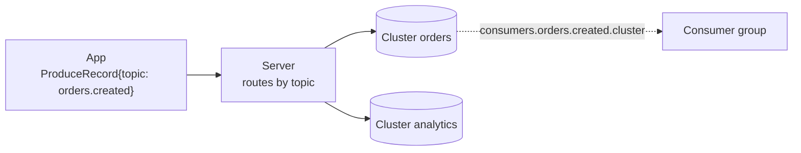
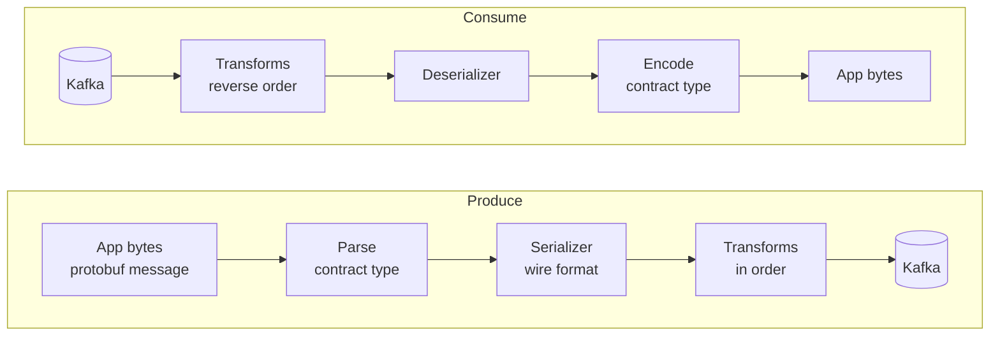

# Odradek: design

Odradek moves the Kafka client out of the application process into a separate server process. This document covers the server deployed as a sidecar container in the application's pod; "the server" below always means that process. The app talks to the server over gRPC on a Unix domain socket and names only topics; which Kafka cluster a topic lives on, and how to connect to it, is the server's configuration.

The design goal is that an app using the server keeps the guarantees it would have with an in-process client. Where it cannot, the difference is named explicitly (section 11).

Contracts:

- App-facing API: [`api/odradek/kafka/v1/odradek.proto`](../api/odradek/kafka/v1/odradek.proto)
- Configuration schema: [`api/odradek/config/v1/config.proto`](../api/odradek/config/v1/config.proto)

## 1. Scope

In scope:

- Produce with broker-ack semantics, per-stream ordering, deduplication of app resends, bounded buffering.
- Consume with consumer groups, app-driven offset commits, rebalance propagation, hung-app detection.
- Several Kafka clusters behind one server, with topic routing owned by the configuration. A topic can be produced to more than one cluster.
- Per-topic record codecs: the format stored in Kafka and transforms such as encryption are server configuration and extension classes, unknown to the app (section 7).
- Configuration read from a mounted volume and applied without restart, including mTLS credential rotation.
- One Java server binary and a thin Java client library.

Deferred:

- Transactions / exactly-once (section 12).
- Client libraries for other languages.
- Shared-memory transport. Broker acknowledgements dominate latency; revisit only if profiles show IPC cost.

## 2. Architecture


| Component | Responsibility |
|---|---|
| `//api` | The two proto contracts. The only thing another language needs. |
| `//server` | Owns all Kafka clients, topic routing, credentials and the settings the guarantees depend on. |
| `//client/core` | The client protocol as a state machine without I/O: sequence numbers, the window, resends, credits, acks. Shared by the JVM clients and checked by the scenarios in `//conformance`. |
| `//client/java` | Binds the core to grpc-java. Exposes `send() -> CompletableFuture` and a handler-based consumer. |
| `//extension/java` | The interface extension jars implement for codec transforms. Serializers use Kafka's own interfaces. |

### Server internals

- **Transport**: grpc-java on unshaded Netty (`grpc-netty`, never `grpc-netty-shaded`) with the epoll native transport (`netty-transport-native-epoll`, `linux-x86_64` and `linux-aarch_64`). The server binds a Unix domain socket, mode `0660`, on an `emptyDir` shared by both containers. Peer UID/GID are checked with `SO_PEERCRED` against an allow-list.
- **Health service**: the standard gRPC health service (`grpc.health.v1.Health/Check`) on a TCP port of its own (default 9464), for kubelet's gRPC probes, which cannot target a Unix socket. The port serves nothing else. Service `""` is `SERVING` when the server can do its work and `NOT_SERVING` otherwise; service `liveness` is `SERVING` while the process runs. The response carries no reason, so each change of state is logged with it. The same service is offered on the app's Unix socket. `Watch` is not offered. Metrics do not need a port: they are pushed over OTLP.
- **Threading**:
  - One shared `KafkaProducer` (thread-safe) per cluster. Each Produce stream calls `send()` from its own serialized gRPC callback, with manual inbound flow control (`request(1)`), so arrival order equals `send()` order.
  - One `KafkaConsumer` per Consume stream, owned by a dedicated poll thread. gRPC control messages (`Credits`, `Ack`, `RevokeDone`) are queued to that thread; nothing else touches the consumer.
  - In a dispatcher, one `KafkaConsumer` per cluster and consumer group that sidecars have declared, owned by a thread of its own together with the group's dispatch cores and `Deliver` streams (see Dispatcher).
  - A Consume stream whose topics are received from a dispatcher has no `KafkaConsumer`. It has a thread of its own all the same, which owns the stream's `Deliver` streams to the dispatcher and everything it knows about them (see What a receiving sidecar does).

### Lifecycle

- The server runs as a native sidecar: an `initContainer` with `restartPolicy: Always`.
- **Startup**: health service `""` is the `startupProbe` and the `readinessProbe`. Its port is up before anything that can take time, and it answers `NOT_SERVING` while the server starts. In order, the server:
  1. loads its first credentials, those of its clusters and those of the delivery port (with a SPIFFE source, it waits for the first SVID);
  2. asks every cluster with `required: true` for its metadata (an Admin client's `describeCluster`, built from the cluster's shared `properties` and its `tls`), one cluster at a time in name order, retrying until each answers;
  3. listens on the Unix socket and, in a dispatcher, on the delivery port;
  4. answers `SERVING`. The app container starts after that.
- **A server that only dispatches** (a `dispatch` section, no `producers` and no `consumers`) does not open the Unix socket: no app runs next to it, and the socket's directory, a volume shared with the app, normally does not exist in its pod. `listener` is then ignored. It is ready when its delivery port is up, whether or not a sidecar is connected.
- **Waiting for a required cluster**: the socket does not exist until every required cluster has answered, so an app never talks to a server that has not reached the clusters it must have. While waiting, the reason for `NOT_SERVING` names the cluster (`starting: waiting for cluster orders`). An attempt times out after 10 seconds and the next follows a second later. The reason for a failure is logged when it differs from the previous one, and the wait itself every 30 seconds. The server neither gives up nor exits: the `startupProbe`'s `failureThreshold` is what bounds the wait, and kubelet restarts the container when it is exceeded. Clusters that are not required are not contacted at startup.
- **The dispatcher is not waited for.** A server that receives topics from a dispatcher connects to it when an app subscribes, not before, and is ready whether or not it can be reached: an app that only produces must be able to start. While the dispatcher is away the app's Consume stream is open and receives nothing.
- **Startup only**: a required cluster that becomes unreachable later does not change readiness. Producing and consuming report their own errors, and taking the pod out of service for a broker blip would turn a partial failure into a full one.
- **Readiness afterwards**: `""` goes back to `NOT_SERVING` when a certificate in use has expired (a cluster's client certificate, the certificate of a dispatcher's delivery port, or the one a server presents to its dispatcher), which means whatever renews it has stopped (files not replaced, or the Workload API unreachable for an SVID's lifetime), and when shutdown begins.
- **App readiness**: the client library reports ready only while it holds a session whose handshake has completed.
- **Shutdown**: the server receives SIGTERM after the app container exits. It stops accepting streams, completes in-flight produce results, `flush()`es, commits acked offsets, leaves its groups and exits. `terminationGracePeriodSeconds` must cover app drain plus `delivery.timeout.ms`.
- **Shutdown of a server that receives from a dispatcher**: for each Consume stream it grants the dispatcher nothing more, passes on the acknowledgements the app has sent, half-closes its `Deliver` streams and ends the app's stream with `UNAVAILABLE`. The half-close is a clean leave: the dispatcher delivers again, under the same attempt numbers, what the app held. It waits up to 5 seconds for the dispatcher to close the streams.
- **Shutdown of a dispatcher**: it stops accepting `Deliver` streams, stops sending, waits up to `consume.revokeDeadline` for the acknowledgements of what its sidecars hold, commits, ends the streams with `UNAVAILABLE` and leaves its groups. `terminationGracePeriodSeconds` must cover `consume.revokeDeadline` plus the commits (the server allows itself 15 seconds more).
- **Server restart with the app alive**: the app reconnects, sees a new `server_epoch`, and fails every unacknowledged send with *outcome unknown*. Consumers get a fresh assignment; unacked records are redelivered.
- **App restart with the server alive**: produce sessions idle out; consume streams close, which triggers a commit of acked offsets and a group leave.

### Metrics

Metrics are pushed over OTLP/gRPC to the collector named by `telemetry.endpoint`, every `telemetry.exportInterval` (default 30 s) and once more at shutdown. Without an endpoint nothing is exported. The server uses the OpenTelemetry SDK, with the exporter running on the gRPC and Netty the server already has. Every metric carries the resource attribute `service.name` (`odradek`) and whatever `telemetry.resourceAttributes` adds.

| Metric | Kind | Attributes | Meaning |
|---|---|---|---|
| `odradek.produce.records` | counter | `topic`, `outcome`, `error.code` | Records answered to the app. `error.code` is the code the app got |
| `odradek.produce.cluster.writes` | counter | `topic`, `cluster`, `required`, `outcome` | Writes of a record to one cluster. The only trace of a failure on a best-effort cluster |
| `odradek.produce.streams` | up-down counter | | Open Produce streams |
| `odradek.consume.records` | counter | `topic` | Records delivered to the app |
| `odradek.consume.decode.errors` | counter | `topic` | Records the topic's codec could not decode |
| `odradek.consume.streams` | up-down counter | `cluster`, `group` | Open Consume streams. Each is a Kafka consumer in its group, unless its topics are received from a dispatcher |
| `odradek.consume.stream.ends` | counter | `cluster`, `group`, `reason` | Consume streams ended, by gRPC status. `ABORTED` is an app that stopped acknowledging; `FAILED_PRECONDITION`, `PERMISSION_DENIED` and `UNIMPLEMENTED` include a declaration the dispatcher refused |
| `odradek.consume.rebalances` | counter | `cluster`, `group`, `event` | Rebalance callbacks: `assigned`, `revoked`, `lost` |
| `odradek.dispatch.receivers` | up-down counter | `cluster`, `group`, `topic` | Open `Deliver` streams: the sidecars a dispatcher hands the topic's records to |
| `odradek.dispatch.records` | counter | `cluster`, `group`, `topic` | Records a dispatcher sent to sidecars. A record sent again is counted again |
| `odradek.dispatch.redeliveries` | counter | `cluster`, `group`, `topic` | Of those, the records that had been sent before: after a missed deadline, a rejection, or a sidecar that went away |
| `odradek.dispatch.in_flight` | up-down counter | `cluster`, `group`, `topic` | Records sent to a sidecar and not yet acknowledged, rejected or expired |
| `odradek.dispatch.partitions.blocked` | up-down counter | `cluster`, `group`, `topic` | Partitions stopped at a record that used all its attempts |
| `odradek.receive.streams` | up-down counter | `cluster`, `group`, `topic` | `Deliver` streams this server holds to dispatcher replicas, declaration accepted. Zero with an open Consume stream means the dispatcher cannot be reached |
| `odradek.receive.records` | counter | `cluster`, `group`, `topic` | Records received from a dispatcher. A record received again is counted again |
| `odradek.receive.rejects` | counter | `cluster`, `group`, `topic` | Records returned to the dispatcher because the topic's codec could not decode them |
| `odradek.receive.reconnects` | counter | `cluster`, `group`, `topic` | `Deliver` streams opened again after one was lost, or refused for the time being |
| `odradek.tls.certificate.not_after` | gauge, seconds since the epoch | `cluster` or `delivery` | When the certificate in use expires |
| `odradek.tls.credential.reloads` | counter | `cluster` or `delivery` | Times new credentials replaced the ones in use, the first load included |
| `odradek.tls.credential.reload.failures` | counter | `cluster` or `delivery` | Times new credentials were rejected or could not be fetched |
| `odradek.ready` | gauge | | 1 when the health service answers `SERVING`, 0 otherwise |

The Kafka clients' own metrics are exported too, from an allow-list: Kafka has hundreds, and the per-node and per-topic ones multiply. Each is read from the client on every collection, so its value and its window are Kafka's (an `avg` or a `max` covers Kafka's sample window, 30 s by default, and is absent while there are no samples).

| Metric | Kind | Attributes | Kafka metric |
|---|---|---|---|
| `odradek.kafka.consumer.records.lag` | gauge, records | `cluster`, `group`, `topic`, `partition` | `records-lag`: records between the partition's end and the consumer's position, as of its last fetch |
| `odradek.kafka.consumer.records.lag.max` | gauge, records | `cluster`, `group` | `records-lag-max` |
| `odradek.kafka.consumer.commit.latency.avg`, `.max` | gauge, ms | `cluster`, `group` | `commit-latency-avg`, `commit-latency-max` |
| `odradek.kafka.consumer.commits` | counter | `cluster`, `group` | `commit-total` |
| `odradek.kafka.consumer.last_poll.age` | gauge, s | `cluster`, `group` | `last-poll-seconds-ago` |
| `odradek.kafka.consumer.rebalances` | counter | `cluster`, `group` | `rebalance-total` |
| `odradek.kafka.consumer.rebalance.failures` | counter | `cluster`, `group` | `failed-rebalance-total` |
| `odradek.kafka.consumer.rebalance.latency.avg`, `.max` | gauge, ms | `cluster`, `group` | `rebalance-latency-avg`, `rebalance-latency-max` |
| `odradek.kafka.consumer.assigned_partitions` | gauge | `cluster`, `group` | `assigned-partitions` |
| `odradek.kafka.consumer.connections` | gauge | `cluster`, `group` | `connection-count` |
| `odradek.kafka.consumer.authentication.failures` | counter | `cluster`, `group` | `failed-authentication-total`, a failed TLS handshake included |
| `odradek.kafka.producer.request.latency.avg`, `.max` | gauge, ms | `cluster` | `request-latency-avg`, `request-latency-max` |
| `odradek.kafka.producer.record.error.rate` | gauge, records/s | `cluster` | `record-error-rate` |
| `odradek.kafka.producer.record.errors` | counter | `cluster` | `record-error-total` |
| `odradek.kafka.producer.record.retries` | counter | `cluster` | `record-retry-total` |
| `odradek.kafka.producer.buffer.available` | gauge, bytes | `cluster` | `buffer-available-bytes`. At zero, sends block |
| `odradek.kafka.producer.record.queue_time.avg`, `.max` | gauge, ms | `cluster` | `record-queue-time-avg`, `record-queue-time-max` |
| `odradek.kafka.producer.batch.size.avg`, `.max` | gauge, bytes | `cluster` | `batch-size-avg`, `batch-size-max` |
| `odradek.kafka.producer.connections` | gauge | `cluster` | `connection-count` |
| `odradek.kafka.producer.authentication.failures` | counter | `cluster` | `failed-authentication-total` |

- A dispatcher's consumers report the same `odradek.kafka.consumer.*` metrics, lag included: there the lag of a group is one series per partition, reported by the replica that owns it.
- The client id is not an attribute: a consumer's changes with every stream. The consumers of one group on one cluster are therefore one series. A counter, `assigned_partitions`, `connections` and `buffer.available` are their sum; every other gauge is the largest among them (the worst consumer).
- A consumer's gauges stop being reported when its stream ends, and a partition's lag when the partition is revoked. A counter keeps what closed consumers counted, so it only goes up while the server runs.
- Lag is what the consumer saw at its last fetch. A group with no open stream reports none: lag of a group nobody consumes is the broker's to report.
- The metrics reach the SDK through a Kafka `MetricsReporter` that the server adds to `metric.reporters`, after any reporter the cluster's properties name (Kafka's JMX reporter when they name none). Without `telemetry.endpoint` the reporter is not installed.

- A server that receives a topic from a dispatcher reports `odradek.consume.records`, `odradek.consume.decode.errors` (records delivered undecoded), `odradek.consume.streams` and `odradek.consume.stream.ends` for it as for any other, and the `odradek.receive.*` metrics besides. It has no Kafka consumer, so no `odradek.kafka.consumer.*` and no `odradek.consume.rebalances`: lag is the dispatcher's to report. In `odradek.receive.*`, `cluster` is the dispatcher's name for the cluster.
- The `odradek.tls.*` metrics have one series per set of credentials. Those of a cluster carry `cluster`. Those of the delivery port carry `delivery` instead, with the configuration section as its value: `dispatch.tls` on a dispatcher, `dispatcher.tls` on a server that receives from one.

Not built yet: latency histograms, configuration reload metrics, and the rest of the dispatcher's and of the receiving side's (window pauses, attempts, dead letters, declarations refused, records waiting for the app's credit).

## 3. API

- Both protos use protobuf Edition 2024. Fields have explicit presence, so "not set" is distinguishable from zero or empty (a null key, a tombstone value, an unset config field that takes its default).
- Every service, RPC, message, field and enum value carries a leading comment, so the protos are the source for generated reference documentation.
- `OdradekService` has two long-lived bidirectional streams:

| RPC | App sends | Server sends |
|---|---|---|
| `Produce` | `ProduceOpen`, then `ProduceRecord`s | `ProduceReady`, then one `ProduceResult` per record |
| `Consume` | `Subscribe`, then `Credits`, `Ack`, `RevokeDone` | `Subscribed`, then `Assigned`, `Revoked`, `Lost`, `RecordBatch` |

- The first message on each stream is the handshake, answered before anything else.
- Neither handshake names a cluster. `ProduceRecord` carries a topic; `Subscribe` carries a list of topics.
- Keys and values are bytes on the API. For a topic with a codec they are a protobuf message of the topic's contract type, independent of what is stored in Kafka (section 7).

## 4. Configuration

### Schema and validation

- The schema is the protobuf message `odradek.config.v1.ServerConfig`. There is no hand-written configuration model.
- The file is YAML (or JSON) in the protobuf JSON mapping: field names in lowerCamelCase, durations as `"30s"`, timestamps as RFC 3339. YAML is converted to JSON and parsed with the protobuf JSON parser in strict mode, so an unknown or misspelled field is an error rather than silently ignored.
- Constraints are declared in the schema with [protovalidate](https://github.com/bufbuild/protovalidate) and evaluated by `protovalidate-java`:
  - Field rules: name patterns for clusters and topics, absolute paths, port range, positive durations, `spiffe://` prefixes, mandatory fields marked `required`.
  - Cross-field CEL rules: every producer entry, every consumer entry that reads Kafka itself and every rule of the dispatcher's policy references an existing cluster; a producer lists each cluster once and has at least one that is not best effort; `bootstrap.servers` is set; a `spiffe` source has a peer policy; the default processing deadline does not exceed the maximum; the settings of a dispatched consumer are consistent; a dispatcher's policy comes with TLS on its delivery port, and the TLS to a dispatcher says who the dispatcher is (see Dispatcher).
  - The enforced Kafka settings (below) are CEL rules on `Cluster`.
- Validation reports every violation with its field path and rule id. Each rule id has a test.
- Checks that need the outside world (referenced files exist and parse, brokers reachable) run after schema validation, in code.
- A configuration is accepted or rejected as a whole. One invalid entry invalidates the file.

### Example

```yaml
# /etc/odradek/odradek.yaml
clusters:
  orders:
    required: true
    properties:
      bootstrap.servers: orders-kafka:9093
    tls:
      spiffe: {}
      acceptedSpiffeIds: ["spiffe://example.org/ns/kafka/sa/orders-broker"]
  analytics:
    required: false
    properties:
      bootstrap.servers: analytics-kafka:9093
    tls:
      files:
        dir: /etc/odradek/tls/analytics

producers:                     # keyed by topic name
  orders.created:
    clusters:                  # written to both; both must acknowledge
      - cluster: orders
      - cluster: analytics
  clickstream:
    clusters:
      - cluster: analytics

consumers:                     # keyed by topic name
  orders.created:
    cluster: orders            # required, must name an entry in clusters
    groupId: billing
  orders.cancelled:
    cluster: orders
    groupId: billing
```

### Clusters

- Each cluster has a name, Kafka client properties (shared, plus producer-only and consumer-only overrides) and an optional `tls` block.
- The name is referenced only inside the configuration. Apps never see it as a parameter; it appears to them only as information in results.
- `required: true` clusters gate startup: the server fetches their metadata before it listens and before the `startupProbe` passes (see Lifecycle). Optional clusters connect on first use. The gate is not re-evaluated after startup.
- Each cluster has its own producer, `buffer.memory`, consumers and credentials, so the container memory limit scales with the number of clusters.
- Every metric carries a `cluster` label.
- A cluster that is still referenced by a producer or consumer entry cannot be removed; such a configuration is invalid.

### Enforced Kafka settings

The server owns the settings the guarantees rest on. They may be omitted from `properties` (the server sets them) but never set to a weaker value, and the app cannot change them over the API.

| Setting | Rule |
|---|---|
| `acks` | `all` |
| `enable.idempotence` | `true` |
| `max.in.flight.requests.per.connection` | 1 to 5 |
| `enable.auto.commit` | `false` |
| `auto.offset.reset` | Must not be set; the start position is per topic (see Consumers) |
| `ssl.keystore.*`, `ssl.truststore.*`, `ssl.engine.factory.class` | Must not be set; TLS material belongs to the `tls` block |
| `partition.assignment.strategy` | Set by the server to cooperative-sticky (classic group protocol) |
| `allow.auto.create.topics` | Set to `false` on a dispatcher's consumers, whatever the properties say: a topic must not come into being because a sidecar named it |

### Producers

- `producers` is keyed by topic name. Each entry lists the cluster or clusters the topic is produced to.
- Routing is strict: there is no default. A record for a topic without an entry is rejected with `TOPIC_NOT_CONFIGURED` and never reaches Kafka; the stream stays open and other records are unaffected. The map doubles as the allow-list of topics an app may write.
- A topic may list several clusters, as equal peers with no primary. Every record is written to all of them (section 5).
- `bestEffort: true` on a cluster means its acknowledgement is not required for success. At least one cluster of a topic must not be best effort.

### Consumers

- `consumers` is keyed by topic name. Each entry fixes the cluster and the consumer group for that topic.
- The cluster reference is mandatory. A topic is consumed from exactly one cluster, even when it is produced to several.
- A `Subscribe` for a topic without an entry fails the stream with `NOT_FOUND`.
- One stream is one Kafka consumer, so all topics of a `Subscribe` must resolve to the same cluster and group; otherwise the stream fails with `FAILED_PRECONDITION`. The resolved cluster and group are returned in `Subscribed`.
- One stream has one `source`: its topics are all read from Kafka by the server or all received from a dispatcher (see Dispatcher). A `Subscribe` that mixes the two fails with `FAILED_PRECONDITION`. An app that consumes both ways opens a stream for each.
- **Start position**: for a partition where the group has no committed offset, the server positions the consumer itself:
  - `startTimestamp`, if set: the first record at or after that instant.
  - otherwise `offsetReset`: `EARLIEST` (default, never skips) or `LATEST`.

### Dispatcher

[ADR 6](adr/0006-standalone-dispatcher-for-consumption.md) adds a second way to consume: a standalone deployment of the server, the dispatcher, is the consumer group and delivers records to the sidecars. Steps 1 to 5 of its plan exist: the schema, the `odradek.delivery.v1` protocol, the dispatch core, the dispatcher itself, the sidecar's side, and mutual TLS with the policy on the delivery port. An app whose topics have the dispatcher as their `source` consumes them on the same `Consume` stream as before, and its sidecar has no Kafka consumer for them.

> **A dispatcher runs as one replica only so far**: a replica tells sidecars about itself alone, so with two of them a sidecar would see the partitions of one. Membership is step 6. Dead-lettering is step 7. And **without `dispatch.tls` it is for tests**: see Security of the delivery port.

A server that acts as a dispatcher has a `dispatch` section:

| Field | Meaning | Default |
|---|---|---|
| `port` | TCP port of `DeliveryService`, which sidecars connect to | 9465 |
| `advertisedAddress` | `host:port` at which sidecars reach this replica | The pod's interface address and `port` |
| `idleGrace` | How long a topic is still consumed after the last sidecar that declared it has gone | 5m |
| `partitionWindow` | Largest span, in offsets, between a partition's commit position and its newest delivered record | 1000 |
| `tls` | Mutual TLS on the delivery port: a credential source, `spiffe` or `files`, as for a cluster (section 9) | Unset: plaintext, for tests |
| `policy` | Rules saying who may consume what; a declaration that no rule allows is refused. Needs `tls` | With `tls`, no rule: everything is refused |

A rule of `policy` names the sidecars it applies to (`spiffeIds`, `trustDomain`, at least one of the two), one `cluster` of `clusters`, and patterns for the `topics`, the `groups` and, optionally, the `deadLetterTopics` it allows. A pattern is an exact name, or a prefix followed by one `*`; `*` alone matches every name. A declaration is allowed when one rule allows all of it; two rules that each allow a part do not add up.

A server that receives from a dispatcher has a `dispatcher` section:

| Field | Meaning | Default |
|---|---|---|
| `address` | `host:port` of the dispatcher's Service | Required |
| `tls` | Mutual TLS to the dispatcher: a credential source, and `acceptedSpiffeIds` or `acceptedTrustDomain`, which say who the dispatcher is. One of the two is required, whatever the source | Unset: plaintext, for tests |

And on each `consumers` entry concerned:

| Field | Meaning | Default |
|---|---|---|
| `source` | `CONSUMER_SOURCE_KAFKA`: the server reads Kafka itself. `CONSUMER_SOURCE_DISPATCHER`: a dispatcher hands it the records | `CONSUMER_SOURCE_KAFKA` |
| `ordering` | `ORDERING_KEY`, `ORDERING_PARTITION` or `ORDERING_NONE` | `ORDERING_KEY` |
| `maxAttempts` | Deliveries of a record before it is given up on | No limit |
| `onExhausted` | `ON_EXHAUSTED_BLOCK` or `ON_EXHAUSTED_DEAD_LETTER`; needs `maxAttempts` | `ON_EXHAUSTED_BLOCK` |
| `deadLetterTopic` | Where exhausted records are written; set exactly when dead-lettering | — |

- The last four are rejected on a consumer that reads Kafka itself.
- A delivery fails, and uses one of `maxAttempts`, when the record is not acknowledged within the processing deadline or cannot be decoded. A record delivered again because its sidecar went away has not used one.
- `cluster` and `groupId` stay mandatory. On a dispatched consumer `cluster` is a name in the dispatcher's configuration and need not exist under `clusters`.
- `clusters` needs at least one entry, except in a server with a dispatched consumer: one that receives everything it consumes and produces nothing talks to no broker.

```yaml
# The dispatcher
clusters:
  orders:
    properties:
      bootstrap.servers: orders-kafka:9093
dispatch:
  tls:
    spiffe: {}                 # its own SVID, and the bundles sidecars are verified against
  policy:
    - spiffeIds: ["spiffe://example.org/ns/billing/sa/billing"]
      cluster: orders
      topics: ["orders.*"]
      groups: [billing]
      deadLetterTopics: ["billing.dlq.*"]
```

```yaml
# The sidecar of an application pod
dispatcher:
  address: odradek-dispatcher.kafka.svc:9465
  tls:
    spiffe: {}                 # the pod's SVID: the identity the policy goes by
    acceptedSpiffeIds: ["spiffe://example.org/ns/kafka/sa/odradek-dispatcher"]
consumers:
  orders.created:
    source: CONSUMER_SOURCE_DISPATCHER
    cluster: orders            # resolved by the dispatcher
    groupId: billing
    maxAttempts: 5
    onExhausted: ON_EXHAUSTED_DEAD_LETTER
    deadLetterTopic: billing.dlq.orders
```

#### What a dispatcher does

A server with a `dispatch` section serves `DeliveryService` on `dispatch.port` (`server/dispatch`: `DeliveryServer`, `DispatchService`, `DispatchGroup`). It has no list of topics: it consumes what the connected sidecars declare.

- **Declarations.** The first message of a `Deliver` stream names a cluster, a consumer group and a topic, and says how the topic is to be consumed. It is refused, by ending the stream, with:

  | Status | When |
  |---|---|
  | `INVALID_ARGUMENT` | The first message is not `Declare`; a name or the processing deadline is missing; a setting has a value the dispatcher does not know; the dead-letter topic and `on_exhausted` contradict each other |
  | `UNAUTHENTICATED` | The delivery port has TLS and the sidecar's certificate carries no SPIFFE ID to authorize. Said before anything else, whatever the first message is |
  | `PERMISSION_DENIED` | The policy has no rule that allows this identity this topic in this group on this cluster, with the dead-letter topic it names; or the cluster is not one of the dispatcher's. One message for every reason (see Security of the delivery port) |
  | `UNIMPLEMENTED` | `ON_EXHAUSTED_DEAD_LETTER`, until step 7. `ON_EXHAUSTED_BLOCK` works |
  | `FAILED_PRECONDITION` | The group already consumes the topic with other settings, declared by a sidecar that is still connected. The message gives the settings in force and those declared |
  | `UNAVAILABLE` | The dispatcher is starting or stopping, or its consumer for the group failed |

- **Settings in force.** The first declaration for a group and topic fixes them, with every default filled in, and `Accepted` returns them. They hold while a sidecar holds the topic. Once none does, a declaration with other settings is accepted: the dispatcher commits where the topic stands and starts again from there with the new settings.
- **The processing deadline is not one of them.** It comes from the application, so it differs between two versions of it during a rollout. It takes no part in the comparison; the dispatcher applies the deadline of the declaration it accepted last to the records it sends from then on, and a record already sent keeps the one it was sent under. With old and new pods connected, the deadline is whichever declared last.
- **One Kafka consumer per cluster and group**, created by the first declaration for it and subscribed to the topics declared for the group, with one dispatch core per topic. It is built like the consumers of the consume path: the cluster's properties, the enforced settings, the cluster's `tls`, the cooperative-sticky assignor, and the Kafka metrics reporter. `allow.auto.create.topics` is forced off.
- **A newly declared topic** is added to the subscription of the group's consumer, which rebalances the group. The partitions the replica already has are not taken from it, so the topics already consumed go on, with nothing delivered twice.
- **A topic with no stream** is still consumed for `dispatch.idleGrace` (its records are fetched up to the buffer bound and wait), so that a rollout of the application does not make the dispatcher leave the group. After that its positions are committed and it leaves the subscription; a sidecar that declares it again starts from what is committed. A group with no topic left closes its consumer.
- **Receivers.** Each stream is one receiver of its topic's core: credits, acknowledgements and rejections go to the core, and the core's deliveries come back as `RecordBatch` messages carrying the bytes stored in Kafka, the headers and the attempt number. The dispatcher applies no codec. Deliveries to one stream are gathered into a batch while they are of one partition and their offsets increase; a record delivered again behind a newer one starts a new batch. A batch has at most 500 records and about 1 MiB.
- **A stream that ends is a receiver that left**, whether the sidecar closed it, vanished, or broke the protocol. What it held is delivered again under the same attempt numbers. A sidecar that vanishes without closing its connection is noticed by HTTP/2 keepalive (a ping after 30 seconds of silence, 10 seconds to answer).
- **Start position.** A partition is dispatched from the group's committed offset. Without one, from the first record at or after the declared start timestamp, or else from the declared offset reset. The dispatcher positions the consumer itself (`auto.offset.reset=none`), and commits the position it found at the next interval, so that a restart does not look for it again and, under `LATEST`, skip what arrived in between. A committed offset that retention has removed is treated as none, by the offset reset.
- **Commits** are those of the consume path: asynchronously every `consume.commitInterval`, for the partitions whose position moved; synchronously for partitions being given up and when the consumer is closed. A failed asynchronous commit, which is normal while the group rebalances, is retried at the next interval.
- **Rebalance.** In `onPartitionsRevoked` the cores stop sending for the revoked partitions and wait, up to `consume.revokeDeadline`, for the acknowledgements of what is in flight, which are still handled; then the positions are committed and the sidecars still holding records of those partitions get `Released`. Lost partitions are dropped without a commit. `max.poll.interval.ms` is kept above the revoke deadline plus 30 seconds.
- **Backpressure.** A partition whose fetched and never delivered records reach 1000 records or 4 MiB is paused on the consumer, and resumed at half. These two bounds are constants: what bounds memory and redelivery is `dispatch.partitionWindow`, and how much a fetch brings is Kafka's own `max.partition.fetch.bytes` and `max.poll.records` in the cluster's properties. The poll thread never waits for a sidecar, so the consumer is polled, and stays in the group, whatever the sidecars do.
- **A blocked partition** is logged and counted (`odradek.dispatch.partitions.blocked`). Nothing resumes it but a change of owner, which today means restarting the dispatcher.
- **Replicas.** `Accepted` lists this replica alone, at `dispatch.advertisedAddress`, under generation 1, and gives the same address as the replica that answered (`Accepted.address`), which is how a sidecar that came through the Service's address knows which of the listed replicas it already has a stream to. The default address is that of the pod's network interface: the first address of an interface that is up which is neither loopback nor link-local, IPv4 before IPv6.

**Threads.** One thread per cluster and group owns the Kafka consumer, the cores of the group's topics and its streams. It is the only one to touch the consumer and the cores, and the only one to write to a stream once its declaration has been checked. gRPC threads check a declaration and queue commands for it. The thread waits on that queue, for at most 10 ms when nothing happens, and polls the consumer without blocking: an acknowledgement is acted on when it arrives, not at the end of a poll, which matters under `ORDERING_KEY`, where the next record of a key waits for it.

**Known limits**, beyond those in the box above:

- A rejected record is delivered again at once. A sidecar therefore keeps a record it cannot decode for a second before rejecting it (see What a receiving sidecar does); a client of `DeliveryService` that does not would, without `maxAttempts`, send such a record round as fast as the network allows. Rejections are logged at most once per topic every 10 seconds.
- An error that Kafka reports for one topic of a group (a topic the dispatcher may not read, for example) ends every stream of the group with `UNAVAILABLE`. The sidecars reconnect, and the group fails again while the topic is declared.
- A sidecar's credit bounds what is written to its stream, not what it reads: a sidecar that grants credit and stops reading holds that many records in the dispatcher's memory until its connection is closed.

#### Security of the delivery port

`Deliver` streams run over mutual TLS when both ends configure it: `dispatch.tls` on the dispatcher, `dispatcher.tls` on the server that receives. The credentials come from the sources of section 9, `files` or `spiffe`, loaded and kept current by the same code as a cluster's (`server/tls`: `TlsSources`, `ReloadingSslContext`, `PeerTrust`).

**The handshake.** TLS 1.3 only, with the JDK's TLS, because both ends are this server. Identities are SPIFFE IDs: the one URI subject alternative name of a certificate. No host name is ever checked, since a sidecar connects to replicas by IP address.

| End | Presents | Accepts |
|---|---|---|
| Dispatcher | The certificate of `dispatch.tls` | Any client certificate that verifies. With a `spiffe` source: one that carries a SPIFFE ID and chains to the bundle of the trust domain that ID names, federated bundles included, so that an authority federated with vouches only for its own identities. With `files`: one that chains to the CA bundle. A connection without a client certificate is closed |
| Sidecar | The certificate of `dispatcher.tls` | A certificate that verifies the same way and whose SPIFFE ID is in `acceptedSpiffeIds` or in `acceptedTrustDomain`. Every replica must present one: the check is made on the connection to the Service's address and on each connection to a replica |

- The dispatcher's handshake does not consult the policy. A sidecar the policy has no rule for completes the handshake and is refused when it declares, with a status and a message; a handshake can only fail, and the sidecar could not tell why.
- **A handshake that fails is not an answer.** Whichever end refuses, and for whatever reason (no certificate, an authority that is not trusted, an identity that is not accepted, one end speaking plaintext), gRPC reports `UNAVAILABLE` on the sidecar: the dispatcher was not reached. The sidecar opens the stream again with its usual backoff and the app's stream stays open, as while a dispatcher is away; the reason is in the sidecar's log, at each attempt. This is deliberate. During a rotation a handshake can fail for a moment (one end has the new authority and the other does not yet), and whoever can answer at the dispatcher's address without being the dispatcher must not be able to end an app's stream. `UNAUTHENTICATED` and `PERMISSION_DENIED`, which do end it, are only ever said by a dispatcher whose identity the sidecar has verified.

**Authorization.** The dispatcher authorizes each declaration by the SPIFFE ID of the connection it arrives on, against `dispatch.policy` (`Policy`).

- A certificate without a SPIFFE ID (possible only with a `files` source) names nobody: `UNAUTHENTICATED`.
- Whatever no rule allows is `PERMISSION_DENIED`, with one message whatever the reason: `<SPIFFE ID> is not allowed to consume topic <t> in group <g> on cluster <c>`, and `with dead-letter topic <d>` when the declaration names one. It is made of who asked and what was asked, so it tells a sidecar nothing of the clusters the dispatcher has, of the rules of other identities, or of which part of its own rule failed. The dispatcher logs each refusal.
- A malformed declaration is `INVALID_ARGUMENT` before the policy is consulted: that answer is the same for everyone.
- The dead-letter topic is checked with the rest, before the answer that dead-lettering is not built (step 7).
- **A declaration is authorized when it is made.** A stream that was accepted stays until it ends: a policy change needs a restart of the dispatcher anyway (`dispatch` is not hot-reloadable), which ends every stream, and a certificate that expires or is revoked while its connection is open is not looked at again, as TLS does not re-validate a live connection.

**Rotation.** grpc-netty takes one Netty `SslContext` for the life of a listener or channel, and Netty's contexts are immutable. `ReloadingSslContext` is a context that only points at another: each time grpc-netty asks it for an engine, which is once per connection, it answers from a context built from the `CredentialSource`'s snapshot of that moment, built once per snapshot. So:

- a rotated certificate or trust bundle is used from the next handshake on, on both ends;
- the listener is not restarted and no channel is rebuilt;
- a connection that is open keeps the session it negotiated, and its streams go on;
- a context per snapshot is also a TLS session cache per snapshot, so a connection made after a rotation cannot resume a session from before it: the certificate a peer is seen with is one it presented in that handshake.

A sidecar makes its connections when an app subscribes, so a pod presents its newest certificate to the dispatcher on each new Consume stream and on each reconnection, not before.

**Readiness and metrics.** The credentials of the delivery port are loaded with the clusters', before the server listens: a dispatcher whose `dispatch.tls` cannot be loaded does not start, and neither does a sidecar whose `dispatcher.tls` cannot. Once started, an expired certificate of either makes the health service answer `NOT_SERVING` (`dispatch.tls: the certificate expired at …`), as a cluster's does. The three `odradek.tls.*` metrics report them under the attribute `delivery`, whose value is the section: `dispatch.tls` or `dispatcher.tls`.

**Plaintext.** Each end is plaintext when its `tls` is unset, and says so in a warning every time it starts. It exists for tests and for a machine nobody else can reach.

- A dispatcher without `dispatch.tls` accepts every well-formed declaration that names one of its clusters: whoever reaches the port reads every topic the dispatcher's Kafka credentials can.
- **`dispatch.policy` without `dispatch.tls` is rejected when the configuration is loaded** (`dispatch.policy_requires_tls`), and the server exits with status 2. Nobody has an identity on a plaintext port, so such a policy would either match no one or be ignored. Refusing to start was chosen over refusing every declaration: the mistake shows where it was made, in the dispatcher's rollout, and not as `PERMISSION_DENIED` in every application's logs; and a configuration that reads as protected is never served unprotected.
- With `dispatch.tls` and no rule, the dispatcher starts, warns, and refuses every declaration.
- The two ends must agree. A sidecar with `dispatcher.tls` does not talk to a plaintext dispatcher, nor a plaintext sidecar to a dispatcher with TLS: both are handshakes that fail.

**Not covered.** Certificates without SPIFFE IDs match no rule (ADR 6, Open). Nothing bounds how long a connection, and so an identity, lives: a pod whose identity was withdrawn keeps its open streams until they end. The policy is not hot-reloadable.

#### What a receiving sidecar does

A `Subscribe` whose topics have the dispatcher as their `source` is served by `server/receive` (`ReceiveService`, `ReceiveSession`) instead of a Kafka consumer. `Subscribed` is sent at once, with the cluster and group of the consumer entry and the processing deadline resolved as for any stream. The app cannot tell the difference, except by what follows.

- **Streams.** One `Deliver` stream per topic and dispatcher replica, opened when the app subscribes and closed when its stream ends. Each declares the entry's `cluster`, `groupId` and topic, its `ordering`, `offsetReset`, `startTimestamp`, `maxAttempts`, `onExhausted` and `deadLetterTopic` (what the entry leaves unset is left to the dispatcher's defaults), the app's processing deadline, and the server's version.
- **Finding the replicas.** The first stream of each topic goes to `dispatcher.address`. `Accepted` carries the list of replicas and the address of the one that answered (`Accepted.address`): if that address is on the list, the stream is the stream to that replica, and one is opened to each of the others; if it is not, or is missing, every listed replica gets a stream of its own and the first one is closed. A `ReplicaList` that arrives later, on any stream, replaces the list when its generation is higher: streams are opened to replicas that are new and closed to those no longer listed. A list whose generation is not higher is ignored. Replica addresses are connected to as given, with the same `dispatcher.tls` as the first connection: every connection is made in one place (`ReceiveService.connect`).
- **Lost streams.** A stream that ends with `UNAVAILABLE`, which includes every TLS handshake that failed (see Security of the delivery port), or with anything else that is not a refusal for good, is opened again at the same replica while that replica is listed, after a delay that doubles from 100 ms to 5 s, each delay drawn at random from the upper half of its step (the backoff of the client libraries). When no stream is left, open or being opened, the list and its generation are forgotten and the server starts again from `dispatcher.address`. Meanwhile the app's stream stays open and receives nothing.
- **Refusals for good.** `FAILED_PRECONDITION` (the group consumes the topic with other settings), `PERMISSION_DENIED`, `UNAUTHENTICATED`, `INVALID_ARGUMENT` and `UNIMPLEMENTED` would be met again by a new stream. The app's stream ends with the same status and a message that names the dispatcher's address, the topic, the group and the cluster, followed by what the dispatcher said. The client libraries treat all five as fatal. All five are answers of a dispatcher that was reached, and, with TLS, verified: gRPC itself reports a connection that could not be made or secured as `UNAVAILABLE`, never as one of these.
- **Decoding.** Records arrive as stored in Kafka and are decoded with the topic's codec, as on the consume path. A record that cannot be decoded follows the entry's `onDecodeError`: with `DELIVER_UNDECODED` it is delivered as stored with `decode_error` set, and acknowledged by the app like any other; with `FAIL`, where a consumer that reads Kafka ends the stream with `DATA_LOSS`, it is rejected to the dispatcher, which counts a failed attempt, and the stream stays. The rejection is sent one second after the record arrived, so that a record nobody can decode, on a topic with no `maxAttempts`, goes round once a second per sidecar and not as fast as the network allows. Rejections are logged at most once per topic every 10 seconds.
- **No Kafka client.** The server commits nothing and holds no consumer for these topics. A server whose consumers are all received, and which produces nothing, needs no entry under `clusters`.

**Partitions, epochs and acknowledgements.** The app's protocol speaks of assigned partitions; a pod that receives from a dispatcher owns none. What stands in for ownership is the stream that last delivered a partition's records (`Holdings`):

| Event | What the app is sent |
|---|---|
| The first record of a partition is about to be delivered | `Assigned` for that partition, with a new epoch, then the records |
| The dispatcher sends `Released` for a partition the app holds records of | `Lost` for it. What the app held is delivered again by the dispatcher |
| A `Deliver` stream ends, or is closed because its replica left the list | `Lost` for every partition whose records came from it |
| A record of a partition arrives on another stream than the one that delivered it so far | `Lost`, then `Assigned` with a new epoch, then the record: another replica owns the partition now, whether or not the first has said so yet |
| Never | `Revoked` |

- An epoch therefore names one stream, and every record held under it came from that stream. Epochs count up from 1 over the Consume stream; a partition that comes back after `Lost` gets a new one, so an acknowledgement under the old one is recognizable and dropped, by the client core and by the server.
- **An acknowledgement** is a range of one partition under an epoch. The server passes on the records of the range that it delivered under that epoch and that are not acknowledged yet, to the stream they came from, as the fewest ranges of consecutive offsets. It never passes on the app's range as such: the offsets between two of this app's records went to other pods, and one of them, rejected here, may be on its way back, where a range spanning it would acknowledge it unprocessed.
- An acknowledgement for anything no longer held (released, its stream gone, an earlier epoch, never delivered here) is dropped. The dispatcher delivers the record again, or it is not this pod's to speak for.
- A record that the dispatcher delivers a second time to the same pod, because its deadline passed, is handed to the app again and held once. A late acknowledgement is passed on like any other; the dispatcher counts it if the record is still unacknowledged.

**Credit** (`CreditSplit`). The app grants credit for its whole stream, and a credit granted to a replica cannot be taken back. So no `Deliver` stream is given the app's credit to keep:

- **One stream wanted** (one topic, one replica): everything the app grants is passed on. There is nothing else that could need it.
- **Several**: each has a window, the most it may have outstanding. A window starts at 1 and doubles each time its stream uses all it had outstanding, up to the app's budget divided by twice the number of streams, the budget being what the app can still take. What the app granted beyond the windows stays in the server until a record arrives, and is granted where it arrived. A stream with nothing to send thus holds one credit, a stream that was busy at most its share of half the budget, and the other half always follows the records.
- **A stream with nothing outstanding gets one credit even when the budget is all promised**, as long as the app can take a record at all: otherwise an app that asks for one record at a time would give its only credit to one stream and never hear of the others. Records that arrive for credit the app did not grant wait in the server; such a credit is granted only while the credits outstanding exceed the budget by less than the number of streams less one, which is therefore the most records the server holds beyond what the app asked for. They are on the dispatcher's clock while they wait.
- The number of streams is the number wanted, topics times listed replicas, not the number open: while one of two is being opened again, the other keeps to its window.

**An app that stops acknowledging.** A consumer that reads Kafka ends the stream with `ABORTED` when a record is held past the processing deadline (section 6). Here the dispatcher is the authority: it delivers the record again, to this pod or another, on its own clock, and the app's stream is not ended. What the server does is stop asking: while the app has held any record for longer than the deadline, the dispatcher is granted no more credit on that Consume stream, since every record sent to such an app would wait out its deadline before another pod got it. Credit flows again when the app has acknowledged every overdue record; the change is logged both ways. An app that loses a record and never acknowledges it is therefore not told, as it is by `ABORTED`: its pod receives nothing more until its stream is opened again.

**Threads.** One thread per Consume stream owns the stream's state, the writes to the app and the writes to its `Deliver` streams. gRPC threads, the app's and the dispatcher's, only queue events for it. It waits on that queue, and on the timers of the streams to open again and the rejections to send.

**Known limits** of the receiving side:

- With several streams, a stream that was busy and went quiet keeps what its window had outstanding, up to its share of half the app's budget, until it is opened again.
- A record waiting in the server for the app's credit is not visible in a metric yet.
- There is one connection per address and Consume stream: streams of different Consume streams do not share one, and each makes its own TLS handshake.

#### Dispatch core

`DispatchCore` (`server/dispatch`) is the dispatcher's decision logic with no I/O, in the manner of the client core: events in (partitions assigned, revoked or lost; records fetched; receivers joining, leaving and granting credit; acknowledgements, rejections; dead letters written or failed; time passing), actions out (deliver, commit, dead-letter, pause and resume fetching, tell a receiver to drop a partition's records, partition released, partition blocked or unblocked). One instance covers one topic of one consumer group on one replica. It settles what the ADR left open:

- **Commit position.** The offset of a partition's oldest unacknowledged record, or one past the last fetched record when there is none; offsets that hold no record are not waited for. `Commit` is emitted each time an acknowledgement moves it, and how often to commit is the caller's business.
- **Window.** A record is delivered for the first time only while its offset is less than the window above the commit position. The oldest unacknowledged record is therefore always deliverable.
- **Fetching** of a partition pauses when its never-delivered records reach a bound, in records or bytes, and resumes at half.
- **Redelivery.** After a rejection or a missed deadline the record goes to a different receiver if one has credit at that moment, and back to the same one otherwise. Within a partition the lowest offset is sent first, and under `key` and `partition` ordering a record waiting to be redelivered holds back what it constrains.
- **Attempts.** A rejection and a missed deadline each use one. A receiver that leaves uses none: what was in flight to it is delivered again under the same attempt number. Otherwise rolling the application, with a limit and `ON_EXHAUSTED_BLOCK`, could block partitions through no fault of the records. An attempt number of 1 therefore does not promise that no application has seen the record.
- **Processing deadline.** The one setting that can change while the core runs. A record keeps the deadline in force when it was sent.
- **Late acknowledgement.** A receiver whose record passed its deadline still holds it, and its acknowledgement counts for as long as the record is unacknowledged, even if another receiver has been sent it since: the record was processed. The second copy is a duplicate, and its acknowledgement is ignored.
- **Blocked partition.** An exhausted record with `ON_EXHAUSTED_BLOCK` is not delivered again, the commit position stays at it, and nothing after it in its partition is sent, for the first time or again. Records before it are still delivered and committed. It stays blocked until the partition is revoked or lost, which also resets the attempt counts, or until a receiver that held the record past its deadline acknowledges it.
- **Hand-over.** A revoked partition stops sending at once and is released when nothing of it is in flight or being dead-lettered, or after a bounded wait; receivers still holding its records are then told to drop them. A lost partition is dropped without a commit.

## 5. Produce path

### Routing

A Produce stream is not bound to a cluster. Each record is routed by its topic to the clusters listed in that topic's `producers` entry. Records for topics on different clusters can share a stream.

### Session and deduplication

- The app picks a `session_id` once per process and numbers records with a strictly increasing `seq`.
- The server generates a `server_epoch` at start and returns it in `ProduceReady`.
- Per `session_id` the server keeps a table `seq -> {in-flight | result}`, with one entry per record covering all of its writes:
  - A record whose `seq` is already in the table is not sent again; the stream is attached to the existing outcome.
  - Entries below the app's `low_watermark` are dropped. Because the window bounds unacknowledged records, the table is bounded too.
- After a stream reconnect:
  - Same `server_epoch`: the library resends everything without a result, with the original `seq`. No duplicates are produced.
  - Different `server_epoch`: the table is gone. The library fails pending sends with `OUTCOME_UNKNOWN`. Whether to resend, accepting possible duplicates, is the app's call, as it is after a Kafka timeout in-process.

### Acknowledgement

- A `ProduceResult` is built only from Kafka delivery callbacks. The server never acknowledges on enqueue.
- The result is a success once every cluster of the topic that is not `bestEffort` has acknowledged with `acks=all`.
- `ProduceResult.writes` lists each cluster that acknowledged, with its own partition and offset.
- A server crash between broker ack and result delivery surfaces as *outcome unknown*, never as a false success.

### Producing to several clusters

Listing more than one cluster for a topic is a first-class, possibly permanent arrangement (two regions, an analytics copy, a standby). It is also the mechanism for moving a topic between clusters (section 10).



- The record is handed to every listed cluster's producer from the same serialized callback, so each cluster receives a stream's records in the same order.
- The server stamps the record with one timestamp (its clock, unless the app set one) and uses it for every write. Timestamps are identical across clusters, which makes timestamp-based positioning of a consumer on another cluster possible.
- A failure on a `bestEffort` cluster is only counted in metrics. That cluster may miss records.
- Once a required cluster has failed, the server waits for every cluster of the topic, best effort included, before answering, so that the result says truthfully where the record is. A definite error code (such as `INVALID_RECORD`) is reported only when no cluster acknowledged and every failure is itself definite.
- If a required cluster fails after another acknowledged, the result is `OUTCOME_UNKNOWN` and `writes` shows where the record already is. An app resend duplicates it there. Multi-cluster produce is at-least-once on each cluster, never exactly-once across them.
- **Prerequisite**: the topic exists on every listed cluster with the same partition count, so that keys map to the same partition number and an explicit `ProduceRecord.partition` is valid everywhere.

What it does not give:

- **Identical logs.** Each producer's own order is preserved on every cluster, but records from different pods can interleave differently on each. For a compacted topic written concurrently by several pods with the same key, the surviving value can differ between clusters. If exact log equality matters, replicate with MirrorMaker 2 instead.
- **History.** A newly added cluster only has what was produced after every pod picked up the change.
- **Independent availability.** A topic is as available and as fast to produce as the worst of its required clusters. Marking a cluster `bestEffort`, or removing it from the list, is a hot reload and the escape hatch.
- **Free memory.** Every in-flight record is buffered once per cluster.

### Ordering

- One Produce stream is one ordering domain. Records are passed to the producers in arrival order by a single serialized callback, so order is preserved per partition on every cluster.
- The idempotent producer preserves per-partition order across its own retries.
- Results may complete out of `seq` order across partitions; within a partition they complete in order.
- As in-process, a failed record does not block later records to the same partition. Apps needing stop-on-first-error use the client library's fail-fast option.

### Backpressure

- `ProduceReady` advertises `max_in_flight_records` and `max_in_flight_bytes`. The library blocks (or fails after a configurable `max.block` equivalent) when the window is full. Each result returns a slot.
- The window is sized below the producers' `buffer.memory`, so `send()` in the server does not block on buffer exhaustion. gRPC/HTTP-2 flow control is the backstop.
- A record that exceeds the window is rejected with `PROTOCOL_VIOLATION`.
- The window is per stream, not per cluster. Records waiting on a slow cluster occupy slots and can delay records for other topics on the same stream. An app that needs isolation between topics uses separate producers in the client library, which are separate streams.

## 6. Consume path

### Delivery and flow control

- The app grants `Credits`. The server delivers at most that many records and pauses all partitions when credits run out, while continuing to `poll()` to stay in the group.
- Records are delivered as per-partition `RecordBatch`es tagged with the partition's `assignment_epoch`.

### Commit after processing

- Auto-commit is off. The app sends `Ack` ranges per partition.
- Per partition the server tracks delivered and acked offsets and commits `highest contiguous acked offset + 1`: asynchronously on an interval, synchronously on revoke and on close.
- Acks carrying a stale `assignment_epoch` are ignored.
- Result: at-least-once, with redelivery limited to records that were delivered but not acked.

This section describes a stream whose topics the server reads from Kafka itself. For topics received from a dispatcher, the same stream carries the same messages with another meaning behind them: see What a receiving sidecar does (section 4).

### Liveness

In-process, `max.poll.interval.ms` evicts a consumer whose processing thread is stuck. Here the server keeps polling regardless, so it enforces the equivalent itself:

- If the oldest delivered-but-unacked record is older than `max_processing_ms`, the app is considered hung.
- The server commits what was acked, leaves the group, and closes the stream with `ABORTED`. The library surfaces this and fails app readiness.
- `max.poll.interval.ms` on the real consumer is set above `max_processing_ms` plus the revoke deadline, so the server's own rule always fires first.

### Rebalance

With the cooperative-sticky assignor, `onPartitionsRevoked` runs on the poll thread inside `poll()`:

1. Stop delivering records for the revoked partitions.
2. Send `Revoked{revoke_id, partitions, deadline_ms}`.
3. Wait, bounded by `deadline_ms`, for `RevokeDone` while still processing incoming `Ack`s.
4. `commitSync` the contiguous acked offsets for those partitions.
5. Return from the callback.

- `deadline_ms` is kept well under the rebalance timeout.
- `onPartitionsLost` sends `Lost`; nothing is committed.
- `onPartitionsAssigned` sends `Assigned` with a new `assignment_epoch` per partition.

## 7. Record codecs: serialization and encryption

A codec is the per-topic pipeline between the bytes the app exchanges with the server and the bytes stored in Kafka. It is the server's extension point: wire formats and transforms such as encryption are classes named in the configuration, loaded the way the Kafka Java client loads `value.serializer`.

### What the app sees

- The app's contract for a topic is a protobuf message type, never a Kafka wire format. `ProduceRecord.value` and `ConsumedRecord.value` carry that message in protobuf encoding. The Java client library exposes it as typed messages.
- The format stored in Kafka (protobuf with or without schema-registry framing, JSON), and whether it is encrypted, is the topic's codec. Changing it is a configuration change; the app is not rebuilt and cannot tell.
- With no codec configured, bytes pass through unchanged, as today. The app then owns the format.

### Pipeline



- Keys and values have separate pipelines. Each has one serializer/deserializer pair and zero or more transforms.
- The Kafka clients themselves are always configured with the byte-array serializers; the pipeline runs in the server, before `send()` and after `poll()`.

### Extension interfaces

| Stage | Interface | Notes |
|---|---|---|
| Wire format | Kafka's own `org.apache.kafka.common.serialization.Serializer<T>` and `Deserializer<T>` | `T` is `com.google.protobuf.Message` when the topic declares a contract type, `byte[]` when it does not. Serializers written for the Java client against those types are usable as they are |
| Transform | `RecordTransform`, published by Odradek in a small API artifact (`//extension/java`) | Bytes to bytes, one class for both directions so encrypt and decrypt cannot be configured apart |

```java
public interface RecordTransform extends Closeable {
  void configure(Map<String, ?> configs, boolean isKey);
  byte[] apply(String topic, Headers headers, byte[] data);    // produce
  byte[] reverse(String topic, Headers headers, byte[] data);  // consume
}
```

- The lifecycle matches the Java client: instantiate by class name, `configure` once with the codec's `properties`, call per record with topic and headers, `close` on teardown.
- A transform may add headers on produce (key id, algorithm) and is responsible for removing them on consume if the app should not see them.
- A serializer instance is shared by all Produce streams, so it must be thread-safe, as it must be under a shared `KafkaProducer`. Deserializers and the reverse side of transforms get one instance per Consume stream.
- Pipeline code runs on the stream's serialized callback and on the consumer poll thread. It must not block per record: key material and schemas are fetched in `configure` or cached.
- Extension jars are read from one directory (`extensionsDir`) at startup, into a class loader below the server's. The server's own classes, kafka-clients and protobuf always win over a copy in an extension jar. Adding or replacing a jar needs a restart; the image is extended or the directory is mounted.
- Extensions run inside the server process, next to the Kafka credentials. Only trusted code belongs there.

### Configuration

Two things are configured, separately:

- **The contract**, per topic: the protobuf message type the app exchanges, as `valueType` and `keyType` on the topic's `producers` and `consumers` entries. Types are resolved from the descriptor sets listed under `contracts`. A topic present in both maps must declare the same types.
- **The codec**, reusable: how records are stored. Codecs are named, like clusters. `defaultCodec` names the one used by every topic; a topic's `codec` field overrides it.

Resolution for a topic:

1. The topic entry's `codec`, if set.
2. Otherwise `defaultCodec`, if set.
3. Otherwise the built-in `passthrough`, which stores the app's bytes unchanged.

- An override replaces the default as a whole. Nothing is merged, so what a topic uses is always one named codec read in one place.
- `passthrough` is a reserved name. Setting `codec: passthrough` on a topic is how it opts out of the default.
- A reference to a missing codec, a type missing from the descriptor sets, or a class that cannot be loaded rejects the configuration.
- A serializer that needs the message type (`T` is `Message`) cannot be used for a topic without a declared type; that also rejects the configuration.
- A serializer that declares `byte[]` is handed the app's bytes even when the topic declares a type.
- Null keys and tombstone values never enter a pipeline: null stays null in both directions.

```yaml
contracts:
  descriptorSets:                # FileDescriptorSet files
    - /etc/odradek/schemas/acme.binpb

defaultCodec: encrypted-json     # every topic, unless it says otherwise

codecs:
  encrypted-json:
    value:
      serializer: com.example.serde.JsonFromProtoSerializer
      deserializer: com.example.serde.JsonToProtoDeserializer
      properties:
        schema.registry.url: https://registry.example:8081
      transforms:
        - class: com.example.crypto.AesGcmTransform
          properties:
            key.uri: kms://default
    # key: omitted, so keys pass through as bytes
  plain-protobuf:
    value:
      serializer: com.example.serde.ProtobufSerializer
      deserializer: com.example.serde.ProtobufDeserializer

producers:
  orders.created:                # uses the default codec
    valueType: acme.orders.v1.OrderCreated
    clusters:
      - cluster: orders
      - cluster: analytics
  clickstream:                   # override
    codec: plain-protobuf
    valueType: acme.web.v1.Click
    clusters:
      - cluster: analytics
  legacy.raw:                    # opts out; the app owns the bytes
    codec: passthrough
    clusters:
      - cluster: orders

consumers:
  orders.created:
    valueType: acme.orders.v1.OrderCreated
    cluster: orders
    groupId: billing
```

### Effect on the produce path

- The pipeline runs once per record, before routing. Every cluster the topic is produced to receives the same bytes.
- It runs on the stream's serialized callback, in arrival order, so ordering is unchanged.
- The partitioner hashes the key as stored. A transform on the key must be deterministic, or records of one key spread over partitions and compaction stops working. The server cannot check this.
- A payload that does not parse as the contract type, or a serializer or transform that throws, fails that record with `INVALID_RECORD`. Nothing was sent to any cluster, and the stream stays open.
- The in-flight window counts the bytes the app sent. The stored size can differ; a record that grows past the broker limit fails with `INVALID_RECORD`.

### Effect on the consume path

A record that cannot be reversed or deserialized cannot be delivered as the contract type, and skipping it would be silent loss. The consumer entry chooses:

| `onDecodeError` | Behaviour |
|---|---|
| `FAIL` (default) | The stream ends with `DATA_LOSS`. The offset is not committed, so the record is met again after resubscribing, until the codec or the record's source is fixed. This matches the Java client, whose `poll()` keeps throwing at that offset |
| `DELIVER_UNDECODED` | The record is delivered with the stored bytes and a decode-error marker. The app acks it like any other record and decides what to do with it, for example dead-lettering |

### Changing a codec

- A change to a codec's `properties`, classes or transforms, to `defaultCodec`, or to a topic's `codec` is applied by hot reload (section 8): produce pipelines are replaced at a record boundary, consume pipelines between batches. No producer is recreated and no rebalance happens.
- Changing what is stored in a topic that already holds records is a compatibility problem the codec has to solve, not the server: the deserializer must read both the old and the new form until the old records have expired. Self-describing forms (schema-registry framing, a header naming the encryption key) make that possible.
- Key rotation is the transform's concern for the same reason: write with the new key, keep reading with the old ones.

## 8. Hot reload

### Source and watching

- All configuration lives in a directory on a mounted volume (ConfigMap, Secret or projected), default `/etc/odradek`. The only process-level inputs are the configuration directory path and the JVM flags. There are no environment overrides for Kafka settings, because they could not be reloaded.
- Files referenced by the configuration (PEM credentials, SASL credential files) are part of the watched set.
- The watcher is `java.nio.file.WatchService`, which is inotify on Linux, on the configuration directory and on the parent directory of every referenced file.
- Kubernetes updates a volume by swapping the `..data` symlink to a new timestamped directory; the files themselves are never modified in place. The watcher therefore watches directories and treats the `..data` create/move event as "everything may have changed". Watching an individual file would miss updates.
- Volumes mounted with `subPath` never receive updates and must not be used.
- Events are debounced (a few hundred ms), then the whole configuration is re-read and compared by content hash. An inotify `OVERFLOW` forces a re-read. A slow periodic re-hash is the safety net for missed events.

### Applying a change

1. Parse the complete new configuration into `ServerConfig`, validate it with protovalidate, then run the non-schema checks.
2. If invalid: keep running on the last good configuration, log every violation, increment `config_reload_failures_total`. Liveness is not affected.
3. If valid: diff against the running configuration and apply per the table below, then publish the new content hash and reload timestamp as metrics.

At startup there is no last good configuration, so an invalid or missing one fails the `startupProbe`.

| What changed | How it is applied | Visible to the app |
|---|---|---|
| Server tunables: processing deadlines, revoke deadline, commit interval, peer allow-list | In place | No |
| Produce window sizes | New streams only (the window is advertised once per stream) | No |
| mTLS key material and trust bundle | In-memory swap inside the running clients (section 9) | No |
| A cluster's producer properties or SASL credentials | Producer swap | Latency blip only |
| A topic's `producers` entry: cluster added or removed, `bestEffort` changed | At a flush boundary of the produce streams; producers of unchanged clusters are kept | Latency blip only |
| A topic's `producers` entry added or removed | For the next record of that topic; in-flight records complete first | New records for a removed topic fail with `TOPIC_NOT_CONFIGURED` |
| A cluster's consumer properties or SASL credentials; a topic's consumer `cluster` or `groupId` | Consumer rebuild for the streams reading it. If a stream's topics no longer share one cluster and group, it is closed with `FAILED_PRECONDITION` after the revoke handshake | `Revoked` then `Assigned`, or stream ends |
| A topic's `consumers` entry removed | Revoke handshake, commit, then the streams reading it close with `NOT_FOUND` | Stream ends |
| A topic's `startTimestamp` or `offsetReset` | Stored; used only the next time a partition has no committed offset | No |
| A codec's classes, properties or transforms; `defaultCodec`; a topic's `codec` or contract type | Pipeline replaced at a record boundary (produce) or between batches (consume) | No |
| A cluster added | Available immediately | No |
| Socket path, health port | Not reloadable; logged and flagged in `config_restart_required` | No, until restart |

### Producer swap

Kafka clients cannot change properties after construction, so a change means a new client. Two producers writing to one partition at the same time would break ordering, so the swap is gated:

1. Stop reading from the Produce streams (withhold `request(1)`).
2. `flush()` the old producer; every in-flight record gets its result as usual.
3. Create the new producer. If construction fails, resume on the old one and count a reload failure.
4. Resume the streams on the new producer; close the old one.

The session `seq` tables live above the producers, so `server_epoch` does not change and no send becomes *outcome unknown*. The app sees backpressure through the window for the duration of the flush.

### Consumer rebuild

1. Run the normal revoke handshake for all partitions of the stream (`Revoked`, final `Ack`s, `RevokeDone`, bounded).
2. `commitSync`, close the consumer.
3. Create the new consumer and subscribe; the app receives `Assigned` with new `assignment_epoch`s.

- The Consume stream stays open throughout.
- A fleet-wide ConfigMap change reaches every pod within about a kubelet sync period, so rebuilds start after a random jitter to avoid a rebalance storm.
- With static membership (`group.instance.id`) and a rejoin inside the session timeout, the rebuild causes no group rebalance.

## 9. mTLS credential rotation

Certificates do not go through the producer swap or consumer rebuild. SPIRE SVIDs are short-lived (rotated around half of a default one-hour TTL), and a consumer rebuild on every rotation would mean a rebalance every half hour.

The server keeps the current key, certificate chain and trust bundle in memory as one unit and replaces the three together. What differs between sources is only how a new set arrives.

### Mechanism

- Kafka clients accept a custom TLS engine factory through `ssl.engine.factory.class` (KIP-519). The server sets it to its own `ReloadingSslEngineFactory` on every client of a cluster with `tls`, and `security.protocol` to `SSL` unless the properties say `SASL_SSL`.
- The factory reads from a `CredentialSource` that always holds the current `{private key, certificate chain, trust bundle}` as one immutable snapshot.
- Each new TLS handshake builds its engine from the current snapshot. Established connections are left alone; TLS does not re-validate a certificate on a live connection, and connections pick up the new certificate as they are naturally re-established.
- The Kafka clients are never rebuilt for a rotation, so there is no flush, no rebalance, and nothing visible to the app.

### Credential sources

Each cluster's `tls` block selects one source.

| Source | How it updates | When to use | Status |
|---|---|---|---|
| `files` | PEM files in a directory, written by `spiffe-helper`, cert-manager or similar. The server re-reads them every 5 seconds; changed content is parsed and validated, then swapped | No Workload API access, or non-SPIFFE PKI | Implemented |
| `spiffe` | The server holds one stream open on the SPIRE agent's Workload API socket (`FetchX509SVID`); each update the agent pushes is validated, then swapped. The private key never touches disk | Clusters with SPIRE | Implemented |

- `files` is polled, not watched: a Kubernetes volume is updated by swapping a symlink, which a watch on the files does not see.
- A snapshot is rejected if the key does not belong to the leaf certificate, or the leaf is expired or not yet valid. The previous one stays in use and the next poll tries again. This is what makes a writer that replaces the certificate and the key at different moments safe.
- The certificate chain is not checked against the trust bundle: with a non-SPIFFE PKI the client's issuer and the brokers' issuer may differ.
- If the first set cannot be loaded, the server does not start. For `spiffe` it waits up to two minutes for the first SVID, then exits; the pod's restart policy takes it from there.
- `spiffe` is the server's own client of the Workload API, on the gRPC stack it already has, rather than `java-spiffe`: one streaming call, no second gRPC or Netty on the class path, and nothing new for the native image. The socket is `workloadApiSocket`, or the `SPIFFE_ENDPOINT_SOCKET` environment variable. Clusters naming the same socket share one stream and so one SVID. The first SVID of an update is used.
- When the stream ends (the agent restarts), it is opened again with a pause that grows from half a second to thirty. The current SVID stays in use meanwhile, for as long as it is valid.
- Federated bundles cover brokers in another trust domain. A broker is verified against the bundle of the trust domain its SPIFFE ID names and no other, so an authority federated with can only vouch for its own identities.
- The delivery port of a dispatcher (`dispatch.tls`) and the connections to one (`dispatcher.tls`) take their credentials from the same two sources, held by the same code and reloaded the same way; there it is gRPC's listener and channels that are never rebuilt. A source named for both a cluster and the delivery port is shared when it is the same Workload API socket. See Security of the delivery port (section 4).
- Metrics (section 2): `odradek.tls.certificate.not_after`, `odradek.tls.credential.reloads` and `odradek.tls.credential.reload.failures`, per cluster and per end of the delivery port. Alert on time-to-expiry, not on rotation events. Reloads and rejections are also logged, and an expired certificate makes the health service answer `NOT_SERVING`.

### Peer verification

- With `acceptedSpiffeIds` or `acceptedTrustDomain` set, the broker is identified by SPIFFE ID. X.509-SVIDs carry the identity in a URI SAN and usually no DNS SAN, so hostname verification is disabled and replaced in the factory's trust manager: the broker certificate must chain to the trust bundle, carry exactly one URI SAN, and that SPIFFE ID must be listed or belong to the accepted trust domain.
- With neither set (allowed for `files` only), the broker is verified the usual way: chain to the trust bundle, and a certificate that names the host connected to.
- Broker side, outside this repo: brokers need a `principal.builder.class` that maps the client's SPIFFE ID to a Kafka principal for ACLs.

### Deployment

- Credentials are mounted into the server container only. The app container never sees Kafka credentials.
- For `files` with SPIRE, a `spiffe-helper` container writes the SVID to a memory-backed volume shared with the server. For `spiffe`, the agent socket is mounted instead (CSI driver or hostPath).

## 10. Moving a topic between clusters

A migration is a sequence of configuration changes on top of multi-cluster produce. Apps are neither changed nor restarted. Any step can be the last: stopping after step 3 simply leaves the topic produced to both clusters.

| Step | Config change | Wait for |
|---|---|---|
| 1. Add B | New `clusters` entry, `required: false` | Servers report the cluster healthy |
| 2. Warm up (optional) | Add B to the topic's `producers` entry with `bestEffort: true` | Produce error rate on B at zero |
| 3. Produce to both | Remove `bestEffort` from B | Every pod of every producing app has applied it; note this instant as T0 |
| 4. Move consumers | `consumers.<topic>.cluster` to B, `startTimestamp` set | The group's lag on B stable, and no member left on A |
| 5. Stop producing to A (optional) | Remove A from the topic's `producers` entry | Produce error rate normal |
| 6. Retire A (optional) | Remove the `clusters` entry once nothing references it | — |

- Every topic is listed explicitly, so moving a whole cluster means applying the steps to each topic's entry. They can all go in one configuration change.
- **Step 4 precondition**: a group may move only once its committed position on A is past T0, i.e. it has consumed everything that exists only on A. Otherwise those records are lost to it.
- **Step 4 start position**: the group has no committed offsets on B. `startTimestamp` positions it at the first record at or after that instant; set it slightly before the group's current position on A. Without it the group starts at the earliest retained record on B, which is safe but re-reads everything since T0.
- **Step 4 overlap**: the change reaches pods over about a minute, so for a while some members read A and others read B. Records are processed twice in that window, never skipped. Consumers must be idempotent, as with any at-least-once consumer.
- **Rollback**: while the topic is still produced to both, moving consumers back is step 4 in reverse, since A has every record. After step 5, A no longer receives writes.

## 11. Guarantee summary

| In-process guarantee | With the server |
|---|---|
| `send()` success means broker-acked | Preserved. Results come only from delivery callbacks, from every required cluster of the topic. |
| Per-partition ordering | Preserved per Produce stream, on every cluster the topic is produced to. |
| No duplicates from client retries | Preserved while the server stays up. A server restart, or a partial multi-cluster write, yields *outcome unknown*; resending may duplicate. |
| Bounded producer memory | Preserved via the in-flight window, shared by all topics of a stream. |
| Hung consumer is evicted | Preserved via `max_processing_ms`. Through a dispatcher the consumer is not evicted: its records are given to other pods, and it is sent no more until it acknowledges. |
| Commit only processed offsets | Preserved; contiguous-ack rule. |
| Rebalance callbacks | Preserved as `Revoked` / `RevokeDone` with a deadline. |
| App chooses cluster, group and offset reset | Moved to the server configuration by design. |
| App chooses serializers, and with them the stored format | Moved to the server configuration by design. The app's contract is a protobuf message type per topic. |
| A record that cannot be deserialized blocks its partition | Preserved by default; delivering it undecoded is an option per consumer. |
| Transactions / exactly-once | Not provided. |

New, with no in-process equivalent: topics produced to several clusters. Their logs hold the same records but are not identical in order or offsets.

## 12. Transactions (deferred)

- A transactional session is a dedicated Produce stream bound to its own `KafkaProducer` with a stable `transactional.id` per pod (StatefulSet ordinal or configured id) for zombie fencing.
- `Begin`, `SendOffsets`, `Commit`, `Abort` travel in-band on that stream rather than as unary RPCs, so their order relative to produced records is unambiguous.
- `SendOffsets` references a Consume stream in the same server and on the same cluster; the server supplies the consumer group metadata.
- A transaction cannot span clusters. Topics produced to more than one cluster are rejected in a transaction.
- A stream drop mid-transaction aborts it.

## 13. Testing strategy

| Level | What | How |
|---|---|---|
| Unit | Configuration rules (one test per rule id), session tables, contiguous-ack tracker, credit accounting, topic routing | Plain JUnit; Kafka's `MockProducer` / `MockConsumer` |
| Component | Full gRPC stream behaviour over a real UDS against mock Kafka clients | In-process server, real client library |
| End to end | The server binary and the Java client against real brokers: ordering, commit positions, rebalance with two servers | Kafka in KRaft mode (no ZooKeeper), provided by the environment: service containers in CI, containers started locally. Two brokers, so multi-cluster cases run in the same suite |
| Fault | Kill the server mid-produce and mid-revoke; hang the app; drop the stream; stop a broker | End-to-end harness; assert no false acks and no committed-but-unprocessed offsets |
| Dispatcher | The dispatch core against scripted and random events; declarations and batching; the Delivery service against Kafka's mock consumer; and, against a real broker with scripted sidecars (gRPC clients written in the test): more sidecars than partitions, per-key order, a sidecar killed mid-batch, a missed deadline, a blocked partition, a second topic declared while the first is consumed, the idle grace, a restart | Unit tests; `DispatchE2eTest` in the three end-to-end targets, the native image included |
| Receiving from a dispatcher | The credit split, the mapping to partitions and epochs with acknowledgements over gaps, the replica list and the backoff, each on its own; the bridge against scripted replicas (in-process gRPC servers written in the test): several replicas, a list that changes, lost streams, refusals, both decode-error modes, an app that stops acknowledging, the three ways a stream ends; conformance scenarios for the client cores with gapped and repeated offsets; and, against a real broker with a real dispatcher and real sidecars, through the app's API: more sidecars than partitions, per-key order across sidecars, a sidecar killed mid-batch, a late acknowledgement, the dispatcher restarted, a sidecar started before the dispatcher, a declaration refused for good, both decode-error modes, mixed sources, two topics on one stream, an app that produces and consumes | Unit tests; `conformance/scenarios`; `ReceiveE2eTest` in the three end-to-end targets, the native image included |
| Security of the delivery port | Policy matching, rule by rule, and what a refusal says; the TLS context one handshake at a time, in memory: both ends, rotation of a certificate and of an authority, an engine made before a rotation, identities accepted and not, federated trust domains, no host name check; the listener over real connections with a mock consumer: the status a sidecar sees for each refusal and for each handshake that fails; and, against a real broker with a real dispatcher and real sidecars: an allowed sidecar consumes, a topic that is not its own ends the app's stream with `PERMISSION_DENIED`, a certificate without SPIFFE ID with `UNAUTHENTICATED`, no certificate, plaintext, an untrusted authority and an unexpected dispatcher identity get nothing, credentials rotated on both sides under an open stream | Unit tests (`PolicyTest`, `ReloadingSslContextTest`, `DeliveryTlsTest`); `DeliveryTlsE2eTest` in the three end-to-end targets, the native image included |
| Reload | ConfigMap-style `..data` symlink swap; invalid configuration keeps the last good one; producer swap under load keeps order and produces no duplicates; consumer rebuild commits before closing; credential rotation against a fake Workload API | Component and end-to-end harness |
| Multi-cluster | Two brokers: a topic produced to both under load; one cluster failing as required and as best effort; a consumer moved with `startTimestamp` loses nothing; removing a cluster from a topic by reload | End-to-end harness |
| Soak | Rolling restarts of app and server under load in a cluster | With the deployment work |

## 14. Open decisions

- **Java package root**: `io.github.bpalermo.odradek` is a placeholder; change it before anything is published.
- **Consumer group protocol**: classic with cooperative-sticky, or the KIP-848 protocol (`group.protocol=consumer`). The callback contract is the same, so the session code keeps the choice in configuration.
- **Broker principal mapping**: brokers need a principal builder that understands SPIFFE IDs; confirm one exists.
- **Third-party serializers**: existing schema-registry serializers for protobuf are expected to plug in unchanged; this is not verified, and their licences need checking before any is bundled.
- **Contract descriptors**: the design reads a `FileDescriptorSet` from the config volume. Fetching descriptors from a schema registry is the alternative.
- **Key management for encryption**: left entirely to the transform class. Whether Odradek ships a reference transform is open.
